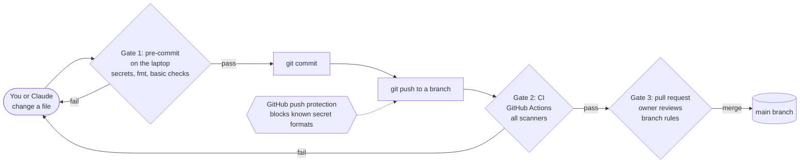

# Bolt B1: Foundation

- Status: Design approved 2026-11-15. Files written and checked. Waiting for owner review, then the GitHub steps
- Date: 2026-11-15
- Tasks: B1-01 to B1-11
- AWS cost: none. Nothing in this bolt touches AWS.
- Security requirements met: SR-52, SR-73, SR-80, SR-81, SR-82 (and SR-83 early)

## 1. Goal

Before any app code exists, build the safety net that every later change passes through:
a Git repo on GitHub, security scanners, checks that run before each commit, a Terraform
skeleton for the app, and a CI pipeline. The repo is public, so the first job is making
sure nothing secret can ever be pushed.

## 2. The gates every change passes

Why three gates: pre-commit is fast but can be skipped (`git commit --no-verify`). CI cannot
be skipped, but it runs after the push, so a secret would already be on GitHub. Running
the secret check in both places closes both gaps. GitHub's own push protection is a free
extra layer on public repos.

## 3. Design by task

### B1-01: Git and GitHub

| Item | Design | Why |
|---|---|---|
| Before `git init` | Delete `tmp/` (the G-10 policy practice files). `tmp/trust.json` contains the account ID | The repo is public; the account ID must never enter history |
| First scan | gitleaks over the whole folder before the first commit | History is forever; check before, not after |
| Commit email | GitHub's private no-reply address (`<id>+<user>@users.noreply.github.com`), set for this repo only | The owner's email must not appear in public commits |
| GitHub settings (owner, web) | "Keep my email address private" and "Block command line pushes that expose my email" | GitHub then rejects a push with the real email |
| Repo | Public, created by the owner on github.com | |
| Repo security features (free on public repos) | Secret scanning + push protection, Dependabot alerts, private vulnerability reporting | Extra layers at no cost |
| Rules on `main` | Require a pull request (0 approvals, since one person cannot approve their own PR); require CI checks to pass; block force pushes and deletion | Nothing reaches `main` without passing CI |
| Fork pull requests | "Require approval for all outside collaborators" before their workflows run | Someone else's PR cannot run code in our CI unasked (new threat T-028) |
| Who runs git | Claude runs `git init` and makes commits when the owner says so. The owner pushes | Keeps the owner in control of what goes public |

### B1-02: Scanners, pinned

Decision: run the scanners as Docker images pinned by digest, the same way as Prowler.

| Option | For | Against |
|---|---|---|
| **Docker images by digest (proposed)** | Same exact version on the laptop and in CI; nothing installed on the Mac; one file lists every version | Docker Desktop must be running; a few seconds slower |
| Install each tool with Homebrew | Fast | Brew upgrades tools silently; versions drift from CI |

| Tool | Checks | Runs in |
|---|---|---|
| gitleaks | Secrets in files and history | pre-commit, CI |
| tflint (+ AWS rules plugin) | Terraform mistakes, wrong instance types, unused code | `make lint`, CI |
| checkov | Terraform security settings | `make scan`, CI |
| Semgrep | Insecure code patterns, plus our own rules (B1-11) | `make scan`, CI |
| Trivy | Vulnerable dependencies, misconfigurations, secrets | `make scan`, CI |
| pip-audit | Known-vulnerable Python packages | From B2, when the backend has a lockfile |
| npm audit | Known-vulnerable npm packages | From B2, when the frontend has a lockfile |

All versions and digests live in one file, `tools/versions.env`. Each version is checked
on the tool's official release page before it is pinned (SR-81).

### B1-03: pre-commit hooks

The `pre-commit` tool runs checks on the files being committed. Installed once with
`uv tool install pre-commit==<pinned>`.

Hooks, fast ones only: gitleaks on staged changes, `terraform fmt`, detect private keys,
block files over 500 KB, block merge-conflict markers, trailing spaces and end-of-file fixes.
The slower scanners run in `make scan` and in CI.

### B1-04: Terraform skeleton for the app

- Rename `infra/envs/lab/` to `infra/app/`. "lab" is confusing next to `infra/labs/`, and
  there is only one app environment.
- Files: `versions.tf` (Terraform `~> 1.15`, AWS provider `6.71.0`, same as bootstrap),
  `providers.tf` (us-east-1, `default_tags` with `Stack = app`), `backend.hcl.example`
  (state key `app/terraform.tfstate` in the existing state bucket), `variables.tf`.
- No resources yet. The first ones arrive in B3.
- `infra/modules/README.md`: module conventions (one purpose per module, inputs validated,
  no provider blocks inside modules, outputs documented).
- `.tflint.hcl` with the AWS ruleset plugin pinned.

### B1-05: CI with static checks only

One workflow, `.github/workflows/static-checks.yml`:

- Runs on pull requests and on pushes to `main`. Uses `pull_request`, never
  `pull_request_target` (that one runs fork code with access to secrets).
- `permissions: contents: read`. No AWS access, no secrets.
- Jobs: gitleaks (full history), Terraform fmt + validate (without a backend) for
  bootstrap, app and labs, tflint, checkov, Semgrep, Trivy.
- Every third-party action pinned by commit SHA, not by tag (SR-83, done early because
  it costs nothing). A tag can be moved to point at malicious code; a SHA cannot.

### B1-06: Dependency policy

`docs/dependency-policy.md`:

- Exact versions and lockfiles everywhere; images by digest.
- Checklist before adding any package: it exists, the name is spelled right (no
  look-alikes), the publisher is the real one, it is maintained, and its licence is fine.
- Dependabot version updates once a week for GitHub Actions, Docker, pip and npm. Its
  pull requests go through the same CI gates as ours.

### B1-07: Makefile

A Makefile is a list of named shortcuts for long commands, so `make scan` replaces five
Docker commands.

| Command | Does |
|---|---|
| `make help` | Lists the commands |
| `make fmt` | `terraform fmt` on all stacks |
| `make validate` | `terraform validate` without a backend |
| `make lint` | tflint |
| `make scan` | gitleaks, checkov, Semgrep, Trivy |
| `make check` | All of the above: the same as CI |
| `make hooks` | Installs the pre-commit hooks |
| `make sweep` | Runs `scripts/sweep.sh` |

### B1-10: Lab template

`infra/labs/_template/` with the README checklist from I-11 (Free plan check, prices,
time box, estimate, approval, destroy and sweep result) and a backend key pattern
`labs/<name>/terraform.tfstate`.

### B1-11: Our own Semgrep rules

Generic scanners do not know our app. Two custom rules in `.semgrep/`, each with a test
file showing what it must catch and what it must allow:

1. React: flag `dangerouslySetInnerHTML` and `innerHTML` assignment (SR-35, stored XSS).
2. FastAPI: flag a route that takes `user_id`, `owner_id` or `sub` from the path, query or
   body (SR-20, IDOR). The user always comes from the token.

### B1-08, B1-09: Theory

- `docs/theory/terraform-state-and-modules.md`: state, locking, drift, modules.
- `docs/theory/supply-chain-security.md`: how attacks through packages, images and
  actions work, with real-world examples, and which of our controls stops each.

## 4. Other files

| File | Why |
|---|---|
| `SECURITY.md` | Tells people how to report a security problem privately (GitHub shows it on the repo) |
| `LICENSE` | See decision 3 below |
| `.gitignore` additions | `tmp/`, `.DS_Store` already covered; add `.semgrep_logs/`, `trivy-cache/` |

## 5. Threat model changes

| ID | Threat | Mitigation |
|---|---|---|
| T-028 (new) | A pull request from a fork runs malicious code in our CI | `pull_request` trigger only, read-only token, no secrets in CI, approval required for outside contributors |
| T-008, T-016 | Supply chain; secret in the repo | Moved from Planned to Done when B1 closes |

## 6. Decisions for the owner

| # | Decision | Recommendation |
|---|---|---|
| 1 | Scanners as pinned Docker images instead of Homebrew installs | Yes (reasons in B1-02) |
| 2 | Rename `infra/envs/lab/` to `infra/app/` | Yes |
| 3 | Licence for the public repo | MIT: anyone may reuse the code. With no licence, the code is public to read but nobody may reuse it. Either is fine for a learning repo |
| 4 | Delete `tmp/` before `git init` (it holds the account ID) | Yes |

## 7. Order of work

1. Owner: GitHub email settings (B1-01). Claude: delete `tmp/`, write all files.
2. Claude: run every check locally (`make check`), fix anything found.
3. Owner reviews the files.
4. Claude: `git init`, first commit (after a clean gitleaks run).
5. Owner: create the GitHub repo, push, turn on the security features and branch rules.
6. Open a test pull request with a badly formatted Terraform file, to prove CI blocks a
   failure, then close it. (Not a fake secret: anything pushed to GitHub stays in its
   history even after the branch is deleted.)
7. Docs: journal, tracker, threat model, `CLAUDE.md` status.

## 8. Build notes (2026-11-15)

The owner approved the design, with the four recommendations in section 6 (Docker
images, rename to `infra/app/`, MIT licence, `tmp/` deleted).

### Files written

| Task | Files |
|---|---|
| B1-01 | `.gitleaks.toml`, `SECURITY.md`, `LICENSE`, `.gitignore` (additions), `docs/runbooks/repo-and-ci.md` |
| B1-02 | `tools/versions.env` |
| B1-03 | `.pre-commit-config.yaml` |
| B1-04 | `infra/app/` (5 files + README + lock file), `infra/modules/README.md`, `.tflint.hcl` |
| B1-05 | `.github/workflows/static-checks.yml`, `.github/dependabot.yml` |
| B1-06 | `docs/dependency-policy.md` |
| B1-07 | `Makefile` |
| B1-08 | `docs/theory/terraform-state-and-modules.md` |
| B1-09 | `docs/theory/supply-chain-security.md` |
| B1-10 | `infra/labs/README.md`, `infra/labs/_template/` |
| B1-11 | `.semgrep/rules/` (2 files, 5 rules), `.semgrep/tests/` (2 files), `.semgrepignore` |

Also changed: `infra/bootstrap/cloudtrail.tf` and `state_bucket.tf` (ignore comments
only, no change to resources), `README.md`, glossary, threat model, findings log.

### Results

| Check | Result |
|---|---|
| `make fmt-check`, `make validate` | Pass on bootstrap, app and the lab template |
| `make lint` (tflint) | Pass |
| `make checkov` | 179 passed, 0 failed, 12 skipped with reasons |
| `make semgrep` | Rule tests 5/5; scan clean |
| `make trivy` | Clean |
| gitleaks on staged files, in a scratch copy of the repo | No leaks; a planted fake account ID was caught |
| pre-commit, in the scratch copy | All hooks pass |

### What differs from the design

| Design | Built | Why |
|---|---|---|
| gitleaks over the whole folder before the first commit | gitleaks over the staged files | A folder scan also reads files git ignores, and reported `backend.hcl` (F-014). Staged files are exactly what would be committed |
| Not in the design | Three own gitleaks rules for the AWS account ID | The built-in rules do not treat an account ID as a secret |
| Not in the design | A third Semgrep rule file entry: user ID in a request model or in the route path | Covers the body and the path, which the design named |
| Cache folders `.semgrep_logs/`, `trivy-cache/` | One folder, `.cache/` | Simpler to ignore and to delete |
| CI jobs listed one by one in the branch rule | One job `all-checks` that needs all the others | The rule names one check; adding a scanner later needs no settings change |
| Dependabot for Actions, Docker, pip, npm | Actions only for now | The other three have nothing to update until B2 |
| tflint with default rules | All rules on, `terraform_standard_module_structure` off | Our stacks are split into files by topic, not `main.tf` |

### Accepted findings

F-013 (SSE-S3 instead of a KMS key; Trivy and Semgrep). Reasons are next to the resources.

### Still to do

Owner review, first commit, GitHub repo and settings, the test pull request, journal.
The steps are in `docs/runbooks/repo-and-ci.md`.
