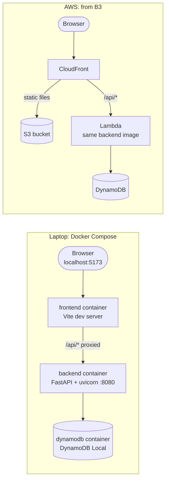
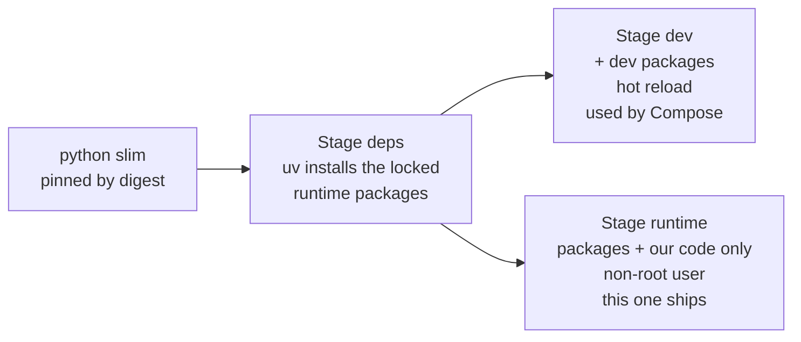

# Bolt B2: Local development

- Status: Design approved 2026-11-15, with Python 3.12 and Node 26 (decision 1). Pull request 1 (backend) written
- Date: 2026-11-15
- Tasks: B2-01 to B2-08
- AWS cost: none. Nothing in this bolt touches AWS.
- Security requirements: SR-80 (images by digest), SR-82 (pip-audit and npm audit join
  CI). Started early because the skeleton needs them: SR-40 (one error format), SR-41
  and SR-42 (one log line per request, never bodies).

## 1. Goal

One command, `make up`, starts the whole app on the laptop: the React frontend, the
FastAPI backend and a local DynamoDB. The browser shows a page that says the API is up.
There are no features yet. This bolt builds the two empty apps, their containers and
their checks, so that every later bolt only adds features.

The backend image built here is the same image that goes to Lambda in B3.

## 2. Words used in this design

| Word | Meaning |
|---|---|
| Dockerfile | The recipe for building a container image, one instruction per line |
| Multi-stage build | A Dockerfile with several stages. Build tools stay in an early stage; only the result is copied into the final image, which is smaller and has less to attack |
| Docker Compose | A tool that starts several containers together from one file, `compose.yaml` |
| Bind mount | A folder on the laptop made visible inside a container, so edits show up at once |
| Hot reload | The app restarts or refreshes by itself when a source file changes |
| Proxy | A server that passes a request on to another server. Vite's dev server passes `/api` requests on to the backend |
| DynamoDB Local | AWS's free program that behaves like DynamoDB and runs on the laptop |
| Health check | A cheap request that answers "is this service up?" |
| hadolint | A linter for Dockerfiles |
| kind | "Kubernetes in Docker": a real Kubernetes cluster that runs inside Docker on the laptop |

## 3. Local set-up compared with AWS

Why the Vite proxy: in AWS the browser talks to one address (CloudFront) for both the
pages and `/api`. The proxy gives the same shape locally. The browser never calls the
backend on a different address, so the app needs no CORS settings at all, locally or
in AWS. CORS rules are easy to get wrong; not needing them is the safest setting.

| Part | Laptop | AWS |
|---|---|---|
| Frontend | Vite dev server in a container | Static files on S3 behind CloudFront |
| Backend | The backend image, with hot reload | The same image on Lambda with the Web Adapter (added in B3) |
| Database | DynamoDB Local | DynamoDB |
| Sign-in | Not in this bolt (B4) | Cognito (B4) |

## 4. Design by task

### B2-01: FastAPI skeleton

Folder `app/backend/`. Python packages are managed with uv (`pyproject.toml`, `uv.lock`).

| Item | Design | Why |
|---|---|---|
| Layout | `src/api/`: `main.py` (builds the app), `config.py`, `logging.py`, `errors.py`, `middleware.py`, `routes/health.py`. Tests in `tests/` | Small files with one job each |
| Endpoint | `GET /api/v1/health` returns `{"status": "ok"}`. It does not call the database | I-03. A health check that depends on the database turns a database hiccup into "the whole API is down" |
| Settings | Read from environment variables with `pydantic-settings`, checked at start-up. No `.env` file | A wrong setting stops the app at start, not at the first request. There are no secrets yet, so nothing needs a file |
| Logs | One JSON line per request: time, request ID, method, path template, status, duration. Written with Python's own `logging`, no extra library | SR-41. JSON lines are what CloudWatch can search. Fewer packages is less supply-chain risk |
| Never logged | Request bodies, response bodies, headers | SR-42, SR-44: journal text and tokens must never reach logs. The rule is built in before there is anything sensitive to log |
| Errors | One handler. Every error has the shape `{"error": {"code", "message"}}`. A crash returns 500 with no detail; the detail goes to the log with the request ID | SR-40 |
| API docs pages | FastAPI's `/docs` and `/openapi.json` are switched off | SR-01 says every route except health needs a token. The docs page also loads scripts from another site, which our CSP will forbid. `make openapi` writes the schema to a file instead |
| Tests | pytest: health works; unknown path gives the error format; a forced crash gives a clean 500; the log line has the fields and no body; the list of routes is exactly what we expect | The route-list test fails if someone adds a route without thinking about sign-in |
| Lint and types | ruff (lint and format), mypy in strict mode | Catch mistakes before tests do |

Packages, each checked against the dependency policy when it is added:

| Runtime | Development only |
|---|---|
| fastapi, uvicorn, pydantic-settings, boto3 | pytest, httpx, ruff, mypy, boto3-stubs, pip-audit, watchfiles |

### B2-02: React skeleton

Folder `app/frontend/`. Vite + React + TypeScript, packages with npm and a lockfile.

| Item | Design | Why |
|---|---|---|
| Pages | A layout with the menu (Dashboard, Todos, Habits, Journal, Pages), a home page that shows "API: ok" or "API: unreachable", and a not-found page | Proves browser, proxy and backend are connected |
| Routing | React Router | The standard choice |
| API client | One small function around the browser's `fetch`. It adds the `/api/v1` prefix, reads the error format and raises one error type. No axios | One place for every API call. B3 adds the body hash here and B4 adds the token here (ADR-0002, ADR-0003) |
| Styling | Plain CSS files. No UI library yet | Decide with real screens in B5 |
| Tests | Vitest with Testing Library: the home page shows both API states; the client turns an error response into the error type | |
| Lint and types | ESLint with the TypeScript and React hooks rules, Prettier, `tsc --noEmit` | |
| npm safety | `.npmrc` with `ignore-scripts=true` and `save-exact=true`; installs use `npm ci` | Install scripts are how npm worms spread: a package runs code on install. Switching them off blocks that. `save-exact` writes exact versions (SR-80) |

Packages:

| Runtime | Development only |
|---|---|
| react, react-dom, react-router | vite, @vitejs/plugin-react, typescript, vitest, jsdom, @testing-library/react, @testing-library/jest-dom, @testing-library/user-event, eslint, typescript-eslint, eslint-plugin-react-hooks, prettier |

### B2-03: Dockerfiles

Backend, `app/backend/Dockerfile`, three stages:

| Item | Design | Why |
|---|---|---|
| Base image | Official `python` slim image, pinned by digest, arm64 | ADR-0004. Slim has a shell, which helps while learning. Smaller and stricter bases are covered as theory in B2-08 |
| uv | Copied from the official uv image, pinned by digest; `uv sync --locked` | The build fails if the lockfile and `pyproject.toml` disagree |
| Final image | No uv, no compilers, no tests, no dev packages | Less to attack, smaller to push |
| User | A fixed non-root user (uid 10001) | ADR-0004. A break-in is not root inside the container |
| Port | 8080 | The Lambda Web Adapter's default, so B3 needs no change |
| `.dockerignore` | Allow-list: everything is excluded, then only the needed files are let in | A stray file (notes, a `.env`, `.git`) can never end up inside an image |

Frontend, `app/frontend/Dockerfile`, three stages: `dev` (Vite dev server, used by
Compose), `build` (`npm ci` and `npm run build`), and `static` (an unprivileged nginx
image serving the built files). AWS never runs a frontend container: B3 uploads the
`build` output to S3. The `static` stage exists for the Kubernetes lab (B2-07) and for
checking the production build locally. See decision 3.

### B2-04: Docker Compose

`compose.yaml` at the repo root.

| Service | Image | Port on the laptop | Notes |
|---|---|---|---|
| `frontend` | frontend `dev` stage | 127.0.0.1:5173 | Source bind-mounted, hot reload |
| `backend` | backend `dev` stage | 127.0.0.1:8080 | Source bind-mounted, hot reload |
| `dynamodb` | `amazon/dynamodb-local`, pinned by digest | 127.0.0.1:8000 | Data in a named volume, so it survives a restart |
| `db-init` | backend `dev` stage | none | Runs once: creates the table and the seed data, then exits |

| Item | Design | Why |
|---|---|---|
| Ports | Bound to `127.0.0.1` only | Docker's default publishes a port to the whole network. DynamoDB Local has no password, so on shared Wi-Fi anyone could read it (new threat T-029) |
| Container hardening | Backend runs with a read-only file system (with a writable `/tmp`), all Linux capabilities dropped, `no-new-privileges` | Lambda's file system is also read-only apart from `/tmp`. Finding a write problem on the laptop is cheaper than finding it in AWS |
| Start order | Health checks; the backend waits for `db-init` to finish | No "table not found" on first start |
| AWS credentials | The backend gets the fake values `local` / `local` and the endpoint `http://dynamodb:8000` | The AWS SDK refuses to run with no credentials. DynamoDB Local ignores them. The real `~/.aws` folder is never mounted into a container |
| The endpoint setting | `DYNAMODB_ENDPOINT_URL` is optional; Terraform never sets it | In AWS the SDK finds the real DynamoDB by itself |

New `make` commands: `up`, `down`, `logs`, `ps`, `reset-db`, `seed`, `openapi`.

### B2-05: Local table and seed data

- `app/backend/scripts/create_table.py` creates `productivity-app-data` exactly as in
  I-08: keys `PK` and `SK`, index `GSI1` with `GSI1PK` and `GSI1SK`. Running it twice
  is safe.
- `app/backend/scripts/seed.py` writes two users, `alice` and `bob`, each with a profile
  and a few todos, in the I-08 item shapes. The data is made up. Real journal text
  never goes into seed files or tests.
- An integration test (marked so it only runs when DynamoDB Local is up) seeds both
  users and checks that a query for Alice's partition returns only Alice's items. This
  is the first small piece of the two-user IDOR harness that B4 builds.
- In B3 the real table is created by Terraform. Two definitions can drift apart, so B3
  adds a check that compares them. Noted here so it is not forgotten.

### B2-06: Image scanning, Dockerfile lint and app checks in CI

| Check | Tool | Fails on |
|---|---|---|
| Dockerfile mistakes | hadolint (image pinned in `tools/versions.env`) | Any warning or error |
| Built images | `trivy image` on the backend `runtime` and frontend `static` images | High or Critical with a fix available |
| Python packages | pip-audit, reading `uv export` | Any known vulnerability |
| npm packages | `npm audit` | High or Critical |
| Backend | ruff, mypy, pytest | Any failure |
| Frontend | ESLint, Prettier check, `tsc`, Vitest, `npm run build` | Any failure |

Where they run: inside the `dev` containers, through `make` targets, on the laptop and
in CI alike (decision 2). New targets: `lint-backend`, `test-backend`, `lint-frontend`,
`test-frontend`, `audit`, `hadolint`, `image-build`, `image-scan`. `make check` runs all
of them. CI gets three new jobs (`backend`, `frontend`, `images`) and `all-checks`
waits for them.

Also: Dependabot is extended to Docker, uv and npm, as promised in B1. checkov and
Semgrep already scan the new files; checkov gains the Dockerfile and Kubernetes checks.

Unfixed vulnerabilities in a base image are reported but do not fail the build: there
is nothing to change until a fix exists. The weekly Dependabot update of the base image
digest picks the fix up.

### B2-07: Local Kubernetes lab with kind

Folder `infra/labs/kind/`, with a README in the lab format. Cost: none, nothing in AWS.

The owner does this lab by hand, step by step:

1. Create a cluster with a pinned node image; load our two images into it.
2. Apply the manifests: a Deployment and a Service each for backend, frontend and
   DynamoDB Local, in their own namespace.
3. Look at what a pod is; read logs; open the app through a port-forward.
4. Liveness and readiness probes on the health endpoint: break one on purpose and
   watch what Kubernetes does.
5. Scale the backend to three copies; delete a pod and watch it come back.
6. Roll out a "new version" and roll it back.
7. Security settings: run as non-root, read-only file system, dropped capabilities,
   memory and CPU limits. Remove one and see what checkov says.
8. Delete the cluster.

`kind` is the one tool to install on the Mac (`brew install kind`). It is a learning
tool, not a gate, so a Homebrew install is acceptable here; the version used is written
in the lab README. `kubectl` is already installed.

### B2-08: Theory

`docs/theory/containers-and-eks.md`: what a container really is (namespaces, cgroups,
layers), image hardening (non-root, minimal and distroless bases, read-only file
systems, capabilities, digests), and EKS: how it works, what it costs, and why this
project only uses Kubernetes locally.

## 5. Threat model changes

| ID | Threat | Mitigation |
|---|---|---|
| T-029 (new) | Local dev services reachable from the network; DynamoDB Local has no sign-in | Ports bound to `127.0.0.1`; seed data is made up |
| T-030 (new) | A secret or private file is baked into an image layer | Allow-list `.dockerignore`; no secrets as build arguments; Trivy secret scan on the images |
| T-031 (new) | A compromised container has more power than the app needs | Non-root user, read-only file system, capabilities dropped, minimal final stage |
| T-008 | Supply chain | pip-audit and npm audit join CI; npm install scripts off; base images by digest. T-008 becomes fully Done |
| T-004 | Local auth bypass reaching AWS | Not touched: B2 adds no sign-in and no "auth off" switch. The only route is health |

App-specific risks from `CLAUDE.md`: IDOR, stored XSS and journal data have nothing to
attack yet (no user routes, no editor). The Semgrep rules from B1 start scanning real
code in this bolt.

## 6. Decisions for the owner

| # | Decision | Options | Recommendation |
|---|---|---|---|
| 1 | Language versions | Python 3.14 or 3.13; Node 24 or 26 | Recommended: Python 3.14 and Node 24. **Owner's decision: Python 3.12 and the latest Node LTS, which is Node 26.** Python 3.12 gets security fixes until October 2028, well past the end of the project |
| 2 | Where tests and linters run | (a) Inside the dev containers, on the laptop and in CI. (b) Directly on the laptop and CI runner, with uv and Node installed in both | (a). Same versions everywhere, nothing new to install, and no new third-party actions in CI. The price is a slower CI run (the image is built first), likely 2 to 4 minutes |
| 3 | A frontend `static` image, though AWS never runs it | Yes or no | Yes. It is about ten lines, makes the Kubernetes lab realistic, and lets us test the real production build locally |
| 4 | FastAPI `/docs` page | Off everywhere, or on only locally | Off everywhere. An "only locally" switch is the same kind of risk as a local auth bypass |
| 5 | Logging library | Python's own `logging` with a small JSON formatter, or structlog | Python's own. One package fewer |
| 6 | Install kind with Homebrew | Yes or no | Yes |
| 7 | Split the bolt into three pull requests | One large or three small | Three: (1) backend, database, Compose, backend CI; (2) frontend and its CI; (3) Kubernetes lab, theory, closing docs. Small pull requests are easier to review |

## 7. Order of work

1. Owner approves this design and the decisions.
2. Pull request 1: Claude writes the backend, Dockerfile, Compose, table and seed
   scripts, make targets and CI jobs, and runs `make check`. Owner reviews, runs
   `make up`, calls the health endpoint, pushes and merges.
3. Pull request 2: the same for the frontend. Owner opens `http://localhost:5173`.
4. Pull request 3: lab files and theory. Owner installs kind and does the lab.
5. Docs: journal, tracker, threat model, findings log, runbook
   (`docs/runbooks/local-dev.md`), glossary, `CLAUDE.md` status.

## 8. Done when

- `make up` starts everything and the browser shows "API: ok".
- `make check` passes on the laptop and CI is green with the three new jobs.
- The integration test shows Alice's query never returns Bob's items.
- The images run as non-root and pass the Trivy image scan.
- The kind lab is done and the cluster is deleted.
- The Definition of Done list in `CLAUDE.md` is complete.

## 9. Build notes: pull request 1, backend (2026-11-15)

### Files written

| Task | Files |
|---|---|
| B2-01 | `app/backend/pyproject.toml`, `uv.lock`, `src/api/` (8 files), `tests/` (7 files) |
| B2-03 | `app/backend/Dockerfile`, `.dockerignore` |
| B2-04 | `compose.yaml`, new `make` targets, `docs/runbooks/local-dev.md` |
| B2-05 | `app/backend/scripts/local_table.py`, `seed.py`, `tests/test_user_isolation.py` |
| B2-06 | `tools/versions.env` (hadolint), `.trivyignore.yaml`, CI jobs `backend` and `images`, `.github/dependabot.yml` |

### Pinned versions

Python image `3.12.16-slim-trixie`, uv `0.13.7`, DynamoDB Local `3.3.2`, hadolint
`2.15.1`, all by digest. Packages: fastapi 0.162.2, uvicorn 0.54.0, pydantic-settings
2.16.2, boto3 1.43.126; development: pytest 9.2.0, httpx2 2.16.0, ruff 0.17.4, mypy
2.4.1, boto3-stubs 1.43.126, pip-audit 2.10.1, watchfiles 1.3.0. 69 packages locked in
total. Each direct package was checked on PyPI: real name, source repository, at least
a week old (SR-81).

### Results

| Check | Result |
|---|---|
| `make lint-backend` | ruff and mypy (strict) clean |
| `make test-backend` | 22 passed, 5 of them against DynamoDB Local |
| `make audit-backend` | No known vulnerabilities in 69 packages |
| `make hadolint` | Clean |
| `make image-scan` | 2 High in the base image, accepted with an end date (F-015); no secrets |
| `make check` (everything, including the B1 scanners) | Pass |
| `make up`, then `curl` | 200 on health with a request ID; unknown path gives the error format; log lines are JSON with the path template |
| The `runtime` image, run read-only with all capabilities dropped | Answers health; runs as uid 10001; contains no uv, pytest or ruff; 268 MB |

### What differs from the design

| Design | Built | Why |
|---|---|---|
| Routes grouped with FastAPI's `include_router` | Each routes module adds its routes straight onto the app | In the current FastAPI, included routers are hidden behind private internals: `app.routes` no longer lists them and the log middleware saw `/health` instead of `/api/v1/health`. Plain routes keep both simple |
| httpx for tests | httpx2 | The current Starlette test client needs httpx2 (same author, published under the pydantic organisation). Checked before adding |
| DynamoDB Local data in a named volume | In memory; seed data is reloaded on every start | The image runs as a non-root user that cannot write to a fresh volume. In-memory needs no special rights, and real data never lives locally anyway. Can be revisited when features exist (B5) |
| All containers with a plain read-only `/tmp` | DynamoDB Local's `/tmp` allows running code | It loads a library from `/tmp`; without this it answers 500 |
| `docker compose build` | `docker build` through `make build`, with a selectable network | This network's IPv4 route to PyPI stalls and Docker's default network has no IPv6. `BUILD_NETWORK := host` in `local.mk` fixes it; Compose's own build ignored that setting |
| A fixed `exclude-newer` date | `exclude-newer = "7 days"` | Semgrep flagged the fixed date (F-016): a rolling cooldown cannot go stale |
| Not in the design | Start-up guard: `DYNAMODB_ENDPOINT_URL` is refused when running in Lambda | A deployed function must never be pointed at another "DynamoDB" address |
| Not in the design | The uv download cache is kept between builds (`--mount=type=cache`) | An interrupted build continues instead of starting over |
| Not in the design | Scripts refuse to run unless `DYNAMODB_ENDPOINT_URL` is set | The table and seed scripts can never touch real AWS by accident |

### Lessons from this pull request

- Check the installed version's behaviour, not memory: three tests failed because
  FastAPI and Starlette had changed (`include_router`, the test client).
- A test client can leak too: httpx2 logged the full URL with its query string. HTTP
  client loggers are now kept at warning level (SR-42).
- A build that "hangs" is usually waiting on the network. The Builds tab in Docker
  Desktop shows it; a direct download test over IPv4 and IPv6 found the cause.
