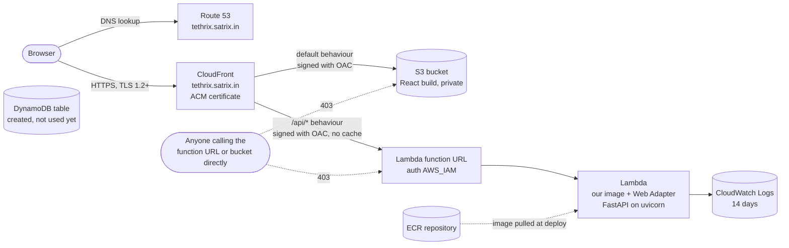
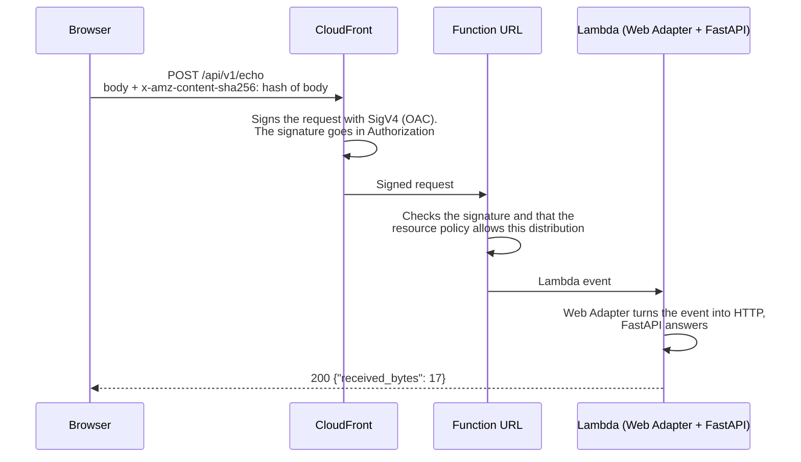
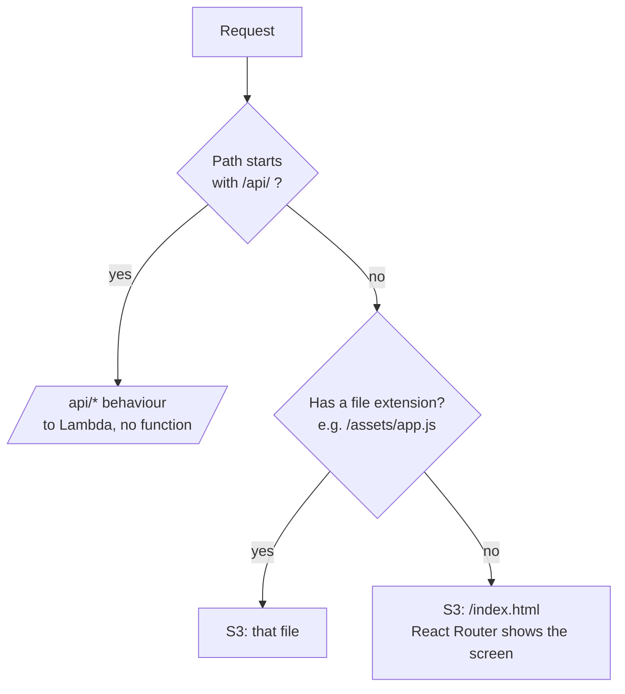
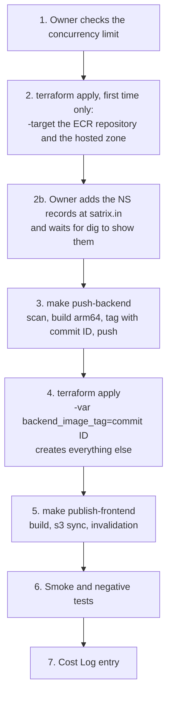

# Bolt B3: Walking skeleton

- Status: Design approved 2026-11-20 with all recommendations, plus the owner's custom
  domain `tethrix.satrix.in` (ADR-0006; DNS hosting waits for confirmation, decision 8)
- Date: 2026-11-20
- Tasks: B3-01 to B3-10
- AWS cost: about 0.55 USD a month (section 7). No hourly services.
- Security requirements: SR-31, SR-40, SR-41, SR-43, SR-50, SR-51, SR-60, SR-61, SR-62,
  SR-70, SR-72

## 1. Goal

The first deploy to AWS. The empty app from B2 runs in the cloud, end to end, along the
real path every later feature will use:

browser -> `https://tethrix.satrix.in` (CloudFront) -> S3 (the React files) and
CloudFront -> Lambda function URL -> FastAPI.

There are still no features and no sign-in. What this bolt proves is the architecture
itself, in particular the two quirks of ADR-0002 (OAC replaces the `Authorization`
header; request bodies need a SHA-256 hash). If that path does not work, we find out now,
while switching to the fallback (API Gateway) is cheap.

A "walking skeleton" is the smallest version of the system that touches every layer.
Features are then added to something that already deploys.

## 2. Words used in this design

| Word | Meaning |
|---|---|
| CloudFront | AWS's content delivery network: servers around the world that answer for our domain, serve files and pass API calls on |
| Distribution | One CloudFront set-up: a domain name, origins and behaviours |
| Origin | Where CloudFront fetches content from. We have two: the S3 bucket and the Lambda function URL |
| Behaviour | A rule "requests whose path matches X go to origin Y, with these settings" |
| OAC (Origin Access Control) | CloudFront signs its requests to an origin, so the origin can refuse everyone else |
| SigV4 | AWS's way of signing a request with credentials, so the receiver knows who sent it and that it was not changed |
| Function URL | A built-in HTTPS address for one Lambda function |
| Lambda Web Adapter | A small program inside our image that turns Lambda events into normal HTTP requests for uvicorn (ADR-0004) |
| ECR | AWS's private registry for container images |
| Response headers policy | CloudFront settings that add headers (CSP, HSTS) to every response |
| CloudFront Function | A few lines of JavaScript that CloudFront runs on each request, before it picks an origin |
| Invalidation | Telling CloudFront to forget its cached copies, so new files are served |
| Reserved concurrency | A cap on how many copies of one Lambda function can run at the same time |
| Route 53 | AWS's DNS service. We use one hosted zone for `tethrix.satrix.in` (ADR-0006) |
| ACM | AWS Certificate Manager: the free TLS certificate for our domain |
| PITR (point-in-time recovery) | DynamoDB keeps a continuous backup, so the table can be restored to any second in the last 35 days |

## 3. What gets built

Nothing has a public IP address and there is no VPC, so there is no NAT Gateway and no
hourly charge (B3-10 explains why).

### How one API call travels

## 4. Design by task

### B3-01: ECR repository (module `infra/modules/ecr_repository`)

Private repository `productivity-app-backend`: scan on push (basic scanning, free),
immutable tags, AES-256 encryption (not KMS, cost rule), lifecycle rule that keeps the
last 3 images. Tags are the Git commit ID (ADR-0004), so a tag can never be moved to
other code.

### B3-02: Lambda function (module `infra/modules/lambda_container_api`)

| Setting | Value | Why |
|---|---|---|
| Package | Image from ECR, tag passed in as a variable | ADR-0004 |
| Architecture | arm64 | ADR-0004 |
| Memory, timeout | 512 MB, 10 s | ADR-0004; T-022 |
| Web Adapter | `public.ecr.aws/awsguru/aws-lambda-adapter:1.1.0` by digest, copied into the `runtime` stage of the existing Dockerfile | Released 2026-09-18 by AWS (repository `aws/aws-lambda-web-adapter`); pinned like every other dependency |
| Readiness check | Web Adapter waits for `/api/v1/health` before the first request | A cold start never sends traffic to an app that is not up yet |
| Log group | Created by Terraform, 14 days retention (SR-43) | If Lambda creates it, it never expires |
| Role | Its own role. Allowed: write to its own log group. Nothing else in B3 | SR-70. The B3 code does not read the database, so it gets no database rights yet. B5 adds the exact DynamoDB actions on the table and index ARNs |
| Function URL | Auth type `AWS_IAM`, buffered | ADR-0002 |
| Resource policy | Only `cloudfront.amazonaws.com`, only for our distribution (`aws:SourceArn`), for `lambda:InvokeFunctionUrl` and `lambda:InvokeFunction` | ADR-0002; SR-62 |
| Concurrency cap | Variable, default "no reservation". Set to 5 only if the account limit allows it | SR-72, see below |
| Tracing | Off in B3 | X-Ray is part of the Operations observability work |
| VPC | None | B3-10 |

Concurrency (SR-72): before the first apply the owner runs
`aws lambda get-account-settings --query AccountLimit.ConcurrentExecutions`. AWS
requires at least 10 copies to stay unreserved. If the account limit is 10, as it often
is for new accounts, no reservation is possible, and the limit of 10 is itself the cap.
If it is 1,000, the reservation is set to 5.

Code changes that go with this task (the app was built for it in B2, so they are small):

- Dockerfile `runtime` stage: copy the Web Adapter into `/opt/extensions/`, set the
  readiness path. The local `dev` stage does not change.
- SR-31: a body size limit in the middleware, 16 KB for now, answering 413 in the
  standard error format. The 128 KB limit for pages and journal comes with B8.
- A test endpoint `POST /api/v1/echo` that answers only the number of bytes it
  received (never the content). B3 needs a POST to prove the body hash works, and there
  is no feature with a POST yet. It is removed in B5, when the first real POST exists
  (decision 1).

The guard from B2 stays: the settings refuse a local database address when running in
Lambda, so local-only settings cannot reach AWS.

### B3-03: DynamoDB table (module `infra/modules/dynamodb_table`)

The table from I-08: `PK`/`SK`, index `GSI1`, provisioned 10/10 for the table and 5/5
for the index (free tier: 25/25 in total). Default encryption (SR-51), point-in-time
recovery on (decision 4), deletion protection on (a variable turns it off for the final
destroy). No seed data in AWS: users and their data arrive with B4 and B5.

### B3-04: S3 bucket and CloudFront

- Bucket for the React build: private, all public access blocked, owner-enforced
  (no ACLs), SSE-S3, a policy that denies non-TLS requests (SR-50) and allows reads
  only to our distribution through OAC.
- Domain (ADR-0006): Route 53 hosted zone for `tethrix.satrix.in`, delegated from
  `satrix.in` with four NS records the owner adds once at its DNS provider; ACM
  certificate with DNS validation; `A` and `AAAA` alias records to the distribution.
- Distribution: alternate name `tethrix.satrix.in`, TLS policy `TLSv1.2_2021`, price class 100 (North America and
  Europe, the cheapest), HTTP redirected to HTTPS, HTTP/2 and HTTP/3, default root
  object `index.html`.
- Single-page app routing: a CloudFront Function on the default behaviour rewrites
  paths without a file extension (for example `/todos`) to `/index.html`.

Why a function and not the usual "custom error response" trick: error responses apply
to the whole distribution, so an API 404 would be turned into the React page. The
function runs only on the default behaviour and never touches `/api/*` (decision 2).

Publishing the frontend is data, not infrastructure (like users in B4-08): the build is
copied into the bucket with `aws s3 sync`, then an invalidation is made. A `make`
target does both.

### B3-05: `/api/*` to the function URL

Behaviour `/api/*`: all methods, managed cache policy `CachingDisabled`, managed origin
request policy `AllViewerExceptHostHeader` (ADR-0002), OAC for Lambda with "always
sign".

Frontend: `apiFetch` adds `x-amz-content-sha256` with the SHA-256 of the body for every
request that has one, using the browser's `crypto.subtle`. It is computed on the exact
string that is sent. A unit test checks it against a known hash.

### B3-06: Security headers (SR-60, SR-61)

A response headers policy on both behaviours:

| Header | Value |
|---|---|
| `Content-Security-Policy` | `default-src 'none'; script-src 'self'; style-src 'self'; img-src 'self' data:; font-src 'self'; connect-src 'self'; manifest-src 'self'; base-uri 'none'; form-action 'self'; frame-ancestors 'none'` |
| `Strict-Transport-Security` | `max-age=31536000` (one year) |
| `X-Content-Type-Options` | `nosniff` |
| `Referrer-Policy` | `strict-origin-when-cross-origin` |
| `X-Frame-Options` | `DENY` (older browsers that ignore `frame-ancestors`) |

Cognito joins `connect-src` in B4. The policy overrides whatever the origin sends, so
nginx's headers from B2 are not involved in AWS.

### B3-07: Negative tests

Written into the smoke test (B3-08), run by the owner after each deploy:

| Test | Expected |
|---|---|
| `curl` the function URL directly | 403 |
| `curl` the S3 bucket's own address | 403 |
| `http://tethrix.satrix.in` | 301 to `https://` |
| POST without `x-amz-content-sha256` | Refused (expected 403; the exact answer is recorded) |
| POST with a 17 KB body and a correct hash | 413 in our error format |
| `GET /api/v1/nope` | 404 in our error format, not the React page |

### B3-08: Manual deploy runbook and smoke test

`docs/runbooks/deploy-manual.md`. Manual on purpose: B6 automates exactly these steps
in GitHub Actions, and they are easier to understand after doing them by hand once.

Step 2 exists because Lambda cannot be created before its image is in ECR, and the
repository is created by the same stack. Terraform warns that `-target` is not for
routine use; that is right, and the runbook uses it only for this one first step
(decision 5).

New `make` targets, run by the owner (they need AWS credentials, which Claude does not
have):

- `push-backend`: refuses to run with uncommitted changes (the tag must match the
  code), runs the image scan, builds the `runtime` image for arm64 without provenance
  attestations (Lambda does not accept them), logs in to ECR and pushes.
- `publish-frontend`: builds the React files in the `build` stage, copies them out,
  `aws s3 sync --delete`, then an invalidation.

Terraform `apply` is run from `main` after the pull request is merged, so what runs in
AWS is always what is on `main`.

### B3-09 and B3-10: Theory

- `docs/theory/cloudfront-oac-sigv4.md`: how a CDN works, caching, OAC compared with
  the older OAI, how SigV4 signing works and why the body hash is needed.
- `docs/theory/vpc-basics.md`: VPC, subnets, route tables, internet and NAT gateways,
  security groups, the default VPC; why this Lambda is outside a VPC (it only talks to
  AWS APIs over HTTPS, so a VPC would add a NAT Gateway or endpoints that cost money
  and add nothing).

## 5. Threat model changes

| ID | Threat | Mitigation |
|---|---|---|
| T-002 | Function URL called directly | `AWS_IAM` + OAC + resource policy; negative test. Moves to Done |
| T-017 | Internals in errors | Done in B2; checked again through CloudFront |
| T-020 | Clickjacking, content-type tricks | Response headers policy. Moves to Done |
| T-021 | Request flood burns credits | Concurrency cap or account limit, body limit, 10 s timeout, budgets |
| T-024 | Lambda role does too much | Logs only in B3; `validate-policy` on the role |
| T-032 (new) | Subdomain takeover: the hosted zone is deleted while the NS records for `tethrix` still exist at `satrix.in`, and someone else claims the name | The final-destroy runbook removes the NS records at the parent before the zone is destroyed. With our own certificate, TLS 1.2 is the minimum, so SR-50 is met in full |
| T-033 (new) | The API is public with no sign-in until B4 | It has only health and the byte-count echo; no data. Body limit, concurrency cap, budgets |
| T-034 (new) | A wrong or vulnerable image reaches Lambda | Trivy scan before push, immutable tags tied to commit IDs, ECR scan on push |
| T-035 (new) | The frontend bucket is read directly or changed | Bucket private, OAC with `aws:SourceArn`, TLS-only policy, only the owner can write |

App-specific risks from `CLAUDE.md`: IDOR and stored XSS have nothing to attack yet. The
echo endpoint never returns what it receives, so it cannot reflect script. No auth
bypass exists to leak: B3 has no sign-in at all, and B4 brings the guard tests.

The domain name is in the repo as a Terraform variable default. It is public anyway:
every TLS certificate is published in Certificate Transparency logs. The
`*.cloudfront.net` name and the function URL are not written into the repo. Outputs
that contain the account ID (the ECR address) are never pasted into docs.

## 6. Decisions for the owner

| # | Decision | Options | Recommendation |
|---|---|---|---|
| 1 | How to test a POST before any feature exists | A temporary `POST /api/v1/echo` that answers only the byte count, or no POST test until B5 | The echo, removed in B5. ADR-0002 asks for a POST to work in B3, before features depend on it |
| 2 | React routing on CloudFront | CloudFront Function, or custom error responses | Function. Error responses would also turn API errors into the React page. 2 million function calls a month are free; the Free plan check is done from AWS docs before apply |
| 3 | CloudFront access logs | Off now, or on (S3 logs need ACLs, which our bucket defaults forbid; the newer CloudWatch delivery is paid per GB) | Off, logged as an accepted finding. Lambda already logs every API call; revisit in Operations |
| 4 | DynamoDB point-in-time recovery | On or off | On. A fraction of a cent at our size, and the journal is data the owner cannot recreate |
| 5 | First apply | Two steps with `-target`, or split ECR into its own stack | `-target` once. A separate stack for one repository adds a state file and a dependency between stacks |
| 6 | Images kept in ECR | 3 (cost model) or 5 (ADR-0004) | 3; ADR-0004 gets a one-line update. The previous image is enough for a rollback |
| 8 | DNS for `tethrix.satrix.in` (ADR-0006) | Route 53 zone for the subdomain only, delegated with NS records; or records typed by hand at the provider of `satrix.in` | Route 53 for the subdomain. Every record stays in Terraform and the rest of `satrix.in` is never touched; 0.50 USD a month |
| 7 | Split into pull requests | One, or three | Three: (1) app changes (Web Adapter, body limit, echo, body hash), no AWS; (2) Terraform, `make` targets, runbook, then the owner deploys; (3) theory, deploy results, closing docs |

## 7. Cost

| Item | Estimate a month |
|---|---|
| Lambda, CloudFront, CloudFront Functions, DynamoDB 15/15 units, CloudWatch Logs | 0, inside the always-free limits (I-11) |
| ECR: 3 images of about 100 MB compressed | about 0.03 USD |
| S3: the React build, under 1 MB | under 0.01 USD |
| DynamoDB PITR: billed per GB of table size, the table is almost empty | under 0.01 USD |
| Route 53 hosted zone (ADR-0006) | 0.50 USD |
| ACM public certificate | 0 |
| **Total** | **about 0.55 USD** |

Nothing in B3 is hourly, so nothing has to be destroyed at the end of a session; this is
the always-on app from the cost model. The Cost Log gets an entry after the deploy, and
the daily budget (1 USD) would show a mistake within a day.

Free plan check before apply: Lambda, DynamoDB, S3, CloudFront and ECR were confirmed in
I-11. CloudFront Functions, Route 53 and ACM are new here; the owner confirms them from AWS
docs. The hosted zone is charged in full for the month it is created in.

## 8. Order of work

1. Owner approves this design and the decisions.
2. Pull request 1 (app only, no AWS): Claude writes the Dockerfile change, body limit,
   echo route, frontend body hash and tests; `make check`. Owner reviews and merges.
3. Pull request 2 (Terraform): Claude writes the modules, the app stack, `make` targets
   and the runbook; fmt, validate, tflint, checkov, Trivy, Semgrep, and
   `validate-policy` input for the owner. Owner reviews and runs `terraform plan`;
   after the merge, the owner deploys from `main` with the runbook.
4. Pull request 3: theory notes, results of the deploy and the negative tests, ADR
   updates (ADR-0002 confirmed or the fallback taken; ADR-0004 details), threat model,
   findings, glossary, Cost Log, tracker, `CLAUDE.md`.

## 9. Done when

- The React page loads from `https://tethrix.satrix.in` and shows "API: ok".
- `curl --tlsv1.1 --tls-max 1.1` to the domain fails; TLS 1.2 and 1.3 work.
- A POST with a body hash works through CloudFront.
- Every negative test in B3-07 gives the expected answer.
- `curl -I` shows all security headers on a page, an asset and an API response.
- Lambda logs one JSON line per request, in a log group with 14 days retention.
- `terraform plan` shows no changes after the deploy.
- The Definition of Done list in `CLAUDE.md` is complete.

## 10. Build notes: pull request 1, app changes (2026-11-20)

### Files written

| Task | Files |
|---|---|
| B3-02 | `app/backend/Dockerfile` (Web Adapter in the `runtime` stage), `src/api/limits.py` (SR-31), `src/api/routes/echo.py`, `src/api/main.py`, tests `test_limits.py`, `test_echo.py`, `test_routes.py` |
| B3-05 | `app/frontend/src/api/client.ts` (`sha256Hex`, header on every request with a body), `client.test.ts` |
| B3-04 | ADR-0006 (custom domain and DNS), design updated for `tethrix.satrix.in` |
| Gate fix | `app/frontend/Dockerfile` (nginx 1.31.7), `.trivyignore.yaml` comments (F-020) |

### Pinned versions

Web Adapter `public.ecr.aws/awsguru/aws-lambda-adapter:1.1.0` by digest of its
multi-platform index. Checked on GitHub: the project now lives at
`aws/aws-lambda-web-adapter` (moved from `awslabs`), not archived, release 1.1.0 of
2026-09-18; the 1.x settings all start with `AWS_LWA_`. nginx-unprivileged
`1.31.7-alpine-slim` by digest, released 2026-10-19.

### Results

| Check | Result |
|---|---|
| `make test-backend` | 32 passed (10 new) |
| `make test-frontend` | 14 passed (3 new) |
| `make check` (everything) | Pass |
| Backend `runtime` image | Trivy clean, including the Web Adapter binary. arm64; the adapter is at `/opt/extensions/lambda-adapter`, executable, owned by root (the app user cannot change it) |

### What differs from the design

| Design | Built | Why |
|---|---|---|
| Not in the design | The frontend base image moved from nginx 1.30.6 to 1.31.7 | Six nginx CVEs (three Critical) were published after B2 and failed the image gate for every pull request. No rebuilt 1.30.x image existed. Logged as F-020 |
| Readiness check on the health path | Also requires exactly 200 (`AWS_LWA_READINESS_CHECK_HEALTHY_STATUS=200`) | The adapter's default counts any answer below 500 as healthy, so a 404 from a wrong path would pass |
| Body limit | Also answers 400 to a `Content-Length` that is not a number, and counts the bytes when the header is missing or wrong | A header can lie; the limit must hold either way |

### Notes for later bolts

- Web Adapter 1.x has `AWS_LWA_AUTHORIZATION_SOURCE`, which copies a named header into
  `Authorization`. Not used: with OAC, `Authorization` carries CloudFront's signature,
  and ADR-0003 already reads the token from `X-Auth-Token`. Worth knowing in B4.
- The app receives CloudFront's SigV4 signature in the `Authorization` header. It is
  never logged, because the middleware logs no headers (SR-42).
