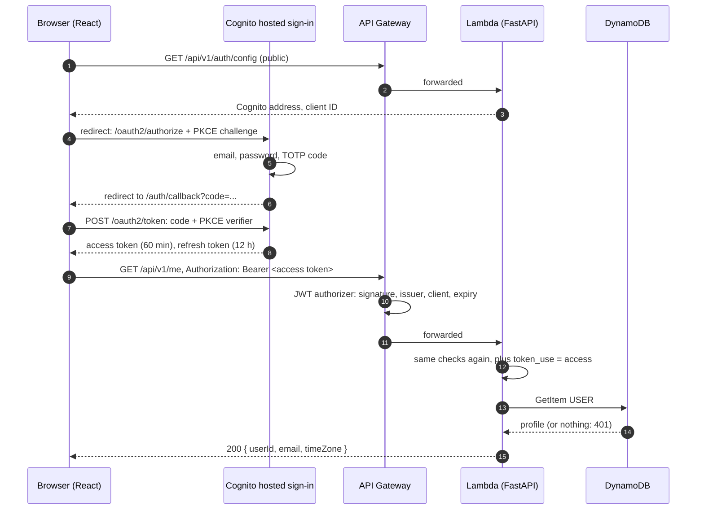
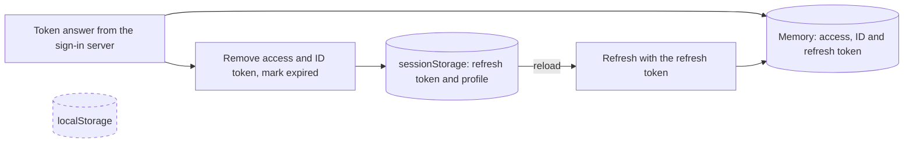

# Bolt B4: Auth

- Status: Design approved 2026-11-20 with all recommendations (decisions 1 to 8)
- Date: 2026-11-20
- Tasks: B4-01 to B4-08
- AWS cost: 0 USD extra (section 7). No hourly services.
- Security requirements: SR-01 to SR-06, SR-20, SR-21, SR-44, SR-53
- Builds on: ADR-0003 (auth), ADR-0007 (API Gateway), I-08 (table design)

## 1. Goal

Only people the admin created can use the app, and each of them only ever sees their own
data. At the end of B4:

- Opening the app sends you to Cognito's sign-in page: email, password, then a code
  from an authenticator app. First sign-in also sets up the authenticator app.
- After sign-in the app shows who you are (`GET /api/v1/me`) and has a sign-out button.
- Every API route except health and the public sign-in settings answers 401 without a
  valid token. Nothing has to remember to protect a new route: routes are protected by
  default.
- A test harness with two users (alice and bob) proves user A cannot reach user B's data.
  B5 onward add a two-user test for every route that takes an ID.
- On the laptop, the same sign-in flow runs against a local stand-in for Cognito, and that
  local mode cannot start in AWS.

## 2. Words used in this design

| Term | Meaning |
|---|---|
| User pool | Cognito's user directory. Stores users, passwords and MFA settings, and signs tokens |
| App client | The app's entry in the user pool: which sign-in flows it may use, where Cognito may send users back to, token lifetimes |
| Hosted sign-in page (classic hosted UI) | Cognito's own sign-in pages. On the Lite plan this is the only hosted option; the newer "managed login" needs the Essentials plan |
| Prefix domain | Cognito's built-in address for the sign-in pages: `https://<prefix>.auth.us-east-1.amazoncognito.com`. Free, no certificate |
| Authorization code flow with PKCE | The sign-in steps: the app sends you to Cognito, Cognito sends you back with a one-time code, the app swaps the code for tokens. PKCE ties the code to the browser tab that asked for it, so a stolen code is useless |
| Callback URL | Where Cognito may send the user back to after sign-in. Cognito refuses any address not on the list (stops open redirects) |
| Issuer (`iss`) | Who signed a token. For us: our user pool's address |
| JWKS | The public keys an issuer publishes, used to check token signatures |
| `kid` | Key ID in a token's header: which JWKS key signed it |
| JWT authorizer | An API Gateway feature that checks a JWT before calling Lambda |
| IDOR | Insecure direct object reference: changing an ID in a request to read someone else's data |
| TOTP | Time-based one-time password: the 6-digit code from an authenticator app |

## 3. What gets built

### Sign-in, step by step

Steps 9 and 10 are two locks on the same door (decision 2). FastAPI's check is the one
that counts: it runs everywhere, laptop included, and it is the only place the profile is
checked.

### What changes where

| Area | Change |
|---|---|
| Terraform `infra/app/auth.tf` (new) | User pool (Lite, admin-only accounts, TOTP required), prefix domain, app client (code flow + PKCE, no secret, exact callback URLs, token lifetimes, revocation on) |
| Terraform `infra/app/api.tf` | JWT authorizer; route `ANY /api/{proxy+}` with the authorizer; open routes `GET /api/v1/health` and `GET /api/v1/auth/config`; `$default` stays open for the React files |
| Terraform `infra/app/lambda.tf` | Environment: user pool ID and client ID. Policy: `dynamodb:GetItem` on the table only (first database permission) |
| Backend | `auth.py` (token checks, JWKS cache, local mode guard), protected-by-default router, `GET /api/v1/me`, `GET /api/v1/auth/config`, profile read from DynamoDB, CSP allows the Cognito address |
| Frontend | `oidc-client-ts` sign-in and sign-out, `/auth/callback` page, tokens kept as ADR-0003 says, sign-out after 60 minutes idle, `Authorization` header on every API call |
| Local | `mock-oauth2-server` container in Compose as the local Cognito; seed adds profiles for `alice` and `bob` |
| Scripts and runbook | `scripts/user.sh` + `make user-create`, `user-disable`, `user-delete`; `docs/runbooks/user-accounts.md` |

## 4. Design by task

### B4-01: Cognito user pool and app client (`infra/app/auth.tf`)

| Setting | Value | Why |
|---|---|---|
| `user_pool_tier` | `LITE` | New pools default to Essentials; Lite is enough and free for 10,000 monthly users (SR-04) |
| Sign-up | `allow_admin_create_user_only = true` | I-01 |
| Sign-in name | Email, case-insensitive | |
| MFA | `ON`, software token (TOTP) only, no SMS | SR-04 |
| Password policy | 14+ characters, upper, lower, number, symbol; temporary password valid 3 days | SR-04 |
| Account recovery | Verified email only | |
| Deletion protection | `ACTIVE` | Users are data; deleting the pool deletes every account |
| Email | Cognito's built-in sender (small daily limit, free) | Enough for a few users; SES would need its own setup |
| Domain | Prefix domain `tethrix-app` (variable) | A custom domain such as `auth.tethrix.satrix.in` makes Cognito create a CloudFront distribution, which this account cannot have (ADR-0007) |
| App client | Public client, no secret; `code` flow only; scopes `openid email`; `prevent_user_existence_errors = ENABLED`; `enable_token_revocation = true` | A browser cannot keep a secret; PKCE replaces it |
| Callback URLs | `<app_url>/auth/callback` only; sign-out URL `<app_url>/` | Exact match, so Cognito cannot be used to redirect anywhere else |
| Token lifetimes | Access and ID 60 minutes, refresh 12 hours | ADR-0003 decision 5, SR-05 |

`app_url` is the `execute-api` address now, and `https://tethrix.satrix.in` once the
domain is on; both come from Terraform, so switching the domain updates the callback URL
in the same apply.

### B4-02: Token checks in FastAPI (`app/backend/src/api/auth.py`)

A FastAPI dependency applied to the whole `/api/v1` router, with an explicit allow-list
of open routes (health, auth config). A route is protected unless it is on that list, and
a test walks every route in the app and calls it without a token (SR-01).

Checks, in order (SR-02):

1. `Authorization: Bearer <token>` present, nothing else accepted.
2. Header `alg` is `RS256`; `kid` is in the issuer's JWKS. PyJWT is called with
   `algorithms=["RS256"]`, so `none` and HMAC tricks fail.
3. Signature valid; `iss` is our user pool; `exp` in the future (30 seconds leeway);
   `token_use` is `access`; `client_id` is our app client. ID tokens and tokens for other
   clients fail.
4. Profile `USER#` / `PROFILE` exists (SR-03), otherwise 401.

JWKS: fetched once from the issuer and cached in memory for the life of the Lambda copy.
An unknown `kid` triggers one refetch, at most once every 5 minutes, so junk tokens
cannot make us hammer Cognito.

The user ID handed to routes is the token's `sub`, as a typed `CurrentUser` object. No
route reads a user ID from the path, the query or the body (SR-20).

Every failure answers the same `401 {"error":{"code":"unauthorized"}}`, with the reason
only in the log (not the token, SR-44).

Package: `PyJWT[crypto]` 2.15.1 (checked on PyPI: maintained by the `jpadilla` project,
pinned in `uv.lock`). `cryptography` comes with it.

### B4-03: Frontend sign-in and sign-out

Package: `oidc-client-ts` 3.5.0 (checked on npm: repository `authts/oidc-client-ts`,
pinned by `package-lock.json`). It does the PKCE code flow, refresh and sign-out.

- On start the app fetches `/api/v1/auth/config` (decision 4) and builds the client.
- Not signed in: redirect to Cognito. `/auth/callback` finishes the flow and goes to the
  page the user wanted.
- Access token in memory; refresh token in `sessionStorage` (ADR-0003 decision 6,
  SR-53). Nothing in `localStorage`.
- Every `apiFetch` adds `Authorization: Bearer`. A 401 clears the session and starts
  sign-in again.
- Sign-out: revoke the refresh token at Cognito, clear the session, then Cognito's
  `/logout` so its own session cookie is cleared too.
- Idle sign-out after 60 minutes without clicks or key presses (SR-05, ADR-0003).

### B4-04: Per-user authorization and the two-user test harness

- `GET /api/v1/me` is the first route that reads user data: GetItem with
  `PK = USER#` from the token.
- The data access code builds every key from `CurrentUser`; there is no function that
  takes a raw user ID from a request.
- Test harness (`tests/auth_helpers.py`): `as_user("alice")` and `as_user("bob")` give a
  test client with a valid token for that user, signed by a test key the app trusts only
  in tests. Seed profiles exist for both.
- Rule enforced by a test: every route whose path contains `{...}` (an ID) must be listed
  in the two-user test table, or the test fails. B4 has no such routes yet, so the table
  starts empty and B5's todo routes cannot be added without their IDOR test (SR-21).

### B4-05: Local sign-in and its guard

A local stand-in for Cognito, `navikt/mock-oauth2-server` (Docker image
`ghcr.io/navikt/mock-oauth2-server`, open source, pinned by digest to a release at least
two weeks old), runs in Compose on `localhost:8090`. Its sign-in page asks only for a
user name; type `alice` or `bob`. It issues tokens with the same claims as Cognito
(`token_use`, `client_id`, `sub`) through the same PKCE flow, so the frontend code is
identical locally and in AWS.

The backend has `AUTH_MODE`: `cognito` (default) or `local`.

- `local` trusts only the mock server's issuer and keys.
- Guard 1: with `AUTH_MODE=local` the app refuses to start if `AWS_LAMBDA_FUNCTION_NAME`
  is set (same pattern as `DYNAMODB_ENDPOINT_URL` in B2) (SR-06).
- Guard 2: Terraform never sets `AUTH_MODE`; a checkov-style test greps `infra/` for it.
- Guard 3: in `cognito` mode the issuer must be an `https://cognito-idp.` address, so a
  wrong setting cannot point a deployed app at some other token issuer.

This replaces ADR-0003's "script that mints local tokens" with a local issuer: same
idea (a different trusted issuer, every check identical), but the browser flow is tested
too (decision 5).

### B4-06: Threat model update (section 5)

### B4-07: Theory note `docs/theory/oauth-oidc-jwt.md`

OAuth 2.0 and OIDC in plain words, the code flow with PKCE as a diagram, JWT pitfalls
(`alg: none`, HMAC/RSA confusion, missing audience check, ID token used as access token,
long-lived tokens), user pools vs identity pools, why tokens in the browser are an XSS
risk and what the cookie-based alternative (BFF) looks like.

### B4-08: Runbook `docs/runbooks/user-accounts.md`

`make user-create EMAIL=... TZ=Asia/Kolkata`:

1. `aws cognito-idp admin-create-user` (Cognito emails a temporary password).
2. Reads the new user's `sub` from the answer.
3. `aws dynamodb put-item` for the profile `USER#` / `PROFILE` with the time zone,
   only if it does not exist yet.

`make user-disable EMAIL=...` (`admin-disable-user` plus `admin-user-global-sign-out`)
and `make user-delete EMAIL=...` (profile first, then the Cognito user; B10 extends it to
all the user's data). Users are data, not infrastructure, so CLI is allowed here (I-13).
Email addresses are passed on the command line, never written into the repo.

## 5. Threat model changes

| ID | Change |
|---|---|
| T-001 (JWT checks) | Controls built: checks in API Gateway and FastAPI; tests with forged, expired, wrong-issuer, wrong-client, `alg: none`, HS256 and ID tokens |
| T-003 (weak sign-in) | Built: MFA required, 14-character passwords, no self sign-up |
| T-004 (local bypass) | Built: three guards (section 4, B4-05) with tests |
| T-013 (IDOR) | Built: key from `sub` only; two-user harness and the "every ID route has a two-user test" rule |
| T-015 (token theft) | Built: memory and `sessionStorage`, CSP, short lifetimes, never logged |
| T-027 (deleted account keeps access) | Built: profile check per request |
| T-039 (new) | Open redirect through the sign-in flow: exact callback URLs in Cognito; the app only returns to its own paths after sign-in |
| T-040 (new) | Phishing look-alike: the sign-in page is on `amazoncognito.com`, not our domain, so users cannot rely on the address alone. Accepted (custom domain needs CloudFront); few, known users |
| T-041 (new) | Local issuer image is tampered with: pinned by digest, used only on the laptop, never in AWS (guard 1) |
| T-042 (new) | JWKS refetch abused to flood Cognito with junk `kid` values: one refetch per 5 minutes at most |

## 6. Decisions for the owner

| # | Decision | Options | Recommendation |
|---|---|---|---|
| 1 | Token header | `Authorization: Bearer` (standard, works again without OAC), or keep `X-Auth-Token` | `Authorization: Bearer`. ADR-0003 chose the custom header only because of OAC |
| 2 | Where tokens are checked | FastAPI only, or API Gateway JWT authorizer on `/api/*` and FastAPI | Both. The authorizer is free, stops requests without a valid token before Lambda runs (cheaper floods, T-021), and FastAPI still checks everything, including the profile. Cost: API Gateway's own 401 has a different body, which the frontend treats like any 401 |
| 3 | Sign-in page address | Cognito prefix domain, or custom domain `auth.tethrix.satrix.in` | Prefix domain. The custom domain needs CloudFront, which this account cannot have |
| 4 | How the frontend learns the Cognito address and client ID | Built into the JavaScript at build time, or read at start from `GET /api/v1/auth/config` | Read at start. One image works on the laptop and in AWS, and B6 can promote the same image. The values are public anyway |
| 5 | Local sign-in | A local OIDC server in Compose (`mock-oauth2-server`), or a script that mints tokens (ADR-0003 as written) | Local OIDC server: the real browser flow runs locally, so sign-in bugs show up before AWS |
| 6 | Who creates the profile item | `make user-create` writes it with the Cognito user, or the API creates it on first sign-in | The script. If the API created profiles, a deleted user's still-valid token would bring the profile back and defeat SR-03 |
| 7 | B4 endpoints | `GET /me` only, or also `PATCH /me` (time zone) | `GET /me` only. The time zone is first used for "today" in B5, so `PATCH /me` comes with it |
| 8 | Echo route | Protect it now, or remove it | Protect it (it is under `/api/v1`, so this happens by default); still removed in B5 |

ADR-0003 gets an "Update 2026-11-20" section for decisions 1 to 5. The rest of ADR-0003
stays as it is.

## 7. Cost

| Item | Cost |
|---|---|
| Cognito Lite | Free up to 10,000 monthly active users; we have a few |
| Cognito email | Built-in sender, free |
| JWT authorizer | No extra charge on HTTP APIs |
| DynamoDB GetItem per request | Inside the provisioned 10 read units |

Total: 0 USD extra. Free plan check: Cognito is on AWS's list of Free Tier services
("Supported AWS services for Sign up for AWS (new)", checked 2026-11-20); the Lite tier
and TOTP MFA are the low end of it. The first apply is the real check, and nothing in it
is hourly.

## 8. Order of work

Four pull requests:

1. Backend and local: `auth.py`, protected-by-default router, `/me`, `/auth/config`,
   local issuer in Compose, two-user harness, all tests. No AWS.
2. Frontend: sign-in, callback, sign-out, idle sign-out, header. Tested against the local
   issuer.
3. Terraform and accounts: `auth.tf`, authorizer and routes, Lambda settings and
   `GetItem`, `scripts/user.sh`, runbook, smoke test update. Owner deploys and creates
   the first user.
4. Theory note (B4-07), ADR-0003 update, closing docs.

## 9. Done when

- Without a token, every protected route answers 401, through API Gateway and in tests.
- The owner signs in on AWS with password and authenticator app, sees their email on the
  dashboard, signs out, and the back button does not bring the data back.
- A second test user cannot see the first user's profile (manual check plus tests).
- Local `make up`: sign in as `alice`, then as `bob`, each sees only their own profile.
- `AUTH_MODE=local` with the Lambda variable set fails to start (test).
- All scanners pass; threat model, findings log, glossary, tracker and `CLAUDE.md`
  updated; owner's journal entry.

## 10. Risks to check during the build

- The classic hosted UI must offer authenticator-app setup at first sign-in for
  admin-created users. AWS's TOTP page says Cognito prompts for it when MFA is required;
  if the classic pages do not, the runbook gets a CLI step (`associate-software-token`)
  instead.
- The prefix domain is AWS's own address and creates no CloudFront resource in our
  account; the first apply confirms it.
- `mock-oauth2-server`'s claim settings must produce `token_use` and `client_id`; checked
  in PR 1 before anything depends on it.

## 11. Build notes: pull request 1, backend and local sign-in (2026-11-20)

Branch `b4/backend`.

### Files written

| Task | Files |
|---|---|
| B4-02 | `app/backend/src/api/auth.py` (token checks, key cache, `auth_gate`, `current_user`), `config.py` (sign-in settings, Lambda guards), `main.py` (app-wide `auth_gate`, verifier, profile store), `errors.py` (keeps `WWW-Authenticate` on 401), `security_headers.py` (CSP allows the Cognito address), `middleware.py` (request log names the user) |
| B4-04 | `db.py` (`DynamoProfileStore`), `routes/me.py`, `tests/auth_helpers.py`, `alice` and `bob` fixtures, `tests/test_idor.py`, `tests/test_routes.py` rewritten |
| B4-05 | `compose.yaml` (`oidc` service, `AUTH_MODE=local`), `routes/auth_config.py`, `scripts/local-token.py`, `make guard-local-auth` (part of `make lint`), seed users renamed to `alice` and `bob` |
| B4-06 | Threat model: T-004, T-041, T-042 Done; T-001, T-013 in progress; T-039 to T-042 added |
| Docs | ADR-0003 "Update 2026-11-20", glossary, `docs/runbooks/local-dev.md` "Signing in locally" |

### Pinned versions

| Package or image | Version | Checked |
|---|---|---|
| `pyjwt[crypto]` | 2.15.1 (brings `cryptography` 50.0.2) | PyPI, project `jpadilla/pyjwt` |
| `ghcr.io/navikt/mock-oauth2-server` | 6.1.4, by digest | GitHub releases: published 2026-10-28, more than two weeks old (7.0.x was too new) |

### Results

- Backend: 118 tests pass (66 new). They cover every token case in section 4 (B4-02),
  the Lambda guards, the key cache limits, the two-user harness and "every protected
  route answers 401 without a token".
- ruff and mypy pass. Three `token_use` lines carry `noqa: S105/S106`: it is Cognito's
  claim name, not a password.
- Local run (`make up`): a real PKCE sign-in at the local server, then the backend:
  anonymous 401; alice and bob each see only their own profile; a signed-in name with no
  profile gets 401; the log gives the reason and never the token.

### What differs from the design

- Settings are named `issuer_url` and `app_client_id` in code (names with "token" set
  off the password linter).
- Without a token, an unknown `/api/...` path now answers 401 instead of 404: anonymous
  callers cannot learn which API paths exist. Signed in, it is still the JSON 404.
  `scripts/smoke.sh` changes in pull request 3 to match.
- Local only: the mock server stamps `token_use: access` on its ID tokens too, so locally
  an ID token is accepted. Cognito's are refused (unit test).

### Notes for later pull requests

- PR 2 (frontend): `oidc-client-ts` reads `/api/v1/auth/config`; callback path
  `/auth/callback`; scope `openid email`.
- PR 3 (Terraform): Lambda needs `dynamodb:GetItem` on the table and the three
  `COGNITO_*` settings; smoke test: unknown API path 401, `/me` 401 without a token.

## 12. Build notes: pull request 2, frontend sign-in (2026-11-20)

Branch `b4/frontend`.

### Files written

| Task | Files |
|---|---|
| B4-03 | `app/frontend/src/auth/`: `service.ts` (the `AuthService` interface and the `oidc-client-ts` implementation), `settings.ts` (settings from `/api/v1/auth/config`), `sessionUserStore.ts` (access and ID token in memory only), `returnTo.ts` (only our own paths after sign-in), `idle.ts` (60-minute idle sign-out), `AuthProvider.tsx`; `components/RequireAuth.tsx`; `pages/CallbackPage.tsx`; `api/client.ts` (`Authorization: Bearer`, 401 ends the session); `api/me.ts`; sign-out button and email in `Layout.tsx`; time zone on the dashboard |
| Tests | `auth/*.test.ts`, `api/client.test.ts` (5 new), `App.test.tsx` rewritten with a fake sign-in service (`auth/fakeAuth.ts`, test-only) |
| Policy | Package cooldown raised to 14 days (owner, 2026-11-20): `docs/dependency-policy.md`, `.npmrc` `min-release-age=14`, `pyproject.toml` `exclude-newer = "14 days"` |

### Pinned versions

| Package | Version | Checked |
|---|---|---|
| `oidc-client-ts` | 3.5.0 | npm, repository `authts/oidc-client-ts`, published 2026-03-13 |
| `jwt-decode` (pulled in by it) | 4.0.0 | npm, Auth0's repository, published 2023-10-27 |

Under the new 14-day rule uv refused the backend's newest pins, so three went back one
release: `boto3` and `boto3-stubs` 1.43.126 to 1.43.125 (with `botocore` 1.43.125),
`fastapi` 0.162.2 to 0.162.0, and `click` 8.5.1 to 8.5.0 (pulled in by uvicorn).

### How the tokens are kept (SR-53)

### Results

- Frontend: 60 tests pass (46 new). Backend: 118 pass after the relock.
- Prettier, ESLint and the type check pass.
- Browser check against `make up` (headless Chromium, Playwright 1.55.0, run once from
  a throwaway container, nothing added to the repo): 15 of 15. A protected page goes to
  the local sign-in with a PKCE challenge; after sign-in the app returns to that page;
  `sessionStorage` holds the user without access or ID token; `localStorage` is empty;
  `/me` carries `Authorization: Bearer`; a reload costs exactly one refresh; sign-out
  revokes the refresh token and clears the session; signing in as bob shows bob's data;
  no console errors.
- The owner repeated the browser check on the laptop (2026-11-20): works as expected.

### What differs from the design

- The ID token is kept out of `sessionStorage` too (the design only said the access
  token); the profile claims the app shows are stored separately.
- Found by the browser check: after a reload the app refreshed twice, because React's
  StrictMode starts components twice in development. `init()` now runs once and shares
  its result. Harmless before (no refresh-token rotation), but it would have broken with
  rotation on.

### Risks left for the deploy (PR 3)

- Cognito's `/logout` expects `client_id` and `logout_uri`; the app also sends the
  standard `post_logout_redirect_uri`, which Cognito should ignore. Checked on the first
  sign-out in AWS.
- Cognito's token and revoke endpoints must answer the browser's CORS preflight from the
  app's address; they are meant for browser apps, so they should.

## 13. Build notes: pull request 3, Terraform and user accounts (2026-11-20)

Branch `b4/terraform` (on top of `b4/frontend`).

### Files written

| Task | Files |
|---|---|
| B4-01 | `infra/app/auth.tf` (user pool: Lite, admin-only, TOTP required, 14-character passwords, deletion protection; prefix domain, classic hosted UI; web client: code flow, no secret, exact callback and sign-out URLs, 60 min / 60 min / 12 h, revocation on), `variables.tf` (`cognito_domain_prefix`), `outputs.tf` (pool ID, sign-in address, table name) |
| B4-02 | `infra/app/api.tf`: JWT authorizer (Cognito issuer, client ID as audience), `ANY /api/{proxy+}` with the authorizer, open `GET /api/v1/health` and `GET /api/v1/auth/config`, `$default` for the React files; `lambda.tf`: `COGNITO_*` settings and `dynamodb:GetItem` on the table |
| B4-08 | `scripts/user.sh`, `make user-create`, `user-disable`, `user-delete`, `docs/runbooks/user-accounts.md` |
| B4-07, B3 | `scripts/smoke.sh`: sign-in checks (settings, Cognito page, foreign callback refused, 401 without a token); deploy runbook updated |
| Guard | `make guard-local-auth` now skips comment lines (it had caught a comment naming the settings); proven to still catch a real setting |

### Results

- `terraform validate`, tflint, checkov, Trivy and Semgrep pass. New checkov skips: CKV_AWS_309
  on the two open routes (open on purpose, SR-01); the `$default` reason updated.
- ShellCheck passes on `scripts/user.sh` (two SC2016 notes marked: the backticks are AWS
  CLI query syntax) and `scripts/smoke.sh`.

### Not checked, because Claude has no AWS access

- That the prefix `tethrix-app` is free (it is global per region).
- That the classic hosted UI offers authenticator-app setup at first sign-in for an
  admin-created user (section 10). If not: the runbook gets a CLI step.
- That the hosted UI works with `explicit_auth_flows = ["ALLOW_REFRESH_TOKEN_AUTH"]`
  only. If the sign-in page refuses, add `ALLOW_USER_SRP_AUTH` (still no password sent
  through the API).
- Cognito's `/logout` with the extra `post_logout_redirect_uri` parameter.

## 14. Deploy and closing (2026-11-20)

The owner merged #17 and #19 and deployed commit `e8a2622` with the deploy runbook.

- `make smoke`: passed, 0 failed.
- The first user was created with `make user-create`. Sign-in on AWS worked: temporary
  password, new password, authenticator app set up at first sign-in, dashboard with the
  owner's email and time zone. Sign-out worked.
- Section 10 risks: the classic hosted UI did offer authenticator-app setup for an
  admin-created user (no CLI step needed); the prefix `tethrix-app` was free; the apply
  created no CloudFront resource; the hosted UI worked with only
  `ALLOW_REFRESH_TOKEN_AUTH` in `explicit_auth_flows`.

Pull request 4 (branch `b4/close`): theory note `docs/theory/oauth-oidc-jwt.md`
(B4-07), ADR-0003 deploy note, threat model, deploy record, glossary, tracker and
`CLAUDE.md`.

### Section 9 "Done when"

| Item | Result |
|---|---|
| Without a token every protected route answers 401, through API Gateway and in tests | Done: `make smoke` and the backend tests |
| Owner signs in on AWS with password and authenticator app, sees their email, signs out | Done (owner, 2026-11-20) |
| The back button after sign-out does not bring the data back | Owner to confirm (see below) |
| A second test user cannot see the first user's profile | Done in tests (`test_idor.py`); manual check on AWS: owner to confirm |
| Local `make up`: alice and bob each see only their own profile | Done (browser check, PR 2) |
| `AUTH_MODE=local` with the Lambda variable set fails to start | Done (`test_config.py`) |
| Scanners pass; records updated; owner's journal entry | Scanners and records done; journal entry is the owner's |
