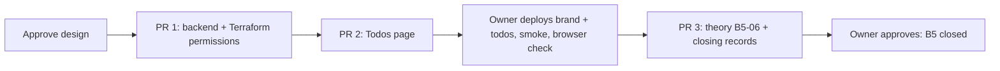

# Design: bolt B5, Todos

- Status: Approved 2026-11-22 with decisions 1, 3 (component library provided), 5 and 6 as
  recommended; decision 2 the other way (`python-ulid`); decision 4 the other way
  (optimistic updates). See section 8
- Stories: US-10 to US-13 (`docs/inception/02-user-stories.md`)
- Builds on: I-03 (todo fields and endpoints), I-08 (keys and GSI1), ADR-0001, ADR-0003
- Security requirements: SR-30 (validation), SR-32 (pagination), SR-35 (no raw HTML),
  plus SR-20 and SR-21 (IDOR) on the first routes with an ID
- Tracker: B5-01 to B5-06
- Ships with: the Tethrix brand (#24, merged, not yet deployed). One deploy covers both.

## 1. Goal

The first real feature. A signed-in user can add, tick off, edit and delete todos, and
see them in four views: Today, Upcoming, All and Completed. "Today" means today in the
user's own time zone.

It is also the first time the app writes to DynamoDB, so the Lambda role gets its first
write permissions, and the IDOR rule from B4 becomes active: every route with an ID must
prove that bob gets 404 for alice's todo.

## 2. Words used in this design

| Word | Meaning |
|---|---|
| Repository | The one module that talks to the database for todos. Routes call it; nothing else builds keys |
| Conditional write | A write that DynamoDB does only if a condition holds, for example "only if this todo exists". Otherwise it refuses, and we answer 404 |
| Cursor | An opaque marker of where the last page of a list ended. The browser sends it back to get the next page |
| Projection | Which fields a DynamoDB index copies. GSI1 copies only what lists show |
| Optimistic update | Changing the screen before the server answers, and undoing it if the server says no. Used here (decision 4) |

They go into `docs/glossary.md`, with any others that come up in the build.

## 3. How a request flows

```mermaid
sequenceDiagram
  participant B as Browser (Todos page)
  participant G as API Gateway (JWT authorizer)
  participant F as FastAPI
  participant D as DynamoDB
  B->>G: POST /api/v1/todos {title, dueDate}  Bearer token
  G->>G: token valid? (else 401, Lambda never starts)
  G->>F: request
  F->>F: token again + profile (B4); body checked by a Pydantic model (SR-30)
  F->>F: new ULID; keys built from the token's sub only (SR-20)
  F->>D: PutItem PK=USER#<sub> SK=TODO#<id>, GSI1 keys = OPEN
  D-->>F: ok
  F-->>B: 201 the new todo
  B->>G: GET /api/v1/todos?view=today
  G->>F: request
  F->>F: "today" in the user's time zone (profile timeZone)
  F->>D: Query GSI1 PK=USER#<sub>#TODO#OPEN, SK <= DUE#<today>~
  D-->>F: up to 50 items + LastEvaluatedKey
  F-->>B: 200 {items, nextCursor}
```

## 4. The API (from I-03, with one addition)

| Method and path | Does | Answers |
|---|---|---|
| GET `/todos?view=today\|upcoming\|all\|completed&cursor=` | One page (max 50) of a view; `all` if no view is given | 200 `{items, nextCursor, today}` (`today` is the user's date, for the "Overdue" label) |
| GET `/todos/{todoId}` | One todo with its notes (added, decision 1) | 200, or 404 |
| POST `/todos` | Add | 201 the todo |
| PATCH `/todos/{todoId}` | Change fields, tick, untick | 200 the todo, 404, or 409 if another tab saved in between |
| DELETE `/todos/{todoId}` | Delete for good | 204, or 404 |

The temporary `POST /api/v1/echo` from B3 is removed, as B3 planned; `make smoke` checks
`POST /api/v1/todos` without a token instead (401).

### Input rules (SR-30)

Every body is a Pydantic model with `extra="forbid"`: an unknown field is a 400, not
ignored. So nobody can send `userId`, `PK` or `completedAt` and have it stored.

| Field | Rule |
|---|---|
| `title` | Required on POST. Trimmed; 1 to 200 characters after trimming; no line breaks or control characters |
| `notes` | Optional, up to 2,000 characters. Plain text, shown as text, never as HTML |
| `dueDate` | Optional. A real date `YYYY-MM-DD`, year 2000 to 2100 (keeps the sort keys in order) |
| `priority` | Optional: `low`, `medium` or `high` |
| `completed` | PATCH only: `true` ticks (sets `completedAt` to now, UTC), `false` unticks (clears it) |
| `todoId` in the path | Must look like a ULID (26 characters, Crockford base32), checked before any key is built: otherwise 404 |
| `view` | One of the four names; anything else is 400 |
| `cursor` | Checked as described below; a bad one is 400 |

On PATCH, sending `null` clears an optional field (`dueDate`, `priority`, `notes`);
leaving a field out keeps it.

Error messages name the field, never repeat the value (already the rule in `errors.py`).

## 5. Data (I-08, unchanged)

```text
Item:   PK=USER#<sub>  SK=TODO#<todoId>  todoId title notes dueDate priority completed
                                         completedAt createdAt updatedAt GSI1PK GSI1SK
GSI1:   open with date   USER#<sub>#TODO#OPEN  DUE#<dueDate>#<todoId>
        open, no date    USER#<sub>#TODO#OPEN  NODUE#<todoId>
        completed        USER#<sub>#TODO#DONE  DONE#<completedAt>#<todoId>
```

| View | Query |
|---|---|
| Today | GSI1 OPEN, `GSI1SK <= DUE#<today>~`: overdue first, then today. Overdue ones get an "Overdue" label in text, not only a colour |
| Upcoming | GSI1 OPEN, `GSI1SK BETWEEN DUE#<tomorrow> AND DUE#9999`, by due date |
| All | GSI1 OPEN, all of it: dated by due date, then undated by creation |
| Completed | GSI1 DONE, newest first |

Ticking a todo rewrites its GSI1 keys, so it moves from OPEN to DONE by itself. All
writes after creation are conditional on the item existing (`attribute_exists(PK)`), so
a PATCH or DELETE to an unknown ID, or someone else's, cannot create an item and answers
404. A user can only ever reach their own partition anyway, because the key is built
from the token.

### The cursor is safe to hand to the browser

DynamoDB's "where to continue" value (`LastEvaluatedKey`) contains the partition key. If
the API accepted it back as is, a crafted cursor could point at another user's
partition. So the cursor holds only the sort-key parts (`GSI1SK` and `SK`), base64url
encoded. The server rebuilds the full key with the caller's own `USER#<sub>`, and checks
the parts have the right prefix for the view. A cursor from another user or another view
is useless or a 400. New threat T-043 records this.

### "Today" in the user's time zone

The profile already holds `timeZone` (for example `Asia/Kolkata`). The server works out
today's date with Python's `zoneinfo`. Tests freeze the clock at a moment when it is
already tomorrow in Kolkata but still today in London, and check that alice and bob get
different Today lists. The slim Python image may not ship the time zone database; if it
does not, the pinned `tzdata` package (the official Python one, at least 14 days old) is
added and checked like every dependency.

## 6. Database permissions

The Lambda role today has `dynamodb:GetItem` on the table. B5 changes it to two
statements:

| Statement | Actions | On | Why |
|---|---|---|---|
| `UseAppTable` | GetItem, PutItem, DeleteItem | The table | Profile and one todo; add a todo, and rewrite it on edit (PutItem with a version condition, so UpdateItem is not needed); delete |
| `QueryAppIndexes` | Query | `index/GSI1` only | The four views |

Separate statements mean item actions never apply to the index and Query never applies
to the table itself. No `Scan`, no `BatchWriteItem`, no table management, no wildcard.
Export and account deletion (B9) add what they need then. IAM cannot limit the role to
"the caller's partition" here: the role belongs to the Lambda, not to the user, so that
protection stays in our code and its tests (T-013). The theory note explains why
`dynamodb:LeadingKeys` does not fit this design.

## 7. The page

```text
+-----------+--------------------------------------------------+
| tethrix   |  Todos                                           |
|           |  [ Today ] [ Upcoming ] [ All ] [ Completed ]    |
| Dashboard |                                                  |
| Todos     |  [ Add a todo...            ] [date] [prio] [Add]|
| Habits    |                                                  |
| Journal   |  [ ] Pay electricity bill     Overdue  20 Nov  H  |
| Pages     |  [ ] Call the bank                     22 Nov    |
|           |  [x] ...                                         |
|           |  [ Load more ]                                   |
+-----------+--------------------------------------------------+
```

- The view is part of the address (`/todos?view=upcoming`), so back and reload work.
- Clicking a todo opens it for editing in place: title, notes, date, priority, Save,
  Cancel, Delete. Delete asks "Delete this todo for good?" with Yes and No in the page.
- Built from the Satrix UI components (section 15).
- All user text is rendered as React text, never as HTML (SR-35; the Semgrep rule from
  B1 already fails CI on `dangerouslySetInnerHTML`).
- Keyboard: every control is a real button, checkbox or input, with a visible focus ring.

## 8. Decisions (owner, 2026-11-22)

| # | Question | Decision |
|---|---|---|
| 1 | How the edit form gets the notes | `GET /todos/{todoId}`, fetched when the form opens. The index stays as I-08 designed it |
| 2 | Where ULIDs come from | The `python-ulid` package (github.com/mdomke/python-ulid, MIT, no dependencies on Python 3.12), pinned at 4.1.0: 4.2.0 is younger than 14 days |
| 3 | Styling | The owner's component library "Satrix UI" (section 15), built now |
| 4 | After a change | Optimistic updates: the screen changes at once; if the server refuses, the change is undone and a toast says why |
| 5 | Delete | Confirmed in the page with Yes and No |
| 6 | Pull requests | Three: backend; component library and page; theory and closing |

## 9. Tests

| What | Where |
|---|---|
| Every field rule above, good and bad values, unknown fields | `tests/test_todos_validation.py` |
| Each view returns the right todos in the right order, pagination at 51 items | `tests/test_todos.py` (DynamoDB Local) |
| Tick moves a todo to Completed with `completedAt`; untick moves it back | `tests/test_todos.py` |
| Bob gets 404 on GET, PATCH and DELETE of alice's todo, and alice's todo is unchanged | `tests/test_idor.py`, registered in `ID_ROUTES` (the rule fails CI otherwise) |
| A cursor from alice used by bob, or from another view, never returns alice's items | `tests/test_idor.py` |
| Today differs between Kolkata and London at the same moment | `tests/test_todos.py` |
| ULID format, sort order and uniqueness | `tests/test_ids.py` |
| Page: views, add, tick, edit, delete with confirm, load more, errors shown | `TodosPage.test.tsx` |
| No raw HTML: a title like `` shows as text | `TodosPage.test.tsx` |
| Signed out: `POST /api/v1/todos` is 401 on AWS | `make smoke` |

Your browser check after deploy: add, tick, edit and delete a todo on
`tethrix.satrix.in`, and see the brand.

## 10. Threat model changes

| Threat | Change |
|---|---|
| T-007 Oversized or malformed input | In progress: todo models, `extra="forbid"`, 16 KB body limit already on |
| T-013 IDOR | Rule enforced from B5: first ID routes, two-user tests required by CI |
| T-022 Unbounded lists | In progress: max 50 per page |
| T-043 (new) Crafted cursor reaches another partition | Cursor holds only sort-key parts; partition always from the token |

## 11. Cost

Nothing new is created. Each todo write uses 1 write unit on the table and 1 on GSI1;
reads are a fraction of a unit. All inside the fixed provisioned capacity (10 table, 5
index), which is inside the always-free 25. Requests above it are throttled, never billed.
Lambda and API Gateway requests stay in cents a month (I-11). Cost Log row: "B5: no
change".

## 12. Order of work



## 13. Done when

- Every test above passes and every scanner is green.
- The owner has deployed, `make smoke` passes and the browser check works.
- B5-06 theory note written (DynamoDB keys, GSIs, capacity modes), with questions.
- Threat model, findings log, glossary, deploy record, Cost Log row, tracker and
  `CLAUDE.md` updated.
- Journal entry (owner).

## 14. Risks to check during the build

- DynamoDB Local and real DynamoDB differ in small ways (error texts, some limits). Tests
  assert on behaviour, not on error wording.
- The Today query relies on `~` sorting after every digit and `#`, and on `NODUE#`
  sorting after `DUE#`. A test proves both.
- GSI updates are eventually consistent: a todo added a moment ago may be missing from a
  list read straight after. With optimistic updates the page keeps its own copy and
  does not re-read the list after each change, so this does not show.
- Optimistic updates and a refused change: every change keeps the old copy of the todo
  and puts it back on error, with a toast. Tests cover a refused tick, edit and delete.

## 15. Component library: Satrix UI

- Source: the owner's design canvas "Satrix UI, component library" (private), 2026-11-22.
  33 components, foundations (concept, colour and type, tokens) and two patterns (dark
  mode, responsive).
- The concept: surfaces are bodies, lines are orbits, moons show where you are.
  - Every rectangle has one wider corner at the top right (the orbit corner), for
    example 6, 12, 6, 6 px on controls.
  - A moon (a small dot on a line) marks the current item or a state, never decoration.
  - Only round things are celestial: avatars, radios, switch knobs, status dots.
  - Status is never colour alone: moon phases plus a word.

B5 builds only the components the todos page needs, as React components with CSS from
tokens:

| Component | Used for |
|---|---|
| Button (primary, secondary, ghost, danger; sm, md) | Add, Save, Cancel, Delete, Yes, No, Load more |
| Checkbox | Tick a todo |
| Input, Textarea, Select (native `<select>` styled as the trigger), Label | Add and edit forms |
| Tabs (orbit tabs, moon on the active underline) | The four views |
| Badge | Priority and "Overdue" |
| Alert | A list that could not load |
| Toast | A change the server refused (optimistic update undone) |
| Sidebar (orbit line, moon on the current item) | The existing menu, restyled |

Tokens added to `styles.css` from the canvas: radii (xs 3/7, sm 6/12, lg 7/16, md 8/24),
spacing on a 4 px base, control heights 32/40/48, borders (default and strong), four
elevations, motion durations and curves (reduced motion respected), and the colours the
canvas adds: `border-strong` `#CFC9D8`, success `#15803D`, danger `#DC2626` on light;
`orbit-1` `#15131C`, `orbit-2` `#1D1B25`, success `#4ADE80`, danger `#F87171`, warning
`#FBBF24` on dark.

One difference on purpose: the canvas uses Sora for headings, Inter for text and
JetBrains Mono for data. The owner chose Sansation for all text on 2026-11-22, after the
canvas was made, so Sansation stays. Headings keep the canvas's sizes and letter
spacing.

The other components (dialog, drawer, table, command menu and so on) are built when a
bolt needs them.

## 16. Build notes: pull request 1, backend (2026-11-22)

Branch `b5/backend`.

- `api/todos.py`: the repository. All todo keys are built here from the caller's user
  ID. Edit is read, change, then `PutItem` only if the `version` is unchanged
  (otherwise 409); create and delete are conditional too, so an unknown or foreign ID can
  never create an item. Lists are one GSI1 Query of at most 50.
- `api/routes/todos.py`: the five routes and their Pydantic models (`extra="forbid"`,
  strict booleans, trimmed one-line titles, dates as `YYYY-MM-DD` strings checked for a
  real date between 2000 and 2100). Today's date comes from the profile's time zone with
  `zoneinfo`; the slim Python image already has the time zone database (checked, and a
  test keeps checking), so no `tzdata` package.
- The app has one clock (`app.state.clock`), so tests freeze time.
- `python-ulid` 4.1.0 added; `uv lock` added only that package.
- The B3 echo route is removed. The body-limit tests use a route that exists only in
  the test app. `make smoke` now checks that the todo routes refuse calls without a
  token.
- Terraform: the Lambda module gets a second statement for index actions
  (`dynamodb_index_actions`); the app grants GetItem, PutItem, DeleteItem on the table
  and Query on GSI1. checkov and tflint pass.
- Seed data: todo IDs are now ULIDs and the todos have a version, so they can be edited
  in the app. A local table made before this keeps its old `a1`-style todos alongside;
  `make reset-db` starts clean.
- Found during the build: items without a `version` field would always have answered
  409 on edit. The condition now accepts "no version" when the item read had none
  (tested).
- Tests: 212 pass, with DynamoDB Local. A planted leak (every read looking in alice's
  partition) made the two-user tests fail with 200 instead of 404, so they work.
