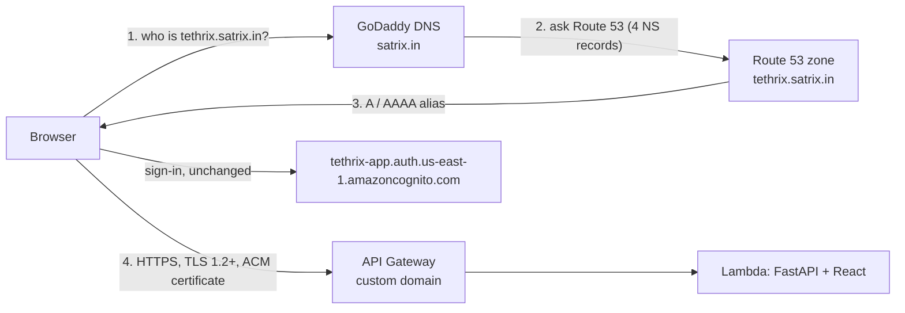

# Design: switch on tethrix.satrix.in

- Status: Approved 2026-11-21 with all four recommendations. Written on branch
  `domain/switch-on`; waiting for the owner's deploy
- Decisions it builds on: ADR-0006 (Route 53 zone for the subdomain only), ADR-0007
  (API Gateway in front), ADR-0003 (Cognito prefix domain)
- Threats it closes: T-036 (old TLS on the default address), T-038 (default address
  bypasses the domain), F-022. T-032 (subdomain takeover) becomes live and is handled by
  the destroy order.

## 1. What changed

GoDaddy lifted the hold on `satrix.in` (checked 2026-11-21: `dig +short NS satrix.in`
shows `ns29` and `ns30.domaincontrol.com`; the registration record no longer lists
`clientHold`). The `clientTransferProhibited`, `clientUpdateProhibited` and similar
statuses still shown are GoDaddy's normal locks against theft; they do not stop DNS
records. `tethrix.satrix.in` has no records yet, so nothing conflicts.

The Terraform has existed since B3 behind `use_custom_domain` (`infra/app/dns.tf`).
This design only covers what is different now that sign-in exists, and the order of the
switch.

## 2. How a request reaches the app afterwards



Delegation, in plain words: GoDaddy stays in charge of `satrix.in`, and four NS records
there say "for `tethrix` and below, ask these Route 53 servers". Nothing else at GoDaddy
changes, and Route 53 never sees the parent domain.

## 3. What changes

| Part | Now | After |
|---|---|---|
| App address | `https://<id>.execute-api.us-east-1.amazonaws.com` | `https://tethrix.satrix.in` |
| TLS | AWS defaults on the default address (TLS 1.0 allowed, T-036) | Our certificate, `TLS_1_2` policy (SR-50) |
| Default execute-api address | On | Off (T-038), in a second step (decision 1) |
| Cognito callback and sign-out URLs | The execute-api address | `https://tethrix.satrix.in/auth/callback` and `/` (follow `local.app_url`, no code change) |
| Cognito sign-in page | `tethrix-app.auth...amazoncognito.com` | Unchanged: a Cognito custom domain needs CloudFront |
| Sessions | | Everyone signs in once more: `sessionStorage` belongs to the old address |
| Security headers | HSTS `max-age=31536000; includeSubDomains` | Same; it now applies to our own name. No `preload` (decision 3) |

## 4. Decisions for the owner

1. **Turn the default address off in a second apply (recommended), or in the same
   apply.** In one apply, Terraform may switch off the execute-api address before the
   certificate is issued; if validation then stalls (up to 75 minutes), the app is
   unreachable. Recommended: a new variable `disable_default_endpoint`. The first apply
   runs with it `false`; after `make smoke` passes on the domain, a second apply turns
   it off. Cost: one more apply, about a minute.
2. **Keep the Cognito prefix domain (recommended).** `auth.tethrix.satrix.in` would need
   CloudFront, which this account cannot have (ADR-0007). The sign-in page stays on
   Cognito's address; the browser shows that it is Amazon's page.
3. **No HSTS preload (recommended).** Preloading puts the name into browsers' built-in
   lists, and getting out takes months. It also needs `includeSubDomains` on the parent,
   which this project must not touch.
4. **Keep the CAA record (recommended).** Only Amazon may issue certificates for
   `tethrix.satrix.in`. The parent has no CAA record, so nothing else is affected.

## 5. Cost

| Item | Cost |
|---|---|
| Route 53 hosted zone | 0.50 USD a month, billed per month started (about 3 USD until the account closes) |
| DNS queries | 0.40 USD per million; a few thousand a month, so cents |
| ACM public certificate | Free |
| API Gateway custom domain | Free; requests cost the same as now |

The cost model (I-11) puts the app under 0.50 USD a month, without the zone. With it,
about 1 USD a month, still inside the 2 USD a month the plan allows. Route 53 and ACM are
listed as Free Tier services on the Free plan (checked 2026-11-20, deploy runbook). The
cost model gets a row.

## 6. Steps

```mermaid
sequenceDiagram
  participant O as Owner
  participant T as Terraform
  participant G as GoDaddy
  O->>T: 1. merge the PR, apply only the zone (-target)
  T-->>O: four name servers
  O->>G: 2. add four NS records, name "tethrix"
  O->>O: 3. wait until dig shows the awsdns names
  O->>T: 4. apply with disable_default_endpoint=false
  T-->>O: certificate, custom domain, A/AAAA, new Cognito URLs
  O->>O: 5. make smoke on the domain; sign in
  O->>T: 6. apply again: default address off
  O->>O: 7. make smoke: default address refused
```

## 7. What Claude writes (one pull request)

- `variables.tf`: `use_custom_domain` default `true`; new `disable_default_endpoint`
  (default `true`, used only while `use_custom_domain` is `true`).
- `api.tf`: `disable_execute_api_endpoint = var.use_custom_domain && var.disable_default_endpoint`.
- `dns.tf`: fix the stale comment that still names CloudFront.
- `scripts/smoke.sh`: check the certificate's name is ours, and accept "default address
  still on" as an INFO line only while step 4 is running (`ALLOW_DEFAULT_ENDPOINT=1`).
- Runbook "Adding the domain" rewritten to the steps above, and a "Removing the domain"
  part: NS records at GoDaddy come off before the zone is destroyed (T-032).
- ADR-0006 update, cost model row, threat model (T-032, T-036, T-038), F-022, glossary
  (delegation, NS record, alias record, CAA), tracker, `CLAUDE.md`.

## 8. Risks

- DNS caches: until the NS records spread (minutes, up to the 1-hour TTL), some
  resolvers still answer "no such name". Step 3 waits on `@1.1.1.1` before the full
  apply.
- If the GoDaddy hold comes back, the name stops resolving. The rollback is one apply
  with `use_custom_domain=false`: the execute-api address comes back and Cognito's URLs
  follow it.
- Old bookmarks to the execute-api address stop working after step 6. Only the owner
  has any.
