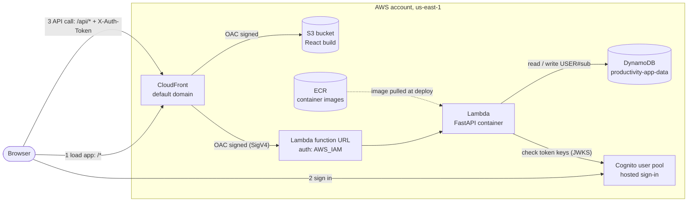
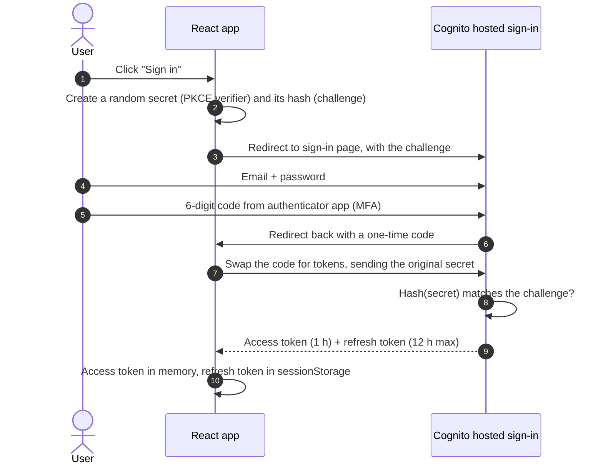
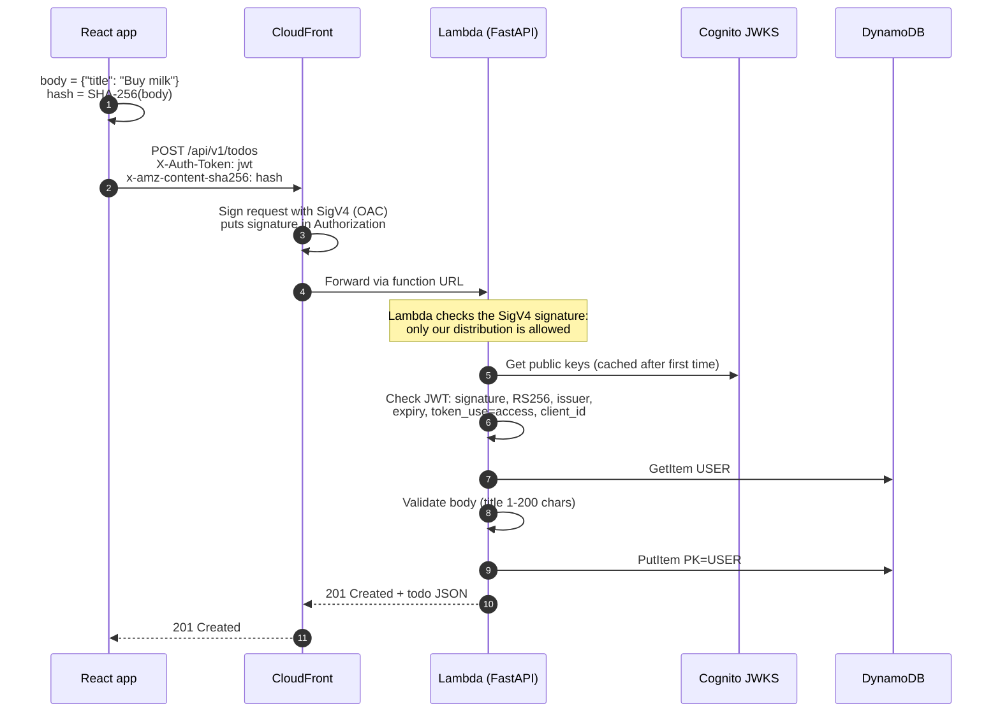
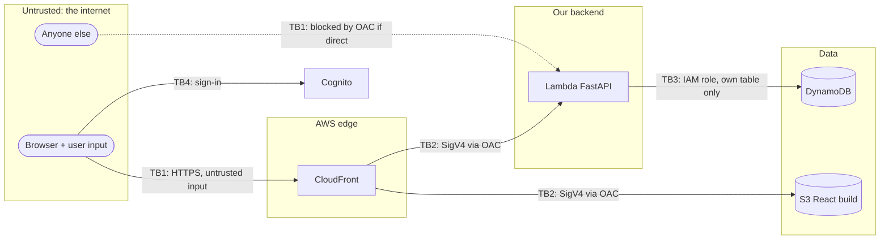
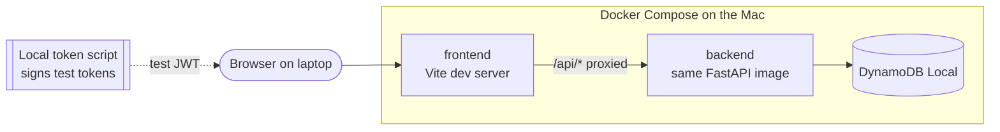
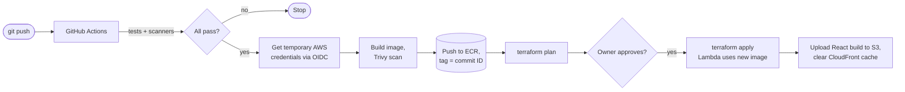

# I-10: Architecture and data-flow diagrams

- Status: Approved 2026-11-15
- Viewable page: https://claude.ai/artifact/CBHZiLc5RJZ3XxEkahCAbP (private)
- Date: 2026-11-15
- Based on: ADR-0001 to ADR-0004

The diagrams are written in Mermaid, a text format that GitHub shows as pictures. In
VS Code, a Mermaid preview extension is needed to see them.

## 1. The whole system

What lives where, and which way requests go.

Reading it:

1. The browser loads the React app. CloudFront fetches the files from a private S3
   bucket, signing each request with OAC.
2. The user signs in on Cognito's hosted page and gets tokens.
3. The app calls the API on the same CloudFront domain. CloudFront signs the request and
   forwards it to the function URL, which only accepts signed requests from this
   distribution. Lambda runs FastAPI, checks the token and reads or writes DynamoDB.

## 2. Sign-in (authorization code flow with PKCE)

Why PKCE: if someone steals the one-time code in step 6, it is useless to them, because
only the app knows the secret from step 2.

## 3. One API call, end to end

Example: adding a todo.

Where a request can be stopped:

| Step | Rejected if | Response |
|---|---|---|
| 4 | The request did not come through our CloudFront | 403 (from AWS) |
| 6 | The token is missing, forged, expired or for another app | 401 |
| 7 | The account was deleted | 401 |
| 8 | The input breaks a rule | 400 |

The user ID used in step 9 comes only from the token (`sub`), never from the request.

## 4. Trust boundaries

A trust boundary is a line where data moves from a less trusted place to a more trusted
one. Every boundary needs a check. The threat model (I-09) goes through each one.

| Boundary | What crosses it | Main check |
|---|---|---|
| TB1 | Everything the browser sends | HTTPS; token check; input validation; size limits |
| TB2 | CloudFront to origins | OAC signature; resource policies allow only our distribution |
| TB3 | Lambda to the database | Lambda's IAM role may only use our table; every key built from the token's `sub` |
| TB4 | User to Cognito | Password + MFA; admin-only accounts |

## 5. Local development (bolt B2)

Same code, no AWS.

Differences from AWS: no CloudFront or OAC, DynamoDB Local instead of DynamoDB, and
tokens signed by a local key instead of Cognito. The backend refuses local mode if it
finds itself running in Lambda.

## 6. Deploy (from bolt B6)

No long-lived AWS keys exist anywhere in this flow. GitHub proves who it is with OIDC and
gets credentials that expire within an hour.
