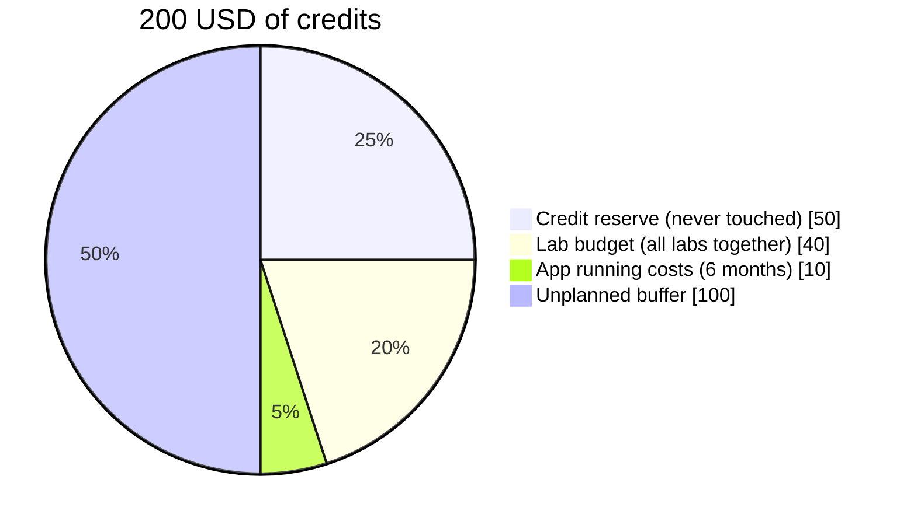
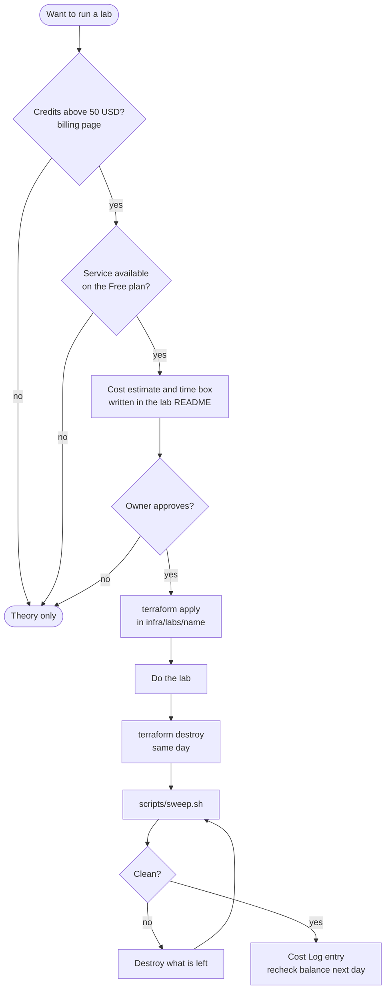

# I-11: Cost model, lab budget and credit reserve

- Status: Approved 2026-11-15
- Date: 2026-11-15
- Credits today: 200 USD. The account closes on 2027-05-11 or when credits reach zero.

## 1. Why we need this

On the Free plan, running out of credits does not create a bill. It closes the account,
and with it the project. So the risk is not a surprise bill, it is ending early.

Costs come from two places:

- **The app** (always on): almost all of it fits in the always-free limits, so it should
  cost cents per month.
- **Labs** (hourly services we try for a few hours, then destroy): this is where nearly
  all the spending happens, and where a forgotten resource can do damage.

All prices below are us-east-1 list prices as I know them, rounded up. They are
estimates. Before each lab, the owner checks the current price on the AWS pricing page
for that service (a web page, not the Cost Explorer API).

## 2. How the 200 USD is split

| Part | USD | What it is for |
|---|---|---|
| Credit reserve | 50 | Never spent on purpose. Covers mistakes (a forgotten load balancer for a month costs about 25 USD) and keeps the account open until the final export and destroy |
| Lab budget | 40 | The total for all labs. The estimate in section 4 is about 10 USD, so this leaves room for repeats and price surprises |
| App running costs | 10 | About 1 to 2 USD a month for the always-on app, rounded up |
| Unplanned buffer | 100 | Not allocated. It stays unspent unless a new lab is approved |

The rule from `CLAUDE.md`: **when remaining credits fall below 50 USD, all labs stop.**
Only the app and the final export and destroy may run after that.

## 3. The always-on app

| Service | What we use | Always-free limit | Expected cost a month |
|---|---|---|---|
| Lambda | A few thousand requests | 1 million requests, 400,000 GB-seconds | 0 |
| DynamoDB | Table 10/10 + GSI 5/5 capacity units, under 1 GB | 25 read + 25 write units, 25 GB | 0 |
| CloudFront | Small traffic | 1 TB out, 10 million requests | 0 |
| Cognito Lite | 1 to 3 users | 10,000 monthly active users | 0 |
| CloudWatch | Logs with 14-day retention, a few metrics | 5 GB logs, 10 metrics, 10 alarms | 0 |
| S3 | React build, CloudTrail logs, Terraform state; under 1 GB | Paid from credits on the Free plan | under 0.05 |
| ECR | 2 to 3 images of about 150 MB, lifecycle rule keeps the last 3 | Paid from credits | under 0.10 |
| CloudTrail | One trail, management events | First trail free | 0 |
| Parameter Store | Standard parameters | Free | 0 |
| Budgets | 2 budgets | Free | 0 |
| Public IPv4, NAT Gateway | None | | 0 |
| Route 53 (added 2026-11-21, domain switch) | One hosted zone for `tethrix.satrix.in`, a few thousand queries | Paid from credits; 0.50 USD per zone a month, 0.40 USD per million queries | 0.51 |
| **Total** | | | **about 1.00** (under 0.50 before the domain) |

The plan allows up to 2 USD a month, so there is room for growth. If the daily budget alert
(1 USD a day) ever fires while no lab is running, something is wrong: open
`docs/runbooks/emergency-cost-stop.md`.

## 4. Lab estimates

Each lab is time-boxed to a few hours and destroyed the same day. "Hours" is the planned
time the resources exist, not working time.

| Lab | Task | Costly parts | Hours | Estimate USD | Free plan check |
|---|---|---|---|---|---|
| KMS key | B8-03 | 1 key at 1 USD a month, charged by the hour; deletion waits at least 7 days | 7 days waiting | 1.00 | To check |
| WAF on CloudFront | B11-01 | Web ACL 5 USD a month + 1 USD per rule a month, charged by the hour | 4 | 0.20 | To check |
| GuardDuty, Security Hub, Inspector, Config | B11-02 | Free trials, if offered; Config charges per recorded item | 4 | 1.00 | To check (the G-12 sweep returned errors for the first three) |
| VPC + EC2 via SSM | B11-03 | t4g.micro, 8 GB disk, 1 public IPv4 (no NAT) | 4 | 0.10 | To check |
| Interface VPC endpoint | B11-04 | 0.01 USD an hour per endpoint per AZ, 1 AZ | 2 | 0.05 | To check |
| RDS PostgreSQL | B11-05 | db.t4g.micro, 20 GB, single AZ, private, no final snapshot | 4 | 0.20 | Likely (used in the G-03 credit activity) |
| ECS Fargate + ALB | B11-06 | ALB, 1 small arm64 task, public IPv4 on the ALB and task | 4 | 0.50 | To check |
| Lambda limits load test | B11-08 | Requests stay inside the free tier | 1 | 0 | Yes |
| Alarms and dashboard | O-01 | Within 10 free alarms and 3 free dashboards | always | 0 | Yes |
| X-Ray | O-03 | Within 100,000 free traces a month | always | 0 | To check |
| Backup and restore drill | O-08 | DynamoDB backup and restore, under 1 GB | 2 | 0.10 | To check |
| Repeats and mistakes | | One lab done twice, or left on overnight | | 5.00 | |
| **Total** | | | | **about 8** | |

The real risk is not the planned hours but forgetting to destroy. What each lab costs if
left running for a whole month:

| Left running for 30 days | About USD |
|---|---|
| ALB + Fargate task + public IPs | 30 |
| RDS db.t4g.micro + storage | 15 |
| WAF with 3 rules | 8 |
| EC2 t4g.micro + public IP | 10 |
| Interface endpoint, 1 AZ | 7 |

This is why the reserve is 50 USD: it survives even the worst single mistake, and the
daily budget alert should catch it within a day or two.

## 5. Before, during and after every lab

Each lab folder `infra/labs/<name>/` gets a short README with:

1. Free plan check: how it was confirmed (a dry run, an error message, or AWS docs).
2. Price per hour of each costly part, from the AWS pricing page, with the date.
3. Time box: the clock time it must be destroyed by.
4. Estimate, and the owner's approval with the date.
5. After: the destroy and sweep result, and the Cost Log row.

Labs have their own Terraform state, so destroying a lab can never touch the app.

## 6. How we track it

- **Cost Log** sheet in the tracker: one row per session that used credits, with the
  balance before and after (read from the billing page; usage can show up a day late).
- **Budgets** (G-07): monthly 10 USD and daily 1 USD, both ignoring credits, so they show
  real usage. They alert by email, hours late. A warning, not a safety switch.
- **Session sweep** (G-12): the real control, at the end of every session.
- **Monthly check**: on the first session of each month, the owner reads the credit
  balance and compares it with this plan. If spending runs ahead, labs are cut first (the
  cut order in `docs/project-plan.md`).

## 7. What is theory only for cost reasons

| Service | Why | Cost if we did it |
|---|---|---|
| NAT Gateway | About 33 USD a month plus data charges; never needed because Lambda is outside a VPC | 33+ a month |
| EKS | 0.10 USD an hour for the control plane alone, plus nodes; practised with kind locally | 75+ a month |
| Shield Advanced | 3,000 USD a month | 3,000 a month |
| Secrets Manager | 0.40 USD a secret a month; Parameter Store SecureString is free | small, but avoidable |
| Organizations, Control Tower | Not a cost issue: joining upgrades the account to the Paid plan permanently | |
