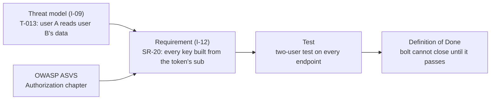

# I-12: Security requirements

- Status: Approved 2026-11-15
- Date: 2026-11-15
- Based on: OWASP ASVS 5.0 (a chosen subset), the threat model (I-09), ADR-0001 to ADR-0005

## 1. What this is

The threat model lists what can go wrong. This document turns that into rules the code
must follow, each with a test, so "secure" becomes something we can check.

OWASP ASVS (Application Security Verification Standard) is a public catalogue of about
350 such rules, grouped by topic. We do not need all of them. We pick the ones that match
our threats and our architecture.

Each requirement below has an ID (SR-xx), the threats it answers, how it is checked and
the bolt where it is built. A requirement is "met" only when its check passes.

## 2. Requirements

### Authentication (ASVS: Authentication, Session management, Token-based sessions)

| ID | Requirement | Threats | Check | Bolt |
|---|---|---|---|---|
| SR-01 | Every API route except `GET /health` needs a valid access token. Routes are protected by default, not one by one | T-001 | Test lists all routes and calls each without a token: expect 401 | B4 |
| SR-02 | JWT checks: signature from Cognito JWKS, algorithm RS256 only, issuer, expiry, `token_use = access`, `client_id` | T-001 | Tests with forged, expired, wrong-issuer, `alg: none` and ID tokens | B4 |
| SR-03 | Each request checks the user profile still exists; a deleted account gets 401 | T-027 | Unit test | B4 |
| SR-04 | Cognito: MFA required (TOTP only, no SMS), passwords 14+ characters, no self sign-up, Lite tier | T-003 | Terraform settings reviewed; checkov | B4 |
| SR-05 | Access token lifetime 60 minutes; refresh token 12 hours; sign-out revokes the refresh token | T-015, T-027 | Terraform settings; manual test | B4 |
| SR-06 | The local token mode refuses to start when running in Lambda, and Terraform never sets it | T-004 | Unit test sets the Lambda environment variable and expects start-up to fail | B4 |

### Authorization (ASVS: Authorization)

| ID | Requirement | Threats | Check | Bolt |
|---|---|---|---|---|
| SR-20 | The user ID comes only from the token's `sub`. Every DynamoDB key starts with `USER#`. No request field can choose the user | T-013 | Code review; Semgrep rule if possible | B4 onward |
| SR-21 | Asking for another user's item returns 404, the same as an item that does not exist | T-013 | Two-user test for every endpoint with an ID | B4 onward |
| SR-22 | Export reads only the caller's partition | T-019 | Two-user test | B9 |

### Input and output (ASVS: Validation and business logic, Encoding and sanitization)

| ID | Requirement | Threats | Check | Bolt |
|---|---|---|---|---|
| SR-30 | Every request body is checked by a Pydantic model: types, lengths and allowed values from I-03. Unknown fields are rejected | T-007 | Unit tests per endpoint | B5 onward |
| SR-31 | Request body limit: 128 KB for pages and journal entries (100 KB page limit from I-08, plus room for JSON), 16 KB for everything else | T-007, T-022 | Unit test with an oversized body: expect 413 | B3 |
| SR-32 | Lists are paginated, maximum 50 items per page | T-022 | Unit test | B5 onward |
| SR-33 | Page content is stored as editor JSON, checked against an allow-list of node types and marks. Raw HTML is never stored or rendered | T-006 | XSS payload test list against the API | B8 |
| SR-34 | Links in pages allow only `https:`, `http:` and `mailto:`. `javascript:` and `data:` are rejected | T-006 | Unit test | B8 |
| SR-35 | The frontend never uses `dangerouslySetInnerHTML` or `innerHTML` with user data | T-006 | Semgrep rule in CI | B5 onward |

### Errors and logging (ASVS: Security logging and error handling)

| ID | Requirement | Threats | Check | Bolt |
|---|---|---|---|---|
| SR-40 | One error handler. Errors use the format `{ "error": { "code", "message" } }`. A 500 shows no stack trace or internal detail | T-017 | Unit test raises an error and checks the response | B3 |
| SR-41 | One structured log line per request: time, request ID, user `sub`, method, path template, status, duration | T-012 | Log review | B3 |
| SR-42 | Request and response bodies are never logged. Journal and page text never reach logs, traces or error messages | T-014 | Test writes a journal entry with a marker string and checks captured logs do not contain it | B8 |
| SR-43 | Every CloudWatch log group has a retention period (14 days for the app) | T-014 | checkov | B3 |
| SR-44 | Tokens and secrets are never logged, not even partly | T-015 | Code review; log test | B4 |

### Data protection (ASVS: Data protection, Cryptography)

| ID | Requirement | Threats | Check | Bolt |
|---|---|---|---|---|
| SR-50 | HTTPS only: CloudFront redirects HTTP to HTTPS, TLS 1.2 minimum; S3 buckets deny non-TLS requests | T-018 | Terraform; checkov | B3 |
| SR-51 | Data encrypted at rest: DynamoDB default encryption, S3 SSE-S3. Journal encryption level decided by ADR in B8 | T-018 | Terraform; ADR | B3, B8 |
| SR-52 | Secrets, if any, live in Parameter Store SecureString, never in code, images or environment files in the repo | T-016 | gitleaks | B1 onward |
| SR-53 | The browser keeps the access token in memory and the refresh token in `sessionStorage`. Nothing sensitive in `localStorage` | T-015 | Code review | B4 |

### Browser security (ASVS: Web frontend security)

| ID | Requirement | Threats | Check | Bolt |
|---|---|---|---|---|
| SR-60 | CloudFront adds security headers to every response: CSP, HSTS, `X-Content-Type-Options: nosniff`, `Referrer-Policy`, `frame-ancestors 'none'` | T-006, T-020 | Header check with curl; ZAP baseline in B10 | B3 |
| SR-61 | CSP: scripts only from our own domain, no inline scripts, no `eval`; `connect-src` only our domain and Cognito | T-006, T-015 | Header check; browser console shows no violations | B3, B8 |
| SR-62 | The API only accepts requests through CloudFront (function URL with `AWS_IAM` + OAC) | T-002 | Direct call to the function URL returns 403 | B3 |

### Infrastructure and AWS (ASVS: Configuration, plus our own rules)

| ID | Requirement | Threats | Check | Bolt |
|---|---|---|---|---|
| SR-70 | Lambda role: only the DynamoDB actions the app uses, on our table and its index ARNs. No `*` without an ADR | T-024 | Access Analyzer `validate-policy`; review | B3 |
| SR-71 | GitHub OIDC: roles trusted only for this repo; the apply role only for the protected `production` environment. Separate plan (read-only) and apply roles | T-005, T-025 | Policy review; Access Analyzer | B6 |
| SR-72 | Cap how many copies of the Lambda can run at once (target 5). New accounts often have an account limit of 10, which already caps a flood; reserved concurrency is set only if the quota allows it | T-021 | Owner checks the quota with `aws lambda get-account-settings`; Terraform | B3 |
| SR-73 | All infrastructure in Terraform; tflint and checkov pass, skips written with reasons | T-009, T-023 | CI gate | B1 onward |

### Supply chain (ASVS: Configuration, Secure coding and architecture)

| ID | Requirement | Threats | Check | Bolt |
|---|---|---|---|---|
| SR-80 | Every dependency pinned to an exact version with a lockfile; base images pinned by digest | T-008 | Review; Trivy | B1 onward |
| SR-81 | Before adding a package: check it exists, is the real one (name, publisher, downloads) and is maintained | T-008 | Noted in the bolt journal | B1 onward |
| SR-82 | CI runs gitleaks, Semgrep, pip-audit, npm audit, Trivy, tflint and checkov. A High or Critical finding fails the build unless logged and accepted in the findings log | T-008, T-016 | CI gate | B1, B6 |
| SR-83 | GitHub Actions pinned by commit SHA, not by tag | T-008 | Review | B6 |

## 3. What we leave out, and why

| ASVS area | Why not |
|---|---|
| Self sign-up, password reset flows we build ourselves | Cognito handles them; no public sign-up (I-01) |
| File upload rules | Attachments are only "if time allows"; added if that bolt happens |
| Multi-tenant admin roles | One role per user, no admin screens in the app |
| Hardware-backed keys, KMS key rotation | KMS costs money; the journal ADR in B8 decides |
| WebSockets, GraphQL, SAML | Not used |

## 4. How this is used

- Each bolt design lists the SR IDs it will meet.
- The bolt cannot close until those checks pass (Definition of Done).
- A requirement we cannot meet goes to `docs/security/findings-log.md` with a reason.
- Coverage is tracked here:

| Bolt | Requirements |
|---|---|
| B1 | SR-52, SR-73, SR-80, SR-81, SR-82 |
| B3 | SR-31, SR-40, SR-41, SR-43, SR-50, SR-51, SR-60, SR-61, SR-62, SR-70, SR-72 |
| B4 | SR-01 to SR-06, SR-20, SR-21, SR-44, SR-53 |
| B5 onward | SR-30, SR-32, SR-35 |
| B6 | SR-71, SR-82, SR-83 |
| B8 | SR-33, SR-34, SR-42, SR-51 |
| B9 | SR-22 |
