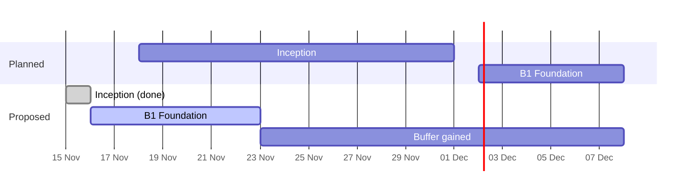

# I-13: Bolt plan, refined

- Status: Approved 2026-11-15
- Date: 2026-11-15
- Based on: I-01 to I-12

## 1. Why refine the plan

The task list was written before Inception. Inception made decisions that change some
tasks: no public sign-up, a 100 KB page limit, security requirements with IDs, and a
lab process with a reserve. This document lists the changes, then the tracker is updated
to match.

## 2. The bolts at a glance

Each bolt builds on the one before it. Nothing moves on without approval.

```mermaid
flowchart LR
  B1[B1 Foundation<br/>repo, scanners, CI] --> B2[B2 Local dev<br/>Docker Compose]
  B2 --> B3[B3 Walking skeleton<br/>first deploy]
  B3 --> B4[B4 Auth<br/>Cognito, JWT, IDOR tests]
  B4 --> B5[B5 Todos]
  B5 --> B6[B6 CI/CD<br/>OIDC, gated apply]
  B6 --> B7[B7 Habits]
  B7 --> B8[B8 Journal + Pages<br/>XSS defences]
  B8 --> B9[B9 Dashboard + export]
  B9 --> B10[B10 Attachments + reminders<br/>cut first if late]
  B10 --> B11[B11 Hardening labs]
  B11 --> Ops[Operations]
```

| Bolt | First deploy to AWS? | Security requirements (I-12) | Costly labs |
|---|---|---|---|
| B1 Foundation | No | SR-52, SR-73, SR-80, SR-81, SR-82 | None |
| B2 Local dev | No | SR-80 (images by digest) | None |
| B3 Walking skeleton | Yes | SR-31, SR-40, SR-41, SR-43, SR-50, SR-51, SR-60, SR-61, SR-62, SR-70, SR-72 | None |
| B4 Auth | Yes | SR-01 to SR-06, SR-20, SR-21, SR-44, SR-53 | None |
| B5 Todos | Yes | SR-30, SR-32, SR-35 | None |
| B6 CI/CD | Yes | SR-71, SR-82, SR-83 | None |
| B7 Habits | Yes | SR-20, SR-21, SR-30 (same rules, new endpoints) | None |
| B8 Journal + Pages | Yes | SR-33, SR-34, SR-42, SR-51 | KMS key (about 1 USD) |
| B9 Dashboard + export | Yes | SR-22 | None |
| B10 Attachments + reminders | Yes | File rules added when the bolt starts | None |
| B11 Hardening labs | Labs only | | About 2 USD in total |

The app itself costs cents a month (I-11). Only B8-03 and B11 use paid hourly services.

## 3. Changes to tasks

| Task | Before | After | Why |
|---|---|---|---|
| B1-10 | (new) | Lab README template in `infra/labs/` | I-11 lab process |
| B1-11 | (new) | Semgrep custom rules: no `dangerouslySetInnerHTML` (SR-35), no user ID from the request (SR-20) | Catch the two biggest app risks automatically |
| B2-05 | Local table creation and seed script | Local table creation (I-08 design) and seed data for two users | Two users needed for IDOR tests |
| B3-02 | Lambda module: container + Web Adapter, least-privilege role, log retention | Add: concurrency cap after checking the account quota (SR-72) | Moved here from B11-08: a cap should exist from the first deploy |
| B4-03 | Frontend sign-up, sign-in, sign-out, token storage decision | Frontend sign-in and sign-out with hosted sign-in and PKCE | No public sign-up (I-01); token storage already decided (ADR-0003) |
| B4-08 | (new) | Runbook: admin creates, disables and deletes user accounts with the CLI | Accounts are admin-only (I-01, US-01 to US-04). Users are data, not infrastructure, so CLI is allowed |
| B8-05 | Pages API: JSON document storage, 400 KB limit strategy | Pages API: editor JSON storage, 100 KB limit (I-08) | Limit decided in I-08 |
| B11-08 | Lambda limits: concurrency cap, timeouts, throttling | Load test: see throttling and the budget alert in action | The cap itself moved to B3-02 |
| B11 labs | No notes | Each lab notes "Free plan check: to do" | I-11: check before every lab |

No tasks are removed. The cut order stays: B10 first, then the RDS and ECS labs in B11.

## 4. Schedule

Inception was planned for 2026-11-18 to 12-01 and finished early. Proposal: start B1 as
soon as Inception is approved, and keep every later end date the same. The extra two weeks
become buffer for B8 (the largest bolt) and for labs that need a second try.

## 5. Open items carried into Construction

| Item | When |
|---|---|
| F-004: owner confirms the security contact | Any time |
| F-008: security alerts, kept as theory | Revisit in O-01 |
| Free plan check for GuardDuty, Security Hub, Inspector | Before B11-02 |
| Editor library ADR: TipTap vs BlockNote | B8 |
| Journal encryption ADR | B8 |
| App name | Any time |
