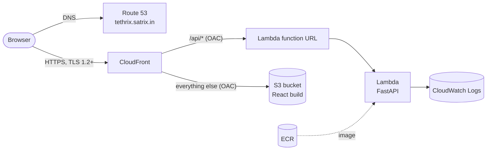

# Manual deploy and smoke test

- Tasks: B3-07, B3-08
- Design: `docs/bolts/B3-walking-skeleton.md`; ADR-0002, ADR-0004, ADR-0006

## Purpose

Put the app on AWS at `https://tethrix.satrix.in` by hand, and prove that it works and
that every way around CloudFront is closed. B6 automates the same steps in GitHub
Actions; doing them by hand once first makes the pipeline easy to follow.

## When to use it

- The first deploy: every step, in order.
- Later deploys by hand: steps 4, 5, 6 and 7 only.

## What gets built



## Cost

About 0.55 USD a month (B3 design, section 7): 0.50 USD for the hosted zone, a few cents
for ECR. Nothing is hourly, so nothing is destroyed at the end of the session; this is
the always-on app.

## Prerequisites

- The B3 pull request with the Terraform is merged, and you are on an up-to-date `main`:
  `git switch main && git pull`.
- `export AWS_PROFILE=admin` in this terminal (and `aws login` if the session expired).
- Docker Desktop is running.
- Free plan check done and written in section 8 below: CloudFront Functions, Route 53
  and ACM (Lambda, DynamoDB, S3, CloudFront and ECR were checked in I-11).
- Access to the DNS settings of `satrix.in` at its DNS provider (needed in step 3).
- Concurrency limit: 10 (checked 2026-11-20). With 10, no reservation is possible, so
  `lambda_reserved_concurrency` stays -1 and the account limit is the cap (SR-72).

## Steps

### Step 1: connect Terraform to its state (first time only)

```sh
cp infra/app/backend.hcl.example infra/app/backend.hcl
# edit infra/app/backend.hcl: replace ACCOUNT_ID (git ignores this file)
terraform -chdir=infra/app init -backend-config=backend.hcl
```

Why: the app stack keeps its state in the bucket from `infra/bootstrap`, under its own
key `app/terraform.tfstate`.

### Step 2: create only the ECR repository and the DNS zone (first time only)

```sh
terraform -chdir=infra/app plan -target=module.ecr -target=aws_route53_zone.app -out=tfplan
terraform -chdir=infra/app apply tfplan
terraform -chdir=infra/app output name_servers
```

Expected: the plan creates 3 resources (repository, lifecycle rule, hosted zone).
Terraform warns that `-target` is not for routine use. That is right; this is the one
exception.

Why two applies: Lambda cannot be created before its image exists in ECR, and the
certificate cannot be validated before the parent domain points at our zone. This step
creates exactly the two things the others wait for.

### Step 3: hand the subdomain to Route 53 (first time only)

At the DNS provider of `satrix.in`, add four records:

| Type | Name (host) | Value | TTL |
|---|---|---|---|
| NS | `tethrix` | first name server from step 2 | 3600 |
| NS | `tethrix` | second | 3600 |
| NS | `tethrix` | third | 3600 |
| NS | `tethrix` | fourth | 3600 |

Some providers want the name as `tethrix`, others as `tethrix.satrix.in`; both mean the
same. Do not change any other record of `satrix.in`.

Then wait until the internet sees it:

```sh
dig +short NS tethrix.satrix.in @1.1.1.1
```

Expected: the four `awsdns` names. This usually takes minutes, sometimes an hour.

Why: this is "delegation". The parent keeps answering for everything else; for
`tethrix` and anything under it, it now says "ask Route 53". From here on every record
is in Terraform.

### Step 4: build, scan and push the backend image

```sh
make push-backend
```

Expected: a build, a Trivy scan with no findings, a push, and a last line with the next
command. It refuses to run with uncommitted changes, because the tag is the commit ID.

Remember the tag for the next steps:

```sh
export TF_VAR_backend_image_tag=$(git rev-parse HEAD)
```

Terraform reads any `TF_VAR_<name>` environment variable as that variable, so later
commands in this terminal need no `-var`.

### Step 5: create everything else

```sh
terraform -chdir=infra/app plan -out=tfplan
terraform -chdir=infra/app apply tfplan
```

Read the plan before applying. Expected for the first deploy: around 30 resources to
add, 0 to change, 0 to destroy. Things to look for: the Lambda image ends with your
commit ID; the function URL has `authorization_type = "AWS_IAM"`; the distribution has
`minimum_protocol_version = "TLSv1.2_2021"`.

The apply takes 5 to 15 minutes: the certificate waits for DNS validation, and
CloudFront copies the distribution to its edge locations.

### Step 6: publish the React files

```sh
make publish-frontend
```

Expected: build, upload, and `InProgress` for the invalidation (it finishes within a
minute or two).

### Step 7: smoke and negative tests

```sh
make smoke
```

Expected: every line `PASS`, and `Failed: 0`. The tests are in `scripts/smoke.sh`; each
line says what it checks. They include the negative tests of B3-07: the function URL and
the bucket answer 403 when called directly, plain HTTP is redirected, TLS 1.1 is
refused, a POST without the body hash is refused, and a 17 KB body gets 413.

Then by hand:

1. Open https://tethrix.satrix.in. Expected: the dashboard with "API: ok".
2. Open the browser's developer tools, Console tab. Expected: no CSP errors.
3. Look at the API's log lines:

   ```sh
   aws logs tail "$(terraform -chdir=infra/app output -raw lambda_log_group)" --since 15m
   ```

   Expected: one JSON line per request, with a request ID, the path template and the
   status; no bodies, no headers.

### Step 8: check the Lambda role's policy (SR-70)

```sh
role=$(terraform -chdir=infra/app output -raw lambda_role_name)   # productivity-app-api-role
aws iam get-role-policy --role-name "$role" --policy-name "${role%-role}-permissions" \
  --query PolicyDocument --output json > /tmp/lambda-policy.json
aws accessanalyzer validate-policy --policy-type IDENTITY_POLICY \
  --policy-document file:///tmp/lambda-policy.json --query 'findings[].[findingType,issueCode]'
rm /tmp/lambda-policy.json
```

Expected: an empty list `[]`. The policy allows only writing to the function's own log
group.

### Step 9: confirm Terraform and AWS agree

```sh
terraform -chdir=infra/app plan
```

Expected: `No changes.`

### Step 10: record it

- Section 8 below: date, commit ID (the first 7 characters are enough), smoke result.
- Cost Log in the tracker: "B3 first deploy, always-on app, about 0.55 USD a month".
- `make sweep`: the new resources show up, all tagged `Stack = app`.

Never paste Terraform outputs into docs: the ECR address and the bucket name contain
the account ID.

## Problems

| Problem | What to do |
|---|---|
| Step 5 waits a long time at `aws_acm_certificate_validation`, then fails | The NS records from step 3 are missing or not visible yet. Check with `dig` as in step 3, then run step 5 again |
| `Error: No image yet` | `TF_VAR_backend_image_tag` is not set in this terminal. Run the `export` from step 4 |
| `make push-backend` says the tag already exists | Tags are immutable. The image for this commit is already in ECR, so skip the push and use the same tag |
| Lambda says the image manifest or media type is not supported | Docker added an index or attestation the image format Lambda reads does not expect. Check that `--provenance=false --sbom=false` are in the build line; note it in section 8 and ask Claude |
| API calls answer 502 | Lambda started but the app did not. `aws logs tail` (step 7) shows why; a wrong architecture shows as `exec format error` |
| API calls answer 403 through CloudFront | The OAC permission or the body hash. A GET failing means the permissions (step 5 plan); only POST failing means the hash |
| The page loads but the API status says "unreachable" | Look at the browser console for a CSP error, and at the Network tab for the status of `/api/v1/health` |
| The old page still shows after `make publish-frontend` | Wait for the invalidation, then reload without the cache (Shift + reload) |

## Undo

Not part of a normal session: the app is always on. To take everything down
(`terraform destroy`), the order matters because of subdomain takeover (T-032):

1. Remove the four NS records for `tethrix` at the provider of `satrix.in` first.
2. Then `terraform -chdir=infra/app apply -var final_destroy=true` (turns off deletion
   protection), then `terraform -chdir=infra/app destroy`.

If the zone were destroyed while the NS records still existed, someone else could
create a Route 53 zone that happens to get the same name servers and serve their own
content as `tethrix.satrix.in`.

## Record of deploys

| Date | Commit | Smoke result | Notes |
|---|---|---|---|
| | | | |

Free plan check (first deploy):

| Service | How it was confirmed | Result |
|---|---|---|
| CloudFront Functions | | |
| Route 53 | | |
| ACM | | |
