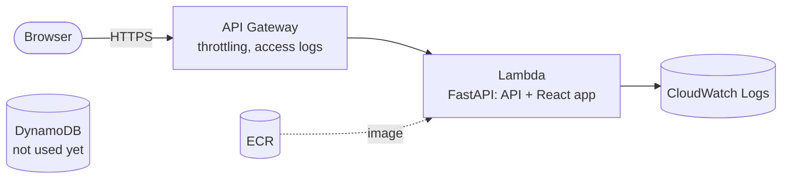

# Manual deploy and smoke test

- Tasks: B3-07, B3-08
- Design: `docs/bolts/B3-walking-skeleton.md` (sections 12 to 14); ADR-0004, ADR-0006,
  ADR-0007

## Purpose

Put the app on AWS by hand, and prove that it works and that the side doors are closed.
B6 automates the same steps in GitHub Actions; doing them by hand once first makes the
pipeline easy to follow.

Where the app lives: API Gateway's own address
`https://<id>.execute-api.us-east-1.amazonaws.com` for now, because `satrix.in` is on
hold at the registrar (`use_custom_domain = false`). Once the hold is lifted, "Adding
the domain" below moves it to `https://tethrix.satrix.in`.

## When to use it

- The first deploy: every step, in order.
- Later deploys by hand: steps 3, 4 and 5.

## What gets built



## Cost

Cents a month: API Gateway about 1 USD per million requests, ECR a few cents for the
images. Route 53 adds 0.50 USD a month once the domain is on. Nothing is hourly, so
nothing is destroyed at the end of a session; this is the always-on app.

## Prerequisites

- The pull request with the API Gateway change is merged, and you are on an up-to-date
  `main`: `git switch main && git pull`.
- `export AWS_PROFILE=admin` in this terminal (and `aws login` if the session expired).
- Docker Desktop is running.
- Concurrency limit: 10 (checked 2026-11-20), so `lambda_reserved_concurrency` stays -1
  and the account limit is the cap (SR-72).

## Steps

### Step 1: connect Terraform to its state (first time only)

Done on 2026-11-20. For a new laptop:

```sh
cp infra/app/backend.hcl.example infra/app/backend.hcl
# edit infra/app/backend.hcl: replace ACCOUNT_ID (git ignores this file)
terraform -chdir=infra/app init -backend-config=backend.hcl
```

### Step 2: create only the ECR repository (first time only)

Done on 2026-11-20. For the record:

```sh
terraform -chdir=infra/app plan -target=module.ecr -out=tfplan
terraform -chdir=infra/app apply tfplan
```

Why: Lambda cannot be created before its image exists in ECR, and the repository is in
the same stack. `-target` is for exceptions like this one only.

### Step 3: build the app into the image, scan it, push it

```sh
make push-backend
export TF_VAR_backend_image_tag=$(git rev-parse HEAD)
```

Expected: the React files are built, then the backend image (with the React files
inside) is built for arm64, scanned by Trivy with no findings, and pushed. It refuses to
run with uncommitted changes, because the tag is the commit ID.

The `export` line tells Terraform which image to run: Terraform reads any
`TF_VAR_<name>` environment variable as that variable.

### Step 4: create or update everything else

```sh
terraform -chdir=infra/app plan -out=tfplan
terraform -chdir=infra/app apply tfplan
```

Read the plan before applying.

First apply after the switch from CloudFront (2026-11-20): the plan also destroys what
the stopped CloudFront apply had created. Expect to see destroyed: the CloudFront origin
access controls, the CloudFront function, the response headers policy, the frontend
bucket and its settings, and the Lambda function URL (only those that were created).
Expect to see created: the API, its integration, route, stage, access log group, and the
Lambda permission. The Lambda function itself is updated in place (new image) or
created, not replaced. Nothing in `module.ecr` or `module.table` may be destroyed or
replaced; if it is, stop and ask.

Later deploys: only the Lambda image changes.

### Step 5: smoke and negative tests

```sh
make smoke
terraform -chdir=infra/app output -raw app_url
```

Expected: every line `PASS`, `Failed: 0`. `INFO` lines are notes, not failures: while
the domain is off, the TLS 1.1 check is reported for the record only, and the default
address is the app's address.

The tests are in `scripts/smoke.sh`; each line says what it checks: the page, a script
file and the API with their security headers and caching, a POST, the 413 for a 17 KB
body, a refused path outside the static folder, and no plain HTTP.

Then by hand:

1. Open the `app_url` address. Expected: the dashboard with "API: ok". The first visit
   after a while takes a few seconds (cold start).
2. Developer tools, Console tab: no CSP errors.
3. Logs:

   ```sh
   aws logs tail "$(terraform -chdir=infra/app output -raw lambda_log_group)" --since 15m
   aws logs tail "$(terraform -chdir=infra/app output -raw api_access_log_group)" --since 15m
   ```

   Expected: the app's JSON line per request (request ID, path template, status; no
   bodies, no headers), and API Gateway's line per request (time, IP, method, path,
   status, latency).

### Step 6: check the Lambda role's policy (SR-70)

```sh
role=$(terraform -chdir=infra/app output -raw lambda_role_name)   # productivity-app-api-role
aws iam get-role-policy --role-name "$role" --policy-name "${role%-role}-permissions" \
  --query PolicyDocument --output json > /tmp/lambda-policy.json
aws accessanalyzer validate-policy --policy-type IDENTITY_POLICY \
  --policy-document file:///tmp/lambda-policy.json --query 'findings[].[findingType,issueCode]'
rm /tmp/lambda-policy.json
```

Expected: `[]`. The policy only allows writing to the function's own log group.

### Step 7: confirm Terraform and AWS agree

```sh
terraform -chdir=infra/app plan
```

Expected: `No changes.`

### Step 8: record it

- "Record of deploys" below: date, the first 7 characters of the commit, smoke result.
- Cost Log in the tracker: "B3 first deploy, always-on app, cents a month".
- `make sweep`: the new resources show up, all tagged `Stack = app`.

Never paste Terraform outputs into docs: the ECR and execute-api addresses identify the
account.

## Adding the domain

When `dig +short NS satrix.in` shows the two `domaincontrol.com` names again:

1. Claude changes the default of `use_custom_domain` to `true` in a pull request; you
   merge it, so `main` keeps matching what runs.
2. Create the zone first:

   ```sh
   terraform -chdir=infra/app plan -target=aws_route53_zone.app -out=tfplan
   terraform -chdir=infra/app apply tfplan
   terraform -chdir=infra/app output name_servers
   ```

3. At GoDaddy, DNS tab of `satrix.in`, add four records: type `NS`, name `tethrix`,
   one per name server from step 2, TTL 1 hour. Do not touch the separate
   "Nameservers" section. Wait until
   `dig +short NS tethrix.satrix.in @1.1.1.1` shows the four `awsdns` names.
4. `terraform -chdir=infra/app plan -out=tfplan` and apply: certificate, the API's
   custom domain with TLS 1.2, the records, and the default execute-api address is
   switched off.
5. `make smoke`: now the TLS 1.1 check and the "default address is off" check run and
   must pass.

## Problems

| Problem | What to do |
|---|---|
| `Error: No image yet` | `TF_VAR_backend_image_tag` is not set in this terminal. Run the `export` from step 3 |
| `make push-backend` says the tag already exists | Tags are immutable: the image for this commit is already in ECR. Skip the push, use the same tag |
| Lambda says the image manifest or media type is not supported | Check that `--provenance=false --sbom=false` are in the build line; note it below and ask Claude |
| The page answers 500 or `Internal Server Error` | `aws logs tail` on the Lambda log group (step 5). `STATIC_DIR ... index.html does not exist` means the image was built without the React files: use `make push-backend`, not a plain `docker build` |
| `{"message":"Internal Server Error"}` (API Gateway's own wording) | API Gateway could not call Lambda: check the access log's `integrationErr` field, then the Lambda permission in the plan |
| `{"message":"Too Many Requests"}` | Throttling (10 a second, bursts of 20) did its job. Wait a moment |
| The certificate waits a long time, then fails (domain step 4) | The NS records are missing or not visible yet. Check with `dig`, then apply again |

## Undo

Not part of a normal session: the app is always on. To take everything down:

1. With the domain: remove the four NS records for `tethrix` at GoDaddy first
   (subdomain takeover, T-032).
2. `terraform -chdir=infra/app apply -var final_destroy=true` (turns off deletion
   protection), then `terraform -chdir=infra/app destroy`.

## Record of deploys

| Date | Commit | Smoke result | Notes |
|---|---|---|---|
| 2026-11-20 | e1c08a7 | Not reached | First apply stopped at the CloudFront distribution (account needs a payment method and the Paid plan for CloudFront). Switched to API Gateway (ADR-0007) |

Free plan check:

| Service | How it was confirmed | Result |
|---|---|---|
| CloudFront | Apply refused; AWS Support: needs a payment method and the Paid plan for this account | Not available to us (ADR-0007) |
| API Gateway, Route 53, ACM, Lambda, ECR, DynamoDB, CloudWatch | AWS docs, "Supported AWS services for Sign up for AWS (new)", checked 2026-11-20 | Listed as Free Tier services |
