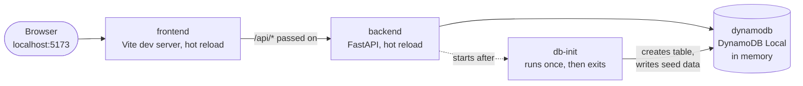

# Local development

- Tasks: B2-01 to B2-06
- Design: `docs/bolts/B2-local-dev.md`

## Purpose

Run the app on the laptop with Docker Compose, and run its checks. Nothing here touches
AWS and nothing costs money.

## When to use it

Every time you work on the app.

## Prerequisites

- Docker Desktop is running.
- You are in the repo folder.

## What runs



| Container | What it is | Address on the laptop |
|---|---|---|
| `frontend` | The React app on Vite's dev server. The page updates by itself when a file in `app/frontend/src` changes | http://localhost:5173 |
| `backend` | Our FastAPI app, restarting itself when a file in `app/backend/src` changes | http://localhost:8080 |
| `dynamodb` | DynamoDB Local | http://localhost:8000 |
| `db-init` | Creates the table and the seed data, then stops | none |
| `oidc` | The local stand-in for Cognito (`mock-oauth2-server`). Its sign-in page asks only for a user name | http://localhost:8090 |

The browser only ever talks to `localhost:5173`. Requests to `/api/...` are passed on to
the backend by Vite, the same way CloudFront will do it in AWS.

## Start, look, stop

1. Start: `make up`. It builds the images first; the first build downloads the packages.
2. Open http://localhost:5173. The dashboard shows "API: ok". Stop the backend with
   `docker compose stop backend`, reload the page and it shows "API: unreachable";
   `make up` starts it again.
3. Check the API answers, directly and through the frontend's proxy:

   ```sh
   curl -i http://localhost:8080/api/v1/health
   curl -i http://localhost:5173/api/v1/health
   ```

   Expected: `HTTP/1.1 200 OK`, a header `x-request-id`, and `{"status":"ok"}`.
4. See the log line that request wrote: `make logs` (Ctrl-C stops watching, not the
   app). Each line is one JSON object. Find the one with `"message": "request"`.
5. See what is running: `make ps`.
6. Stop: `make down`.

## Signing in locally

Since B4 every API route except health and `/api/v1/auth/config` needs a sign-in.
Locally the sign-in goes to the `oidc` container instead of Cognito: same flow (code with
PKCE), same token checks in the backend, but the sign-in page only asks for a user name.

- Type `alice` or `bob`: the two seed users, each with a profile.
- Any other name signs in at the server but the backend answers 401: there is no profile
  for it. That is the deleted-account check (SR-03) working.
- The frontend sign-in arrives in B4 pull request 2. Until then, get a token by hand:

  ```sh
  TOKEN=$(scripts/local-token.py alice)
  curl -H "Authorization: Bearer $TOKEN" http://localhost:8080/api/v1/me
  ```

The backend runs with `AUTH_MODE=local` (set in `compose.yaml`). In Lambda the app
refuses to start with that setting (SR-06).

## The local database

It lives in memory. `make down` or `make reset-db` empties it, and the next start loads
the seed data again: two made-up users, Alice and Bob, each with a profile and a few
todos.

To look inside, use the AWS CLI against the local address. The profile is not used; the
fake key only stops the CLI from complaining:

```sh
AWS_ACCESS_KEY_ID=local AWS_SECRET_ACCESS_KEY=local \
aws dynamodb scan --table-name productivity-app-data \
  --endpoint-url http://localhost:8000 --region us-east-1 \
  --query 'Items[].[PK.S, SK.S, title.S]' --output table
```

Always pass `--endpoint-url` here. Without it the command goes to real AWS.

## Checks

| Command | What it does |
|---|---|
| `make lint-backend` | ruff (format and lint) and mypy |
| `make test-backend` | pytest, including the tests against DynamoDB Local |
| `make audit-backend` | pip-audit on the locked packages |
| `make lint-frontend` | Prettier check, ESLint and the TypeScript type check |
| `make test-frontend` | Vitest |
| `make audit-frontend` | npm audit; fails on High or Critical |
| `make hadolint` | Dockerfile lint |
| `make image-scan` | Builds the backend `runtime` and frontend `static` images and scans them with Trivy. Building `static` also runs the production build |
| `make check` | All of the above plus the B1 scanners: the same as CI |
| `make fmt-backend`, `make fmt-frontend` | Format the code |

## Adding or updating a Python package

1. Go through the checklist in `docs/dependency-policy.md`, section 2.
2. Add it to `app/backend/pyproject.toml` with an exact version (`name==1.2.3`).
3. `make lock` rewrites `uv.lock`.
4. `make up` rebuilds the image with the new package.
5. `make check`, then commit `pyproject.toml` and `uv.lock` together.

`exclude-newer = "7 days"` in `pyproject.toml` stops uv from choosing anything published
in the last week, so a version newer than that cannot be locked yet.

## Adding or updating an npm package

1. Go through the checklist in `docs/dependency-policy.md`, section 2.
2. Add it to `app/frontend/package.json` with an exact version (no `^` or `~`).
3. `make lock-frontend` rewrites `package-lock.json`. Nothing is installed on the laptop.
4. `make up` rebuilds the image with the new package.
5. `make check`, then commit `package.json` and `package-lock.json` together.

`app/frontend/.npmrc` switches install scripts off and makes npm ignore versions newer
than 7 days.

There is no `node_modules` folder on the laptop: the packages live inside the image.
An editor that wants them for autocompletion can get a local copy with
`cd app/frontend && npm ci`; git ignores the folder.

## Problems

| Problem | What to do |
|---|---|
| `Cannot connect to the Docker daemon` | Start Docker Desktop |
| `port is already allocated` | Something else uses 8080 or 8000. `make down`, or find it with `lsof -i :8080` |
| The image build hangs on a `Downloading ...` line | Seen on 2026-11-15: this network's IPv4 route to PyPI's file server is very slow (0.5 MB in 40 seconds, against 15 MB in 5 seconds over IPv6), and Docker's default network has no IPv6. Fix: a file `local.mk` in the repo folder with the line `BUILD_NETWORK := host`. Builds then use the host network, which has IPv6. Git ignores `local.mk`, so the setting stays on this laptop. If `make lock` stalls the same way, run `cd app/backend && uv lock` on the laptop instead |
| `make audit-backend` fails with `Read timed out` | The same network problem, while pip-audit asks PyPI about vulnerabilities. Run it again |
| DynamoDB Local answers 500 and its log says `failed to map segment` | Its `/tmp` must allow running code. `compose.yaml` sets `tmpfs: /tmp:exec` for it; do not remove that |
| `ENOENT ... mkdir '/app/node_modules/.vite-temp'` | Vite was started without `--configLoader runner`. The container's file system is read-only; use the `make` targets or the `npm run` scripts, which pass the flag |
| A code change does not show | `make logs` and look for a reload line or a Python error |
| `uv sync` fails with "lockfile needs to be updated" | `pyproject.toml` was changed without `make lock` |
| Every signed-in request answers 401 after restarting only `oidc` | The local server makes new signing keys at each start, and the backend keeps the old ones. `make down && make up` |
| `make lint` fails with "Local-only settings found in Terraform" | A `.tf` file sets `AUTH_MODE`, `LOCAL_OIDC_*` or `DYNAMODB_ENDPOINT_URL`. Remove it: those are laptop-only |

## Undo

`make down` removes the containers. To also remove the built images:
`docker image rm productivity-app-backend:dev productivity-app-backend:runtime productivity-app-frontend:dev productivity-app-frontend:static`.
