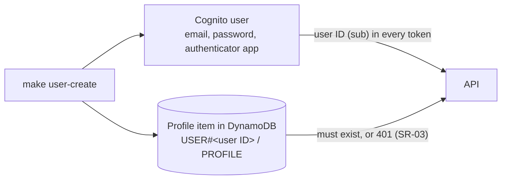

# User accounts

- Task: B4-08
- Design: `docs/bolts/B4-auth.md`; ADR-0003; I-01 (only the admin creates accounts)

## Purpose

Create, disable and delete the people who can sign in. There is no public sign-up: every
account starts here.

Each account is two things, and both are needed:



The API checks the profile on every request. That is what makes deleting an account
take effect at once, even for an access token that has not expired yet.

## When to use it

- After the first B4 deploy: create your own account.
- Whenever someone needs access, loses their authenticator app, or leaves.

## Cost

Nothing: Cognito Lite is free up to 10,000 monthly users; one DynamoDB item per user.

## Prerequisites

- `export AWS_PROFILE=admin` (and `aws login` if the session expired).
- Terraform state is reachable (`terraform -chdir=infra/app output` works): the targets
  read the pool ID and the table name from the outputs.
- Users are data, not infrastructure, so these are CLI calls (I-13). Email addresses are
  typed on the command line only; never put them in the repo, an issue or a commit.

## Create an account

```sh
make user-create EMAIL=you@example.com TZ=Asia/Kolkata
```

Expected: "Created the Cognito user. User ID: ..." and "Created the profile". Cognito
emails a temporary password from `no-reply@verificationemail.com` (check spam). It is
valid for 3 days.

First sign-in, in the browser at the app's address:

1. Sign in with the email and the temporary password.
2. Set a new password: at least 14 characters with upper and lower case, a number and
   a symbol.
3. Set up the authenticator app: scan the QR code (Google Authenticator, Microsoft
   Authenticator, 1Password and so on), then type the 6-digit code.
4. The app's dashboard shows "Your time zone: Asia/Kolkata" and your email in the menu.

Time zones use the standard names (`Asia/Kolkata`, `Europe/London`, `UTC`).

## Disable an account

```sh
make user-disable EMAIL=someone@example.com
```

Stops new sign-ins and revokes their refresh tokens. An access token already issued can
still work for up to 60 minutes (T-027). Undo with
`aws cognito-idp admin-enable-user --user-pool-id <pool> --username <email>`.

## Delete an account

```sh
make user-delete EMAIL=someone@example.com
```

Deletes the profile first (from that moment the API refuses the user's tokens), then the
Cognito user. From B10 it will also delete all of the user's data; until then, items
under their user ID stay in the table.

## Lost authenticator app

```sh
pool=$(terraform -chdir=infra/app output -raw cognito_user_pool_id)
aws cognito-idp admin-set-user-mfa-preference --user-pool-id "$pool" \
  --username someone@example.com --software-token-mfa-settings Enabled=false,PreferredMfa=false
```

At the next sign-in Cognito asks them to set up an authenticator app again (MFA stays
required for the pool).

## Problems

| Problem | What to do |
|---|---|
| `UsernameExistsException` | The account exists. Use it, or delete it first |
| `ConditionalCheckFailedException` on the profile | A profile with that user ID already exists; nothing was overwritten |
| No email arrives | Check spam. Cognito's built-in sender allows only a few emails a day; wait and use `aws cognito-idp admin-create-user ... --message-action RESEND` |
| Signed in at Cognito, but the app says "Sign in to continue" or loops | The profile is missing: `aws dynamodb get-item` for `USER#<user ID>` / `PROFILE`; recreate it with the `put-item` line from `scripts/user.sh` |
| The temporary password expired | `aws cognito-idp admin-create-user --user-pool-id <pool> --username <email> --message-action RESEND` |

## Undo

Delete the accounts created for testing with `make user-delete`.
