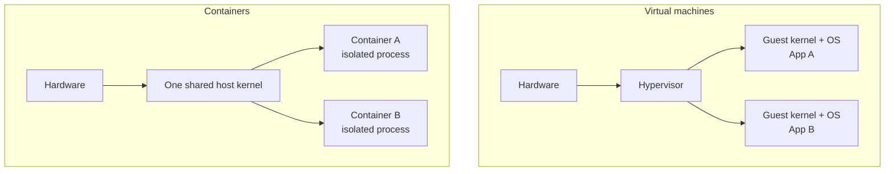
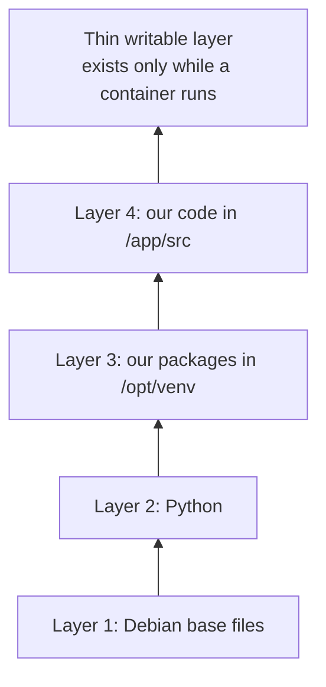
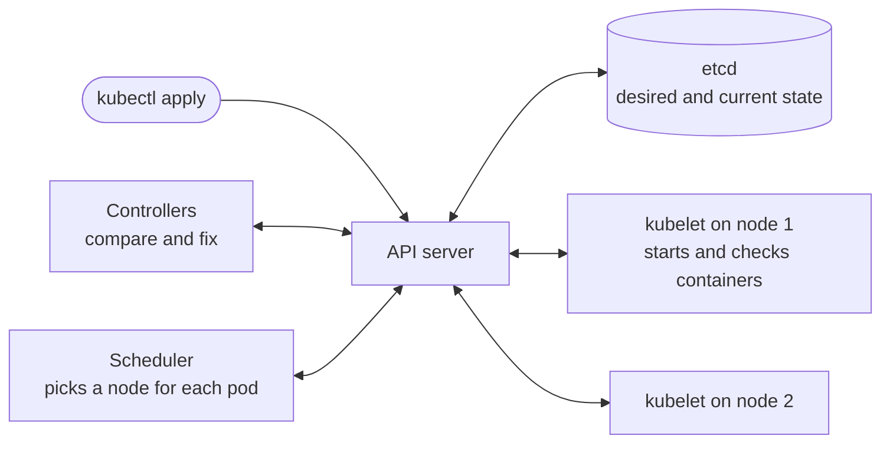

# Containers, image hardening and EKS

- Task: B2-08
- Practical work that goes with it: B2-03 (Dockerfiles), B2-04 (Compose), B2-07 (kind lab)

## 1. What a container really is

A container is not a small virtual machine. It is an ordinary Linux process that the
kernel has been told to isolate and limit. Three kernel features do the work:

| Feature | What it does | What you see |
|---|---|---|
| Namespaces | Give the process its own view of the system: its own process list, network, file system, host name, users | Inside the container, `ps` shows only its own processes, and it has its own IP address |
| cgroups (control groups) | Limit and count resources: CPU, memory, number of processes | A container that goes over its memory limit is killed; this is what `limits` in Kubernetes sets |
| Layered file system | Stacks read-only image layers and puts one thin writable layer on top | Images share layers; a change in a running container vanishes when it is removed |

The consequence for security: containers share the host's kernel. A kernel bug, or a
container given too many rights, can let a process out of its box. A virtual machine
has a stronger wall. That is why the settings in section 3 matter.

On a Mac there is no Linux kernel, so Docker Desktop runs one small Linux virtual
machine and all containers live inside it. Lambda goes one step further: every function
runs in its own tiny virtual machine (Firecracker), so two customers never share a
kernel.

## 2. Images and layers

An image is a stack of layers plus a little metadata (which command to run, as which
user). Each instruction in a Dockerfile that changes files makes one layer.

Things that follow from this:

- **Order matters for speed.** Docker reuses a layer if nothing above it changed. Our
  Dockerfile copies `pyproject.toml` and `uv.lock` and installs packages before it
  copies the code, so a code change does not reinstall the packages.
- **A deleted file is not gone.** Deleting a file in a later layer only hides it; the
  earlier layer still holds it and anyone with the image can read it. A secret copied
  in and removed again is still leaked. This is threat T-030, and why `.dockerignore`
  is an allow-list.
- **The digest is the identity.** An image's digest is a hash over its content. A tag
  is a movable label (see `supply-chain-security.md`).
- **Multi-stage builds** throw whole layers away: only what is copied into the last
  stage ships. Our backend image is 268 MB without build tools; the dev image is 489 MB.

## 3. Image and container hardening

"Hardening" means removing what is not needed, so a break-in has less to work with.

| Measure | What it prevents | Where we do it |
|---|---|---|
| Run as a non-root user | A process that escapes its app is not root inside the container, which makes escaping the container much harder | `USER 10001:10001` in the Dockerfiles; `runAsNonRoot` in the lab |
| Read-only root file system | An attacker cannot drop a tool or change the app's code | `read_only: true` in Compose; `readOnlyRootFilesystem` in the lab. Lambda is read-only too |
| Drop all capabilities | Capabilities are pieces of root's power (change file owners, open raw sockets). The app needs none | `cap_drop: ALL` |
| No privilege escalation | A process cannot gain more rights than it started with (for example through a setuid program) | `no-new-privileges`; `allowPrivilegeEscalation: false` |
| seccomp profile | Blocks system calls that normal apps never use, shrinking the kernel surface a container can touch | Docker's default profile; `seccompProfile: RuntimeDefault` in the lab |
| Minimal final image | Every extra program (compiler, package manager, shell) is a tool for an attacker and a source of CVEs | Multi-stage builds; the runtime image has no uv, pip is unused |
| Pin by digest, scan in CI | A changed or vulnerable base image | Digests in the Dockerfiles; Trivy image scan |
| Resource limits | One container starving the others, or a memory leak taking the node down | `resources.limits` in the lab |
| No secrets in images | Anyone who can pull the image can read every layer | No secrets exist; allow-list `.dockerignore`; Trivy secret scan |

### Smaller base images (not used here)

| Base | What it is | For | Against |
|---|---|---|---|
| `python:3.12-slim` (ours) | Debian with Python | Has a shell and common libraries; easy to debug | More packages, so more CVEs to track (F-015 was one) |
| Alpine | A very small Linux built on musl instead of glibc | Tiny | Some Python packages have no ready-made builds for musl; subtle differences |
| Distroless | Only the language runtime and its libraries: no shell, no package manager | Very little to attack or to scan | Cannot open a shell inside to debug |
| Chainguard, Docker Hardened Images | Minimal images rebuilt often so that known CVEs stay near zero | Least CVE noise | Some are paid, or free only for the newest version |

Why we stay on slim: while learning, being able to run a shell in the container is
worth more than the size. Moving the runtime stage to distroless later is a small change,
because the multi-stage layout is already there.

### What these measures do not do

They limit damage after a break-in. They do not stop the break-in. A bug in our own
code (an IDOR, an injection) works the same in the most hardened container. That part
is covered by tests, reviews and the Semgrep rules.

## 4. From one machine to many: orchestration

Docker Compose runs containers on one machine. It does not restart them elsewhere when
the machine dies, spread traffic over copies, or replace versions gradually. An
orchestrator does. Kubernetes is the most common one.

The core idea is the same as Terraform's: you declare what should exist, and a control
loop keeps comparing that with reality and fixing the difference.

| Part | Job |
|---|---|
| API server | The only door. kubectl and every other part talk to it |
| etcd | The database of what should exist and what does |
| Controllers | Loops such as "this Deployment wants 2 pods, I see 1, create one" |
| Scheduler | Decides which node a new pod runs on |
| kubelet | The agent on each node that starts containers and runs the probes |

The first four are the control plane. The nodes that run your pods are the data plane.
The objects you meet in the lab (Pod, Deployment, Service, ConfigMap, Job,
NetworkPolicy) are explained in `infra/labs/kind/README.md`.

## 5. EKS (theory only)

### What it is

Elastic Kubernetes Service: AWS runs the control plane for you, across several
Availability Zones, patched and backed up. You bring the nodes and the workloads.

### What you still own

| Choice for the nodes | What it means |
|---|---|
| Managed node groups | EC2 instances that EKS creates and updates for you |
| Fargate | No instances; each pod gets its own small isolated environment, billed per pod |
| Auto Mode | EKS also manages nodes, storage and load balancing, for an extra fee |

Under shared responsibility, AWS secures the control plane. You secure everything in
it: who may call the API (IAM and Kubernetes RBAC), pod security, network policies,
images, secrets, and node patching unless a managed option does it.

### How pods get AWS permissions

A pod should not use the node's IAM role, because then every pod on the node has the
same rights. EKS links a Kubernetes service account to an IAM role, so each workload
gets its own narrow role and short-lived credentials (EKS Pod Identity, or the older
IRSA which uses OIDC). It is the same idea as the GitHub OIDC role in B6: an identity
proves who it is and receives temporary credentials, with no stored keys.

### What it costs

Prices change; check the AWS pricing page before relying on these.

| Item | Rough cost |
|---|---|
| Control plane | About 0.10 USD an hour per cluster, about 73 USD a month, even with nothing running |
| Nodes | EC2 or Fargate prices on top |
| Usually also | A load balancer (hourly), NAT Gateway for private nodes (hourly plus data), logs |

### Why we do not use it

- The control plane alone would use up the project's whole credit budget in under three
  months, before a single pod runs (hard constraint 1, and the hourly-services rule).
- The app is one small API with a handful of users. Lambda runs it for cents and scales
  to zero. A cluster would be idle almost all the time (ADR-0004, and
  `well-architected-and-compute.md`).
- The Kubernetes concepts themselves cost nothing to learn locally with kind, which is
  what B2-07 does.

### When EKS is the right choice

Many services owned by several teams; workloads that need long-running processes,
sidecars or special hardware; a team that already knows Kubernetes and wants the same
platform everywhere; a need for the large ecosystem of Kubernetes tools.

### What kind does not teach

The AWS-specific parts: IAM for pods, the VPC network plugin (pods get real VPC
addresses), load balancers created from Services and Ingresses, node autoscaling
(Karpenter), cluster upgrades, and the bill.

## 6. Lambda, ECS and EKS next to each other

| | Lambda (ours) | ECS on Fargate | EKS |
|---|---|---|---|
| You manage | Code or an image | Task definitions, a service | Everything inside the cluster |
| Isolation | One micro virtual machine per function | One per task | Shared nodes, unless Fargate |
| Idle cost | None | Per running task | Control plane plus nodes |
| Restarts, scaling, rollouts | Built in | Built in | You configure them (as in the lab) |
| Good for | Request-driven, spiky or small workloads | Always-on containers without Kubernetes | Large platforms, many teams |

The lab's last question asks which Kubernetes features Lambda gives for free: keeping
copies alive, spreading requests, scaling, and replacing versions.

## 7. Check yourself

1. Why is a container less isolated than a virtual machine?
2. A secret was copied into an image in one layer and deleted in the next. Is it safe?
3. Why install packages before copying the code in a Dockerfile?
4. What can an attacker not do in a container with a read-only file system and no
   capabilities, that they could do otherwise? What can they still do?
5. What is the control plane, and what does EKS charge for it?
