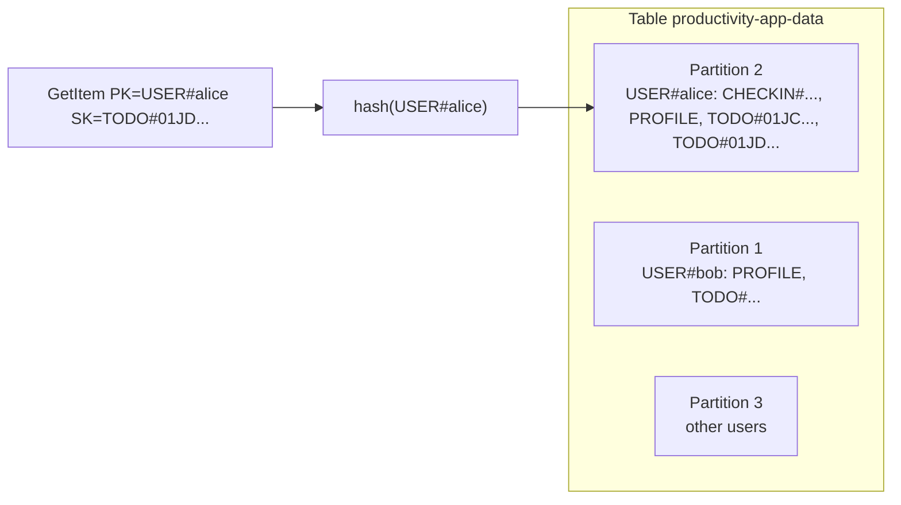
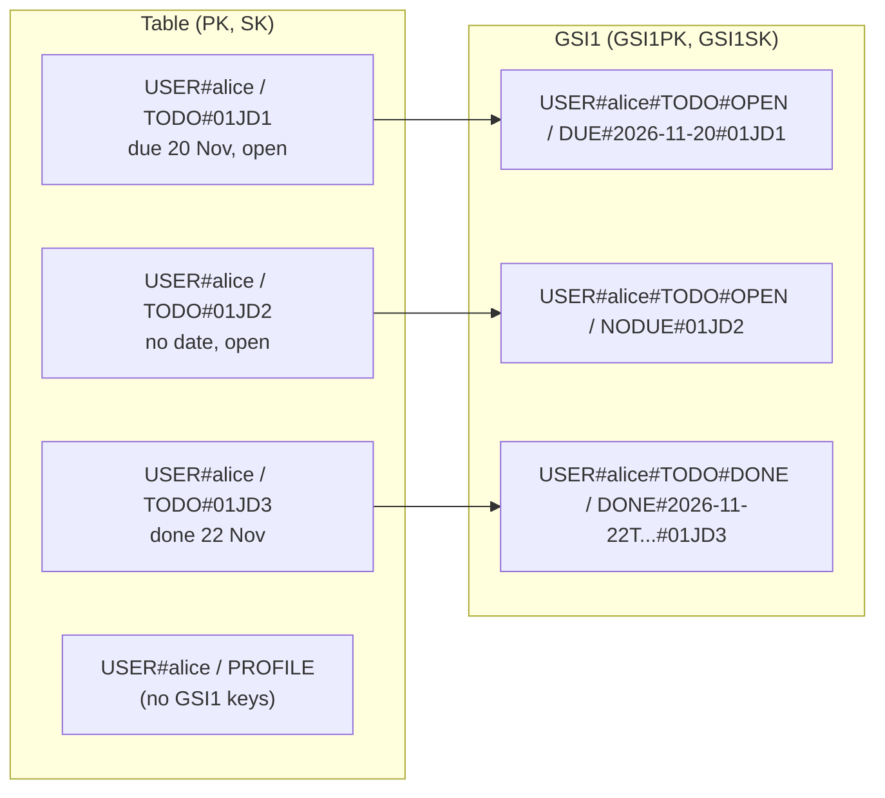
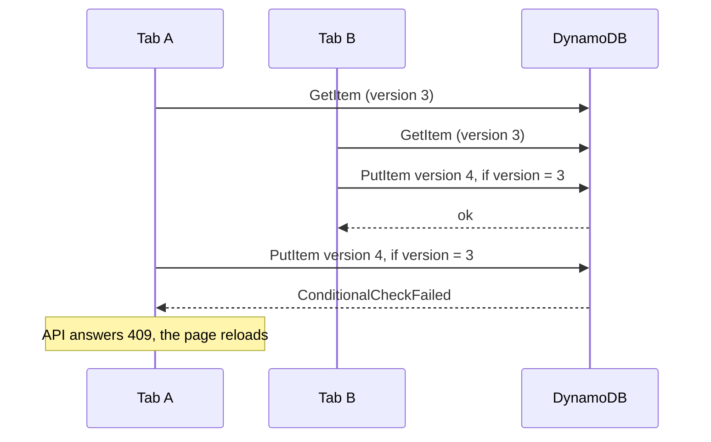

# DynamoDB: keys, indexes and capacity

- Task: B5-06
- Goes with: ADR-0001, `docs/inception/08-dynamodb-table-design.md`,
  `app/backend/src/api/todos.py`, `infra/modules/dynamodb_table/main.tf`,
  `docs/bolts/B5-todos.md`

This note explains how DynamoDB stores and finds data, why the todos code looks the way
it does, and what the capacity settings cost. Every part points at the code that does it.

## 1. A different way of thinking

In a relational database (PostgreSQL, MySQL) you design tables from the data, then write
any query you like later; the database works out how to answer it. DynamoDB turns this
around: it only answers questions that the keys were designed for, but it answers those
in the same few milliseconds whether the table holds a thousand items or a billion.

| | Relational | DynamoDB |
|---|---|---|
| You design from | The data (normalise it into tables) | The questions the app asks (access patterns) |
| A new kind of question | Write a new SQL query | Often needs a new index, or a new key layout |
| Joins | Yes | No: data that is read together is stored together |
| Speed as data grows | Depends on indexes and query plans | Same for every key lookup |
| Scaling | Mostly a bigger server | Spreads over many servers by itself |

That is why I-08 starts with a list of access patterns (AP1 to AP14) before any key.

## 2. Keys and partitions

Every item has a primary key with up to two parts.

- **Partition key (PK).** DynamoDB hashes it to decide which storage partition (one of
  many servers) holds the item. All items with the same PK sit together.
- **Sort key (SK).** Orders the items inside one partition key, as text.

Three ways to read:

| Operation | What it does | Cost | Used here |
|---|---|---|---|
| GetItem | One item by its full key | Cheapest | Profile on every request, one todo |
| Query | Items under one partition key, optionally a range of sort keys (`begins_with`, `between`, `<=`) | Pays for what it reads | The four todo views (on the index) |
| Scan | Reads every item in the table | Pays for the whole table | Never in the app (only the test clean-up) |

A Query returns at most 1 MB per call, and we also ask for at most 50 items. If there is
more, it returns `LastEvaluatedKey`: where it stopped. That is the cursor (section 6).

### Why one partition per user

Every item of a user starts with `PK = USER#`. The API builds that from the
checked token and nothing else (`api/db.py`, `api/todos.py`). So:

- there is no query the API can run that reaches another user's partition (T-013);
- export and account deletion later (B9) are one Query of one partition;
- the sort key says what the item is: `PROFILE`, `TODO#<id>`, later `HABIT#...`,
  `JOURNAL#<date>`.

### Hot partitions

One partition can serve at most about 3,000 read units and 1,000 write units a second.
If a design sends most traffic to one partition key (all orders under `PK=ORDERS`, for
example), that key becomes "hot" and is throttled while the rest of the table sits idle.
One partition per user spreads load well for an app like ours. It would only become a
problem if a single user did more than 1,000 writes a second.

## 3. Sort keys that sort the way you need

The sort key is compared as text, character by character. Our keys are built so that
text order is the order we want:

| Key | Why it sorts right |
|---|---|
| `TODO#01JD...` | ULIDs start with the time, in a fixed width of 26 characters, so text order is creation order |
| `DUE#2026-11-20#...` | Dates as `YYYY-MM-DD` sort as text exactly like dates. That is why the API only allows years 2000 to 2100: a 5-digit year would break it |
| `DONE#2026-11-22T07:30:00.000Z#...` | Timestamps in UTC, always the same width, with milliseconds |

Two small tricks in `api/todos.py`:

- **`~` sorts after everything we use.** In ASCII, `~` comes after digits, letters and
  `#`. So `GSI1SK <= DUE#2026-11-22~` includes every key for 22 November, whatever
  follows the date.
- **`NODUE#` sorts after `DUE#`** because `N` comes after `D`. The Today and Upcoming
  ranges start with `DUE#`, so undated todos fall outside them, and in the All view they
  come last.

## 4. Global secondary indexes (GSIs)

The table's own key answers "this user's items by type". The views need a different
order: open todos by due date, completed todos by when they were ticked. A GSI is a
second copy of chosen items, kept in step by DynamoDB, with its own keys.

Four properties matter:

1. **Sparse.** Only items that have `GSI1PK` and `GSI1SK` appear in the index. The
   profile has none, so it never shows up there.
2. **Moving between lists is just a key change.** Ticking a todo rewrites its GSI1 keys
   from `...#OPEN / DUE#...` to `...#DONE / DONE#...`, so DynamoDB moves it in the index.
   There is no separate "completed" list to keep in step.
3. **Projection.** Ours copies only `title`, `dueDate`, `priority`, `completed` (plus the
   keys). That keeps index writes small, and is why lists have no notes, and why the edit
   form calls `GET /todos/{id}` (B5 decision 1). It is also why the list's `completedAt`
   is read from the sort key.
4. **Eventually consistent.** The index is updated a moment after the table, usually
   well under a second. A list read straight after a write may not show it yet. Reads of
   the table itself can ask for a strongly consistent read (`ConsistentRead=True`, which
   `_get_item` does); index reads cannot. The page's optimistic updates (B5 decision 4)
   hide this, because the page keeps its own copy instead of re-reading the list.

Every write to an item that is in the index costs a write on the table and one on the
index. Changing the index keys costs two index writes (remove the old entry, add the
new one).

A local secondary index (LSI) also exists: same partition key, different sort key, and
it must be created with the table. We do not use one.

## 5. Writes that check first: conditional writes

A conditional write happens only if a condition on the stored item holds. It is checked
and written in one step, so nobody can sneak in between.

| Where | Condition | What it prevents |
|---|---|---|
| `create` | `attribute_not_exists(PK)` | Ever overwriting an existing todo |
| `update` | `attribute_exists(PK) AND version = <the version we read>` | Creating a todo by editing an unknown ID; overwriting another tab's newer save (409) |
| `delete` | `attribute_exists(PK)` | Telling "deleted" from "never existed" so both answer 404 |

The edit works as: read the item, change it in memory, write it back with a `version`
one higher, only if the stored version is still the one read. This is optimistic
concurrency (I-03). It is why the Lambda needs `PutItem` but not `UpdateItem`: the whole
item is written, because the index keys depend on several fields at once.

## 6. Pagination and the cursor

`LastEvaluatedKey` is a full key: for a GSI query it holds `PK`, `SK`, `GSI1PK` and
`GSI1SK`. Many apps base64 it and hand it to the browser. Then the browser could edit
it and send `GSI1PK=USER#bob#TODO#OPEN` back as the start key. DynamoDB itself refuses a
start key outside the query's partition, but relying on that is thin protection.

Our cursor (`encode_cursor`, `decode_cursor`) carries only the sort-key parts. The server
rebuilds the partition from the token and checks the parts fit the view's range. A
cursor from another user only skips ahead inside the caller's own list (T-043,
`tests/test_idor.py`).

## 7. Capacity: what a request costs

DynamoDB measures work in capacity units.

| Unit | One unit buys |
|---|---|
| Read capacity unit (RCU) | One strongly consistent read of up to 4 KB a second, or two eventually consistent reads |
| Write capacity unit (WCU) | One write of up to 1 KB a second |

Examples from this app:

| Request | Cost |
|---|---|
| Profile check (GetItem, about 100 bytes, eventually consistent) | 0.5 RCU |
| `GET /todos/{id}` (strongly consistent, under 4 KB) | 1 RCU, plus the profile |
| A list of 50 todos from the index (about 150 bytes each, about 7.5 KB) | 1 RCU (2 units of 4 KB, eventually consistent) |
| Add a todo | 1 WCU on the table plus 1 WCU on GSI1 |
| Tick a todo (index keys change) | 1 WCU on the table plus 2 WCU on GSI1 |

### Provisioned or on-demand

| | Provisioned (ours) | On-demand |
|---|---|---|
| You set | Read and write units per second, for the table and each index | Nothing |
| You pay | For the units every hour, used or not | For each request |
| Free | 25 RCU and 25 WCU across the account, always (plus 25 GB of storage) | No free requests |
| Above the limit | Throttled: the request fails with `ProvisionedThroughputExceededException` and the SDK retries | Served and billed |
| A loop in our code | Gets throttled; costs nothing more | Costs grow until someone notices |

Ours: table 10 RCU / 10 WCU, GSI1 5 / 5, so 15 of the free 25 each (I-11). The table
also keeps up to 5 minutes of unused capacity as burst, which covers short peaks such as
loading several lists in a row.

Auto scaling (raising and lowering provisioned units by itself) exists, but it can raise
capacity past the free tier, so it is off on purpose (checkov skip `CKV2_AWS_16` in the
module, with the reason).

## 8. Why IAM cannot fence each user into their partition here

IAM has a condition key, `dynamodb:LeadingKeys`, that limits a request to items whose
partition key equals a value, for example `${cognito-identity.amazonaws.com:sub}`. It
works when each user calls DynamoDB with their own temporary AWS credentials (a Cognito
identity pool, `docs/theory/oauth-oidc-jwt.md` section 7).

Our browsers never get AWS credentials: every call goes through the API, and the Lambda
has one role for all users. IAM sees the Lambda, not alice, so it cannot tell alice's
request from bob's. The fence is in our code (keys from the token only) and in the
two-user tests that CI requires for every ID route. What IAM does limit (B5 design
section 6): which actions (`GetItem`, `PutItem`, `DeleteItem` on the table, `Query` on
GSI1 only), on which table, with no `Scan` and no wildcard.

## 9. Single-table design: the trade-off

| For | Against |
|---|---|
| One table, one set of Terraform, one IAM statement, one capacity setting | Keys are harder to read than named tables |
| A user's whole data is one partition (export, deletion) | Every new question means checking the key design first |
| Fewer round trips: related items come back in one Query | Tools that expect "one table per type" (some ORMs) do not fit |

For a small app with known questions, one table is the common recommendation. For an app
whose questions change weekly, a relational database is often easier (the RDS lab is
theory or a short lab only).

## 10. Where to see each part

| Part | File or command |
|---|---|
| Table, index, capacity, PITR, deletion protection | `infra/modules/dynamodb_table/main.tf` |
| The same table locally | `app/backend/scripts/local_table.py` |
| Keys, cursor, conditional writes | `app/backend/src/api/todos.py` |
| Behaviour tests on DynamoDB Local | `app/backend/tests/test_todos.py`, `test_idor.py` |
| The Lambda's database permissions | `infra/app/lambda.tf`, `infra/modules/lambda_container_api/main.tf` |
| Look at your own items (read only) | `aws dynamodb query --table-name productivity-app-data --key-condition-expression "PK = :pk" --expression-attribute-values '{":pk":{"S":"USER#<your sub>"}}'` (your sub is in `GET /api/v1/me`). Do not paste the output into docs |
| See consumed capacity | Add `--return-consumed-capacity TOTAL` to the command above |

## 11. Questions to answer from memory

1. Why does DynamoDB ask you to list the access patterns before choosing keys?
2. What is the difference between a Query and a Scan, and why does the app never Scan?
3. Why does a ULID work as a sort key for "oldest first", when a random UUID would not?
4. Ticking a todo moves it from the open list to the completed list. What actually
   changes in DynamoDB to make that happen?
5. Why does the todo list not show notes, and what did we do about it?
6. You add a todo and immediately load the All list from the index. Why might the new
   todo be missing, and why does the page not show this problem?
7. Two tabs edit the same todo. What stops the second save from silently overwriting the
   first, and what does the user see?
8. Why does our cursor not contain the partition key?
9. What happens if a bug makes the API loop and send thousands of writes a second, with
   provisioned capacity? With on-demand?
10. Why can IAM's `dynamodb:LeadingKeys` not protect alice's data in this app, and what
    protects it instead?
