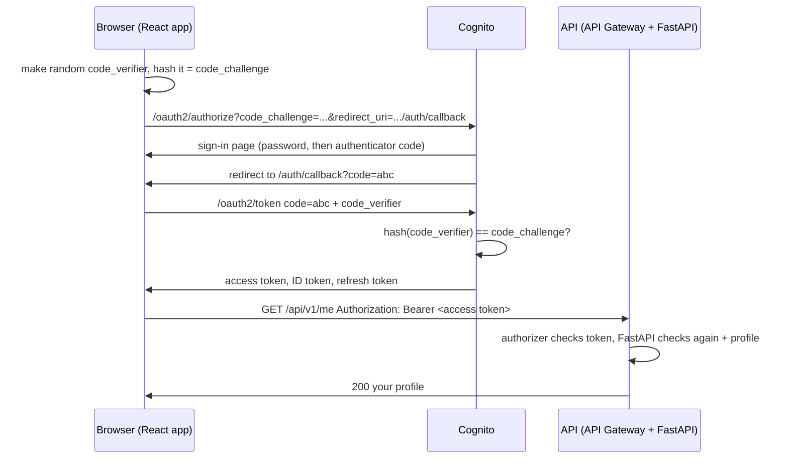

# OAuth 2.0, OpenID Connect and JWTs

- Task: B4-07
- Goes with: ADR-0003, `docs/bolts/B4-auth.md`, `app/backend/src/api/auth.py`,
  `app/frontend/src/auth/`, `infra/app/auth.tf`

This note explains what happens when you sign in to the app, and the mistakes that
make sign-in systems unsafe. Every part is linked to the code that does it.

## 1. Three words that get mixed up

| Word | Question it answers | In this app |
|---|---|---|
| Authentication | Who are you? | Cognito: password plus authenticator code |
| Authorization | What may you do? | FastAPI: only your own items (`USER#<sub>`, IDOR tests) |
| Session | How do we remember you between requests? | Tokens the browser sends with each API call |

## 2. OAuth 2.0 and OpenID Connect in plain words

OAuth 2.0 is a standard for letting an app call an API on your behalf without ever
seeing your password. You type the password only on the sign-in server's own page; the
app gets a token instead. A token is like a hotel key card: it opens certain doors, for
a limited time, and it does not contain your password.

OAuth on its own says what you may do, not who you are. OpenID Connect (OIDC) is a thin
layer on top that adds identity: an ID token that says "this is user X, email Y", plus
standard addresses such as `/.well-known/openid-configuration` and the JWKS (the public
keys).

The parties, with their names in the standard:

| Standard name | Here |
|---|---|
| Resource owner | You |
| Client | The React app in your browser (`productivity-app-web`) |
| Authorization server | Cognito (on AWS) or `mock-oauth2-server` (on the laptop) |
| Resource server | Our API: API Gateway plus FastAPI |

## 3. The authorization code flow with PKCE

This is the flow the app uses. A "public client" such as a browser app cannot keep a
secret (anyone can read its JavaScript), so instead of a client secret it uses PKCE
(Proof Key for Code Exchange): a fresh random secret for every sign-in.



Why each piece is there:

- **The code, not tokens, in the address bar.** Addresses end up in browser history
  and logs. A code is useless alone and works once.
- **PKCE.** Someone who steals the code (a bad browser extension, a log) cannot swap it
  for tokens without the `code_verifier`, which never left the browser tab.
- **Exact `redirect_uri`.** Cognito sends the code only to addresses listed in the app
  client (`callback_urls` in `auth.tf`). Otherwise an attacker could ask for the code to
  be sent to their site (T-039; `make smoke` checks Cognito refuses a foreign one).
- **`state`.** A random value the app checks on return, so nobody can push a sign-in
  into your browser that you did not start. `oidc-client-ts` does this.

Older flows to know by name: the *implicit flow* returned tokens directly in the
address bar (now discouraged), and the *password grant* let the app collect the password
(defeats the purpose). Our client allows neither (`allowed_oauth_flows = ["code"]`,
`explicit_auth_flows` without password flows).

## 4. The three tokens

| Token | What it is for | Lifetime here | Who reads it |
|---|---|---|---|
| Access token | Calling the API | 60 minutes | API Gateway and FastAPI |
| ID token | Telling the app who signed in (email) | 60 minutes | The React app only |
| Refresh token | Getting new access and ID tokens without signing in again | 12 hours | Cognito only |

Short access tokens limit the damage if one is stolen: it stops working within an hour.
The refresh token lives longer but can be revoked; sign-out revokes it
(`enable_token_revocation`). An access token already issued cannot be revoked, which is
why FastAPI also checks the profile item on every request: deleting the profile cuts
access at once (T-027).

## 5. What a JWT is

Cognito's tokens are JWTs (JSON Web Tokens, said "jot"): three base64 parts joined by
dots.

```text
eyJhbGciOiJSUzI1NiIsImtpZCI6Ii4uLiJ9 . eyJzdWIiOiIuLi4iLCJleHAiOjE3...} . signature
        header                                   payload (claims)
```

- **Header:** the algorithm (`alg: RS256`) and which key signed it (`kid`).
- **Payload (claims):** `sub` (the user's ID), `iss` (who issued it), `exp` (expiry),
  `client_id`, `token_use` (`access` or `id`), and so on.
- **Signature:** Cognito signs header and payload with its private key. Anyone can check
  it with the public key from the JWKS address, but only Cognito can make one.

Important: a JWT is signed, not encrypted. Anyone holding it can read the payload (paste
one into a decoder and see). Never put secrets in claims.

## 6. JWT mistakes, and where this app guards against each

| Mistake | What goes wrong | Guard here |
|---|---|---|
| `alg: none` accepted | An attacker sends an unsigned token and the library accepts it | `auth.py` allows only `RS256`, checked before any key lookup |
| HMAC/RSA confusion | The attacker signs with HS256 using the public key as the "secret"; a careless library checks it with that key | Same: RS256 only, keys only from Cognito's JWKS |
| No issuer check | A token from another user pool, or another site using Cognito, is accepted | `iss` must be our pool; the authorizer checks it too |
| No audience / client check | A token issued for another app in the same pool is accepted | `client_id` must be our app client (Cognito access tokens have no `aud`) |
| ID token used as access token | The ID token goes to more places (the app reads it), so it is easier to leak | `token_use` must be `access` (tested) |
| No expiry check, or long-lived tokens | A stolen token works for days | `exp` checked; 60-minute access tokens |
| Trusting claims for authorization | Code reads a `role` or `user` claim and trusts it blindly | Only `sub` is used, checked against a pattern, then the profile must exist |
| Fetching keys on every unknown `kid` | Attackers make the API flood the JWKS address | Key cache, at most one refetch per 5 minutes |

Two locks on AWS: the API Gateway authorizer refuses bad tokens before Lambda starts
(saves credits, T-021), and FastAPI checks everything again, including `token_use` and
the profile, which the authorizer cannot. Locally only FastAPI runs, with every check.

## 7. User pools and identity pools

Cognito has two separate products, often confused:

| | User pool (we use it) | Identity pool (we do not) |
|---|---|---|
| Does | Sign-in: a user directory, passwords, MFA, issues JWTs | Swaps a sign-in token for temporary AWS credentials (an IAM role) |
| Gives you | Access, ID and refresh tokens | AWS access keys valid for up to an hour |
| Use when | Your own API checks the tokens | The browser must call AWS services directly (for example upload straight to S3 without your API) |

We have no reason to give browsers AWS credentials: every request goes through our API,
which has its own IAM role. Fewer moving parts and nothing in the browser that could
call AWS. File uploads later (attachments) use presigned URLs made by the API instead.

## 8. Tokens in the browser and the XSS risk

Anything JavaScript can read, a cross-site scripting (XSS) bug can read too: an attacker
who manages to run script in our page could copy the tokens and use them elsewhere.
Where the app keeps them, and why (T-015):

| Place | Script can read it | Survives reload | Used here for |
|---|---|---|---|
| Memory (a variable) | Yes, while the page is open | No | Access and ID token |
| `sessionStorage` | Yes | Yes, same tab only, gone when the tab closes | Refresh token and profile only (`SessionUserStore`) |
| `localStorage` | Yes | Yes, forever, all tabs | Nothing |
| `HttpOnly` cookie | No | Yes | Nothing (see section 9) |

So the protection is mainly: do not have XSS in the first place. That is the job of the
CSP header (no inline scripts, only our own script files), React escaping text by
default, and the rich-text sanitising in B8. Short token lifetimes and the 60-minute idle
sign-out limit what a stolen token is worth.

## 9. The cookie alternative: backend for frontend (BFF)

The pattern many security teams prefer for browser apps keeps tokens out of JavaScript
entirely:

```mermaid
sequenceDiagram
  participant B as Browser
  participant S as Our backend (BFF)
  participant C as Cognito
  B->>S: /login
  S->>C: code flow (the backend is a confidential client, with a secret)
  C->>S: tokens
  S->>B: Set-Cookie: session=random; HttpOnly; Secure; SameSite=Strict
  B->>S: /api/... (cookie sent by the browser automatically)
  S->>S: look up the session, attach the access token, handle the request
```

- **Gain:** script cannot read an `HttpOnly` cookie, so XSS cannot steal a token to use
  elsewhere (it can still act inside the page while it runs).
- **Cost:** the backend must store sessions (a DynamoDB table with expiry), keep a client
  secret (Parameter Store), handle token refresh, and defend against CSRF (cross-site
  request forgery: another site making your browser send the cookie), with `SameSite`
  cookies and a CSRF token.
- **Why not here:** more code to get wrong while learning, and the decision in ADR-0003
  was to practise the standard browser flow first. It is the natural upgrade if the app
  ever held data for other people.

## 10. Where to see each part

| Part | File or command |
|---|---|
| Pool, client, lifetimes, callback URLs | `infra/app/auth.tf` |
| Authorizer and routes | `infra/app/api.tf` |
| Every token check | `app/backend/src/api/auth.py`, tests in `app/backend/tests/test_auth.py` |
| PKCE flow and token storage in the browser | `app/frontend/src/auth/service.ts`, `sessionUserStore.ts` |
| Decode your own token (read only) | Developer tools, Network tab, a `/api/v1/me` request, copy the `Authorization` value after `Bearer `, then in a terminal: `cut -d. -f2 \| base64 -d` (add `=` padding if it complains) |

## 11. Questions to answer from memory

1. Why does a browser app use PKCE instead of a client secret?
2. What would break if Cognito accepted any `redirect_uri`?
3. Why is the access token short-lived but the refresh token longer?
4. Is a JWT secret? Who can read its payload, and who can make a valid one?
5. Name two checks FastAPI does that the API Gateway authorizer does not.
6. When would you need a Cognito identity pool?
7. Why does deleting a user's profile stop them at once, while disabling them in Cognito
   takes up to an hour?
8. What does a BFF protect against, and what new attack does it bring in?
