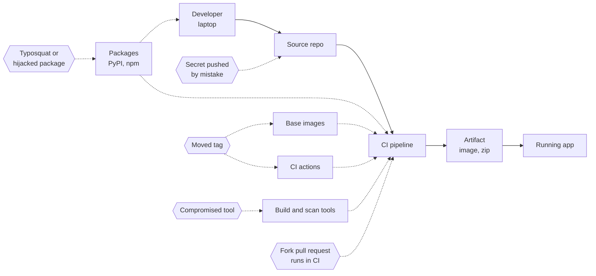
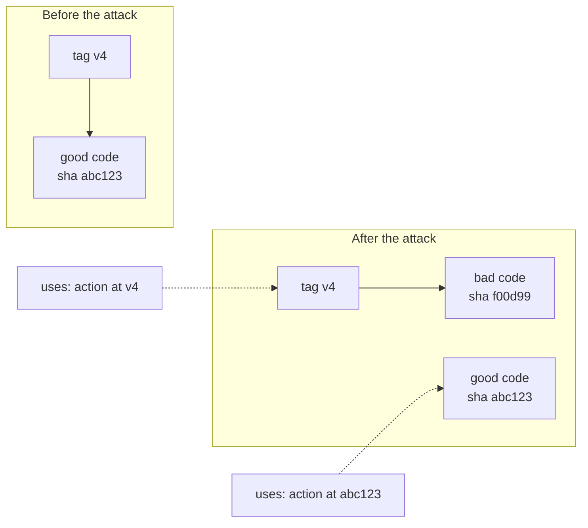

# Supply-chain security

- Task: B1-09
- Requirements: SR-80 to SR-83. Threats: T-008, T-028.
- The rules that follow from this note: `docs/dependency-policy.md`

## 1. What it is

Most of the code in any app is written by someone else: packages, base images, build
tools, CI actions. Together they are the software supply chain. A supply-chain attack
does not break into your app. It puts bad code into something you already trust and
lets you install it yourself.

## 2. Why it works so well

- One compromised package reaches every project that uses it.
- The code runs with your permissions: on the laptop it can read `~/.aws` and SSH keys,
  in CI it can read the secrets and tokens of the pipeline.
- Nobody reads the code of every dependency, and dependencies bring their own
  dependencies (called transitive dependencies).

## 3. Where the chain can be attacked

## 4. Attack types, with real cases

| Attack | How it works | Real case |
|---|---|---|
| Typosquatting | A package with a name close to a popular one | Many on PyPI and npm every year, for example look-alikes of `requests` |
| Dependency confusion | A public package with the same name as a company's private one; the installer picks the public one | 2021: a researcher got code running inside Apple, Microsoft and others this way |
| Maintainer account takeover | The attacker gets the publisher's login and releases a bad version of the real package | `ua-parser-js` (2021); the Shai-Hulud npm worm (2025), which stole tokens and used them to infect more packages |
| Malicious maintainer | Someone earns trust over time, then adds a backdoor | `event-stream` (2018); `xz-utils` (2024), found just before it reached the main Linux releases |
| Moved tag on a CI action | The attacker points existing version tags at new, malicious code | `tj-actions/changed-files` (2025): the tags were moved and CI secrets were printed into public logs |
| Compromised build tool | The tool that builds or scans is itself altered | SolarWinds (2020); Codecov's upload script (2021); Trivy and its GitHub Action (2026) |
| Poisoned pipeline | A pull request changes what CI runs, and CI runs it with secrets | Many cases through the `pull_request_target` trigger |
| Invented package names | An AI model suggests a package that does not exist; attackers register the name | Called slopsquatting |

The Trivy case matters to us because we use Trivy: a security scanner is also a
dependency, and a pinned digest decides whether a bad release reaches us or not.

## 5. Tags, digests and SHAs

A tag is a label that can be moved. A commit SHA or an image digest is calculated from
the content itself, so it cannot point at anything else. A workflow pinned to the SHA
kept running the good code during the `tj-actions` attack.

The cost of pinning: updates are no longer automatic. Dependabot does them as pull
requests, which pass the same checks.

## 6. Our controls

| Attack | What stops or limits it here |
|---|---|
| Typosquat, invented name | The checklist before adding a package (SR-81) |
| Hijacked package, bad new release | Exact versions and lockfiles with hashes (SR-80); 7-day wait before updates; pip-audit, npm audit and Trivy in CI |
| Moved tag | Actions and pre-commit repos pinned by SHA (SR-83); images pinned by digest |
| Compromised scanner | Scanner images pinned by digest in `tools/versions.env`; CI has no secrets and a read-only token, so a bad scanner finds nothing to steal |
| Fork pull request (T-028) | `pull_request` trigger only; approval needed before an outsider's workflow runs |
| Secret in the repo (T-016) | gitleaks in pre-commit and CI; GitHub push protection; nothing secret in CI to leak |
| CI reaching AWS | Not yet possible. From B6: OIDC with short-lived credentials, trust pinned to this repo |

The idea behind several of these is the same: assume one layer will fail, and make sure
the failed layer has little it can reach. This is called defence in depth.

## 7. Terms worth knowing (not practised here)

| Term | Meaning |
|---|---|
| SBOM | Software bill of materials: the full list of what is inside a build. Trivy can produce one |
| Provenance | A signed statement of where, how and from which source an artifact was built |
| SLSA | A framework of levels describing how trustworthy a build process is |
| Sigstore / cosign | Tools for signing images and verifying the signature before use |
| Reproducible build | The same source always gives the same bytes, so anyone can check a published build |

Why we do not sign our own image: one person builds it and one Lambda runs it, from a
private ECR repository. Digest pinning gives most of the value. Signing matters when
others consume your artifacts.

## 8. Cost

All of this is free: the scanners are open source, and GitHub's secret scanning, push
protection and Dependabot are free for public repos.

## 9. Check yourself

1. Why is `uses: actions/checkout@v7` weaker than the same action at a commit SHA?
2. Our CI has no secrets. Which attacks in the table does that make less harmful?
3. Why does a lockfile with hashes protect against a registry serving a changed file?
4. Why do we wait a week before taking a new release?
