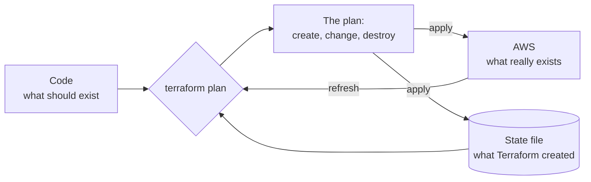
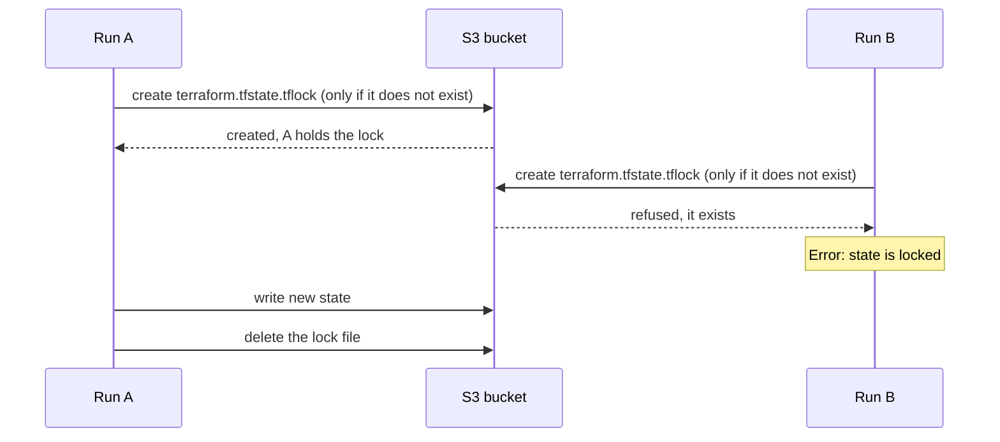
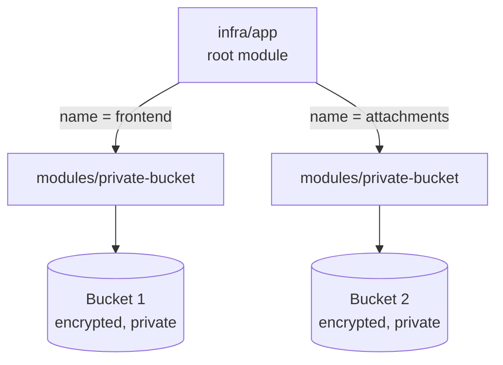

# Terraform state, locking, drift and modules

- Task: B1-08
- Builds on: `terraform-basics.md` (G-06)

## 1. State

### What it is

Terraform code says what should exist. AWS holds what does exist. The state file is
Terraform's notebook that links the two: "the resource called `aws_s3_bucket.state` in
the code is the bucket with this name in AWS, and these were its settings last time".

### What problem it solves

Without state, Terraform could not tell "this bucket is mine, update it" from "this
bucket is someone else's, leave it". It would also have to ask AWS about everything in
the account on every run.

### What to know about it

- It can hold sensitive values (a generated password, for example) in plain text. Ours
  is in a private, encrypted, versioned S3 bucket (G-06), never in git.
- It is the only record of what Terraform owns. Lose it and Terraform thinks nothing
  exists; the next apply tries to create everything again and fails on name clashes.
  Bucket versioning is the backup.
- Never edit it by hand. Use commands: `terraform state list`, `state show`, `state mv`
  (rename), `state rm` (forget without destroying), and `import` blocks (adopt something
  that already exists, as in G-07).

### One state per stack

Each stack in this repo has its own state file in the same bucket:

| Stack | State key |
|---|---|
| `infra/bootstrap` | `bootstrap/terraform.tfstate` |
| `infra/app` | `app/terraform.tfstate` |
| `infra/labs/<name>` | `labs/<name>/terraform.tfstate` |

Why: `terraform destroy` removes everything in one state. With separate states,
destroying a lab cannot remove the app, and a mistake in the app cannot remove the
budgets or CloudTrail. The amount one mistake can damage is called the blast radius.

## 2. Locking

### The problem

Two applies at the same time (two people, or a person and CI) would both read the old
state, both change AWS, and one would overwrite the other's state. The state would then
be wrong about what exists.

### How it works

Before a plan or apply, Terraform takes a lock; others wait or fail until it is released.

We use `use_lockfile = true`: S3 itself refuses to create the lock file if it already
exists. Older setups used a DynamoDB table for this; that is no longer needed.

If a run crashes, the lock stays. `terraform force-unlock <ID>` removes it. Use it only
when you are sure no run is still going.

## 3. Drift

### What it is

Drift is when AWS no longer matches the state, because something was changed outside
Terraform: in the console, with the CLI, or by AWS itself.

### How to see it

`terraform plan` refreshes first, so drift shows up as a change you did not write.
`terraform plan -refresh-only` shows only the drift.

### What to do

| Case | Action |
|---|---|
| The outside change was a mistake | `terraform apply`: Terraform puts it back |
| The outside change is wanted | Write it into the code, then plan shows no changes |
| Only the state should catch up | `terraform apply -refresh-only` |

Why it matters for security: a security group opened "just for a minute" in the console
is drift. A plan that shows no changes is proof the account still matches the reviewed
code. That is the reason for the no-console rule.

We saw a cousin of drift in G-07: the code described the budget in an older format than
the one the console had created, and the first plan showed the mismatch.

## 4. Modules

### What they are

A module is a folder of Terraform files used as a unit, like a function: variables in,
resources created, outputs back. Every stack is itself a module (the root module). A
module called from it is a child module.

### What problem they solve

- No copy-paste: the app needs several private buckets with the same safe settings.
- Safe defaults in one place: fix the module once and every use is fixed.
- A smaller thing to review: inputs and outputs, not fifty resources.

### When not to write one

For something used once, a module only adds a layer to read through. Write the
resources directly, and make a module when the second use appears.

### Sources and versions

| Source | Example | Pinning |
|---|---|---|
| Local path | `../modules/private-bucket` | None needed; changes with the repo |
| Terraform Registry | `terraform-aws-modules/s3-bucket/aws` | Exact `version` |
| Git | `git::https://...//modules/x?ref=<commit SHA>` | Commit SHA |

We write our own local modules. Third-party modules are a dependency like any other
(they are code that runs with admin rights), and writing them ourselves is the point of
a learning project. Our conventions are in `infra/modules/README.md`.

## 5. Cost

Terraform is free. The state bucket holds a few kilobytes, well inside the S3 free tier.

## 6. Check yourself

1. Why is `backend.hcl` not in git, when `backend.tf` is?
2. What happens if two stacks use the same state key?
3. Someone changes a bucket policy in the console. What does the next `plan` show?
4. Why can a module not have its own `provider` block in this repo?
