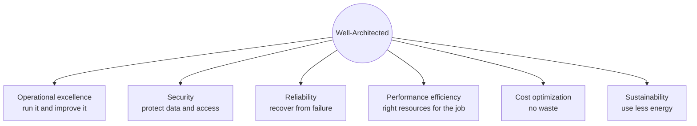
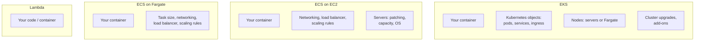
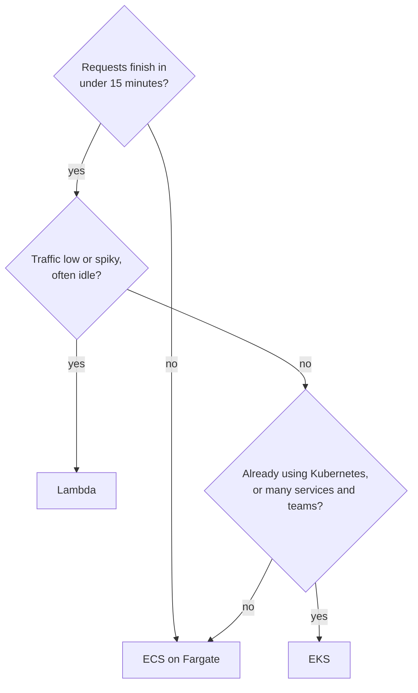

# Well-Architected pillars, and Lambda vs ECS vs EKS

- Task: I-14 (theory)
- Date: 2026-11-15

## Part 1: The Well-Architected Framework

### What it is

AWS's checklist for judging whether a system is built well. It is a set of questions
grouped into six "pillars". There is a free Well-Architected Tool in the console that asks
the questions, but a checklist in a doc does the same job, so we do not use the tool.

### What problem it solves

It is easy to build something that works but is fragile, insecure or expensive. The pillars
make you look at a design from six directions instead of only "does it work?".

### The six pillars, applied to this project

| Pillar | The question in plain words | What we do | What we skip, and why |
|---|---|---|---|
| Operational excellence | Can we change and run it safely? | Everything in Terraform; CI/CD with gated apply; runbooks; journal and ADRs | No on-call or deployment automation beyond one pipeline: one owner |
| Security | Is data and access protected? | Threat model (I-09), requirements (I-12), MFA, least privilege, CloudTrail, scanners in CI | GuardDuty and Security Hub only as a lab; Organizations and SCPs theory only |
| Reliability | What happens when something fails? | Lambda, DynamoDB and CloudFront are spread across Availability Zones by AWS; backup and restore drill (O-08) | Multi-region: one-region rule; personal app can tolerate downtime |
| Performance efficiency | Is it fast enough, without waste? | Single-table design with keys for every access pattern (I-08); arm64 Lambda; CloudFront caching | No load tuning beyond the B11-08 test |
| Cost optimization | Are we paying only for what we use? | Serverless, always-free limits, no NAT, labs destroyed the same day, cost model (I-11) | Nothing skipped: this pillar is a hard constraint here |
| Sustainability | Can it use less energy? | Nothing runs when nobody uses it; arm64 (Graviton) uses less power; log retention limits | No measurement: the scale is too small to matter |

### Trade-offs between pillars

Pillars pull against each other. Choosing one usually costs another:

- More reliability (multi-region) costs more money.
- More security (KMS keys, GuardDuty all year) costs more money.
- Lower cost (provisioned DynamoDB capacity) can mean throttling under a spike, which hurts
  reliability.

We chose cost first (the credits are the project's lifeline), then security, then the rest.
The ADRs record each trade-off.

### When you would use it for real

Before a production launch, at a design review, or once a year on a running system. Teams
answer the questions, list the "high risk issues", and fix them in priority order.

## Part 2: Lambda vs ECS vs EKS

### The question

Our backend is a container (ADR-0004). AWS offers three main ways to run a container.
They differ in how much AWS manages for you, and how you pay.

### Who manages what

The further right, the more you manage yourself.

In all four, AWS runs the data centres and the hardware. In Lambda, AWS also runs the
servers, scaling and networking.

### Compared

| | Lambda | ECS on Fargate | EKS |
|---|---|---|---|
| What it is | Runs code per request | Runs containers as long-running tasks | Managed Kubernetes |
| How you pay | Per request and per millisecond; nothing when idle | Per second while a task runs, even when idle | 0.10 USD an hour for the cluster, plus nodes |
| Our cost a month | 0 (always-free) | About 7 USD for one small task, plus about 16 USD for a load balancer | About 73 USD for the cluster alone |
| Scales to zero | Yes | No (one task minimum to serve requests) | No |
| Max request time | 15 minutes | No limit | No limit |
| Cold starts | Yes, first request after idle is slower (about 1 to 2 s for our container) | No | No |
| Needs a VPC | No | Yes | Yes |
| Skills you learn | Event-driven, IAM, serverless limits | Containers, networking, load balancing | Kubernetes, the industry standard for big platforms |
| Good fit | Spiky or low traffic, short requests | Steady traffic, long requests, background workers | Many services, teams that already use Kubernetes, portability |

### How to choose

### What we chose, and how we still learn the others

- **Lambda** for the app (ADR-0004): one user, mostly idle, short requests, and free.
- **ECS on Fargate** as a time-boxed lab (B11-06), running the same container image behind
  a load balancer, so the difference is felt, not only read.
- **EKS** is theory only. Kubernetes itself is practised for free on the laptop with kind
  (B2-07). The concepts carry over; only the managed control plane is missing.

Because the app is a standard container (FastAPI + Lambda Web Adapter), moving it to
Fargate or Kubernetes later needs no code changes, only different infrastructure.
