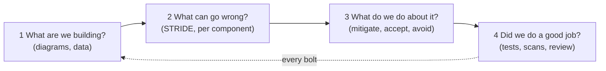
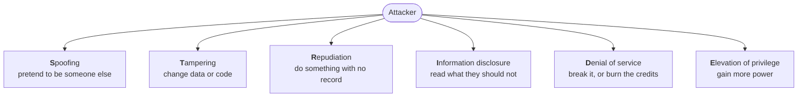
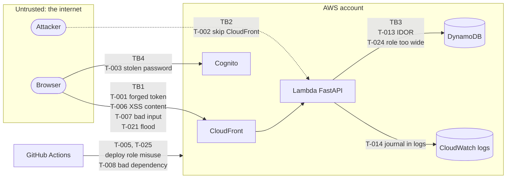

# Threat model

- Status: v1 Approved 2026-11-15
- Date: 2026-11-15
- Task: I-09. Updated in every bolt (Definition of Done).
- Based on: `docs/inception/10-architecture-diagrams.md` (trust boundaries TB1 to TB4)

## 1. What a threat model is

A threat model answers four questions, before anything is built:

STRIDE is a checklist for question 2. For each part of the system, ask whether an attacker
could:

Each STRIDE letter breaks one security property: S breaks authentication, T integrity,
R accountability, I confidentiality, D availability, E authorization.

For each threat we choose one response:

| Response | Meaning | Example here |
|---|---|---|
| Mitigate | Add a control that blocks or limits it | Token checks, input validation |
| Accept | Live with it, with a written reason | A signed-out token works until it expires (max 60 min) |
| Avoid | Remove the feature that causes it | No public sign-up, no sharing |
| Transfer | Let someone else carry it | AWS runs the data centres (shared responsibility) |

## 2. What we are protecting (assets)

| Asset | Why it matters | Worst case |
|---|---|---|
| Journal entries | Sensitive personal thoughts | Read by someone else |
| Pages, todos, habits | Personal data | Read or changed by someone else |
| User accounts and tokens | Access to everything a user owns | Account takeover |
| AWS account (admin, deploy role) | Controls all infrastructure and data | Data deleted or exposed; credits burned |
| Credits (200 USD) | The account closes at zero | Project ends early |
| Terraform state | Records every resource; may hold sensitive values | Infrastructure lost or exposed |

## 3. Where the threats sit

The main threats placed on the trust boundary diagram from I-10. Each arrow crossing a
boundary is a place an attacker can push on.

## 4. Threats

Risk = how likely x how bad, before the mitigation: High, Medium or Low.
Status: Planned (mitigation designed, not built yet), Done, Accepted.

### Spoofing

| ID | Where | Threat | Risk | Mitigation | Verified by | Bolt | Status |
|---|---|---|---|---|---|---|---|
| T-001 | API (TB1) | Forged, expired or another app's JWT accepted | High | Full JWT checks: signature via JWKS, RS256 only, issuer, expiry, `token_use`, `client_id` (ADR-0003) | Unit tests with bad tokens | B4 | Planned |
| T-002 | Function URL (TB2) | Attacker calls Lambda directly, skipping CloudFront | Medium | Function URL `AWS_IAM` + OAC; resource policy allows only our distribution (ADR-0002) | Negative test: direct call returns 403 | B3 | Planned |
| T-003 | Sign-in (TB4) | Stolen or guessed password | High | MFA required (TOTP); 14-character passwords; Cognito lockout | Manual test; Cognito settings in Terraform | B4 | Planned |
| T-004 | Local auth | Local-dev token mode active in AWS | High | Refuses to start in Lambda; never set by Terraform | Unit test | B4 | Planned |
| T-005 | CI/CD | Another repo or branch assumes the deploy role | High | OIDC trust pinned to this repo and environment | Policy review, Access Analyzer | B6 | Planned |

### Tampering

| ID | Where | Threat | Risk | Mitigation | Verified by | Bolt | Status |
|---|---|---|---|---|---|---|---|
| T-006 | Pages | Stored XSS: saved content runs script in the browser | High | Server checks content matches the editor schema; no raw HTML rendering; strict CSP; safe link handling (US-42) | XSS payload test list | B8 | Planned |
| T-007 | API input | Oversized or malformed input | Medium | Validation on every field; body size limit; 400 errors | Unit tests | B5 onward | Planned |
| T-008 | Supply chain | Malicious or vulnerable dependency or base image | High | Exact pins and lockfiles; image digests; pip-audit, npm audit, Trivy in CI; check every new package is the real one | CI gates | B1, B6 | Planned |
| T-009 | Terraform state | State changed or deleted | Medium | Private, versioned, encrypted bucket; HTTPS only; locking; `prevent_destroy` | Done in G-06 | G-06 | Done |
| T-010 | Pages, journal | Two tabs silently overwrite each other | Low | Optimistic concurrency, 409 on conflict (I-03) | Unit test | B8 | Planned |

### Repudiation

| ID | Where | Threat | Risk | Mitigation | Verified by | Bolt | Status |
|---|---|---|---|---|---|---|---|
| T-011 | AWS account | Changes to infrastructure with no record | Medium | CloudTrail, all regions, log file validation | Done in G-09; `validate-logs` passed | G-09 | Done |
| T-012 | App | API actions with no record | Low | Structured logs per request: request ID, user `sub`, endpoint, status. Never content. Log retention set | Log review | B3 onward | Planned |

### Information disclosure

| ID | Where | Threat | Risk | Mitigation | Verified by | Bolt | Status |
|---|---|---|---|---|---|---|---|
| T-013 | API, DynamoDB (TB3) | IDOR: user A reads user B's data | High | Every key built from the token's `sub`; one partition per user; 404 for others' items (I-08) | Two-user test for every endpoint | B4 onward | Planned |
| T-014 | Logs, errors | Journal text appears in logs, traces or error messages | High | Never log request or response bodies; redaction; generic errors (US-33) | Test that greps logs for a marker string | B8 | Planned |
| T-015 | Browser | Tokens stolen through an XSS bug | Medium | Access token in memory only; short lifetimes; CSP; XSS defences (T-006) | Review | B4 | Accepted (residual risk, see ADR-0003) |
| T-016 | Repo | Secret, key or account ID committed to the public repo | High | gitleaks in pre-commit and CI; no secrets in code; Parameter Store for any secret | CI gate | B1 | Planned |
| T-017 | API errors | Stack traces or internals shown to users | Medium | One error handler; 500 responses carry no details | Unit test | B3 | Planned |
| T-018 | Data at rest | Stored data read from disks or backups | Low | DynamoDB and S3 encrypted by default; journal encryption ADR | Settings in Terraform | B8 | Planned |
| T-019 | Export | Export contains another user's data, or its file leaks | Medium | Export built only from the caller's partition; short-lived link if S3 is used | Two-user test | B9 | Planned |
| T-020 | Browser | Clickjacking or content-type tricks | Low | Security headers: CSP `frame-ancestors 'none'`, `X-Content-Type-Options`, HSTS, `Referrer-Policy` | Header check | B3 | Planned |

### Denial of service (including "denial of wallet")

On the Free plan, an attack that makes us spend credits is as damaging as one that takes
the app down.

| ID | Where | Threat | Risk | Mitigation | Verified by | Bolt | Status |
|---|---|---|---|---|---|---|---|
| T-021 | API | Request flood burns credits | Medium | DynamoDB provisioned capacity caps cost; Lambda concurrency limit; budgets alert; WAF rate rule tried in lab | Load test in B11-08 | B3, B11 | Planned |
| T-022 | API | Expensive requests: huge bodies, unbounded lists | Medium | Size limits; pagination (max 50); 10-second Lambda timeout | Unit tests | B5 onward | Planned |
| T-023 | AWS account | Forgotten lab resources | Medium | Session sweep, emergency runbook, budgets | Done in G-07, G-12, G-13 | Week 0 | Done |

### Elevation of privilege

| ID | Where | Threat | Risk | Mitigation | Verified by | Bolt | Status |
|---|---|---|---|---|---|---|---|
| T-024 | Lambda role (TB3) | Code bug used to do more than the app needs | Medium | Lambda role allows only the needed DynamoDB actions on our table ARN; no `*` | Access Analyzer `validate-policy` | B3 | Planned |
| T-025 | CI/CD | Deploy role does more than deploy | High | Separate read-only plan role and apply role; scoped actions | Access Analyzer, review | B6 | Planned |
| T-026 | Admin user | Admin login stolen | High | MFA, no access keys, `aws login` temporary credentials (ADR-0005) | Prowler | G-04 | Done |
| T-027 | Sessions | A signed-out user's access token still works | Low | Lifetime 60 minutes; account deletion is enforced by the profile check | Unit test | B4 | Accepted (max 60 minutes) |
| T-028 | CI/CD | A pull request from a fork runs malicious code in our CI | Medium | `pull_request` trigger only (never `pull_request_target`); read-only token; no secrets in CI; approval required before an outside contributor's workflow runs; actions pinned by SHA | Workflow review; GitHub settings (runbook `repo-and-ci.md`) | B1 | Planned |

## 5. Summary

| | High | Medium | Low | Total |
|---|---|---|---|---|
| Threats | 11 | 12 | 5 | 28 |
| Already done (Week 0) | | | | 4 |
| Accepted with reason | | | | 2 |

The High risks that need the most care: IDOR (T-013), stored XSS (T-006), journal text in
logs (T-014), JWT checks (T-001), supply chain (T-008) and the CI deploy role (T-005, T-025).

## Review log

| Date | Bolt | What changed |
|---|---|---|
| 2026-11-15 | Inception | v1: 27 threats from the I-10 diagrams |
| 2026-11-15 | B1 | T-028 added (fork pull request runs code in CI). T-008 and T-016 controls written; they move to Done when B1 closes |
