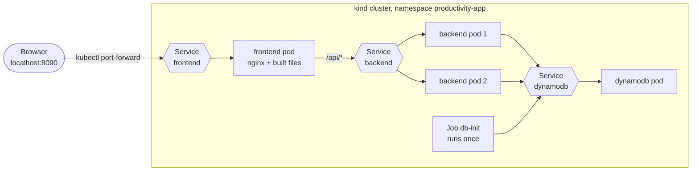

# Lab: Kubernetes on the laptop with kind

- Bolt / task: B2-07
- Date written: 2026-11-15
- Status: Planned
- Theory that goes with it: `docs/theory/containers-and-eks.md`

## 1. Goal

Run our three containers on a real Kubernetes cluster and see what Kubernetes adds on
top of Docker Compose: it keeps things running, restarts what breaks, spreads requests
over copies, replaces versions without downtime, and refuses unsafe pods.

## 2. Before the lab

This lab runs only on the laptop. Nothing is created in AWS, so the cost checks of the
other labs do not apply.

| Check | Result |
|---|---|
| AWS cost | None |
| Docker Desktop running | |
| `kubectl version --client` works (already installed, v1.34) | |
| kind installed: `brew install kind`, then `kind version` | Version: |
| Time needed | About 1.5 hours |

Tested with kind v0.33.0 and the node image for Kubernetes v1.34.11.

Status of these instructions: the files pass checkov, Trivy and Semgrep, but the steps
have not been run on a cluster yet (kind was not installed when they were written).
If a step does not behave as described, note it in section 6 and ask Claude.

## 3. Words used

| Word | Meaning |
|---|---|
| Cluster | A set of machines (nodes) run by Kubernetes. Ours has one node, which is a Docker container |
| kubectl | The command-line tool that talks to a cluster |
| Manifest | A YAML file that describes what should exist. Kubernetes works to make it true, the same idea as Terraform |
| Pod | The smallest unit Kubernetes runs: one or more containers that share a network address |
| Deployment | "Keep N copies of this pod running." It replaces pods that die and rolls out new versions |
| ReplicaSet | The object a Deployment uses to keep the copies; one per version |
| Service | A stable name and address in front of a changing set of pods |
| Namespace | A named area in the cluster that groups objects |
| ConfigMap | Settings or small files stored in the cluster and mounted into pods |
| Job | Runs a pod until it finishes successfully, once |
| Probe | A check Kubernetes runs against a container: readiness (may it get traffic?) and liveness (must it be restarted?) |
| NetworkPolicy | Rules for which pods may connect to which pods |
| Port-forward | A temporary tunnel from a port on the laptop to a pod or Service |

## 4. What gets built



The files are in `manifests/`. Read each one before applying it; the comments explain
every part.

## 5. Steps

Run everything from the repo folder. Every command that changes something is followed
by one that shows the result.

### Step 1: create the cluster

```sh
kind create cluster --config infra/labs/kind/kind-config.yaml
kubectl cluster-info --context kind-lab
kubectl get nodes
```

Expected: one node, `lab-control-plane`, status `Ready`. `docker ps` shows it is a
container.

Why: kind starts a Docker container that behaves like a server and installs Kubernetes
inside it. kubectl now points at this cluster (context `kind-lab`).

### Step 2: build the images and load them into the cluster

```sh
make image-build
kind load docker-image productivity-app-backend:runtime productivity-app-frontend:static --name lab
```

Why: the cluster cannot see the images on the laptop. A real cluster pulls from a
registry (ECR in AWS); kind has a shortcut that copies them into the node.

### Step 3: namespace and the scripts ConfigMap

```sh
kubectl apply -f infra/labs/kind/manifests/00-namespace.yaml
kubectl config set-context --current --namespace=productivity-app
kubectl create configmap backend-scripts \
  --from-file=app/backend/scripts/local_table.py \
  --from-file=app/backend/scripts/seed.py
kubectl get configmap backend-scripts -o yaml | head -20
```

The second command makes `productivity-app` the default namespace for the commands
that follow.

### Step 4: apply everything

```sh
kubectl apply -f infra/labs/kind/manifests/
kubectl get pods --watch
```

Press Ctrl-C when the three kinds of pods are `Running` with `READY 1/1` and `db-init`
is `Completed`. This can take a minute while the DynamoDB Local image downloads.

```sh
kubectl get deployments,services,jobs
kubectl logs job/db-init
```

Expected in the job log: `Table productivity-app-data: created` and
`Seeded 7 items for 2 users`.

### Step 5: look around

```sh
kubectl get pods -o wide
kubectl describe pod -l app=backend | less
kubectl logs -l app=backend --tail=5
```

In `describe`, find: the image, the security settings, the probes, the limits, and the
Events at the bottom (what Kubernetes did, in order). The logs are the same JSON lines
as in Docker Compose; most are the health probes.

Open the app. In a second terminal:

```sh
kubectl port-forward service/frontend 8090:8080
```

Browse to http://localhost:8090. Expected: the dashboard with "API: ok". The request
path is browser, port-forward, frontend pod, backend Service, one backend pod.

```sh
curl -s -i http://localhost:8090/api/v1/health
```

Leave the port-forward running for the next steps.

### Step 6: self-healing and scaling

Delete a backend pod and watch the Deployment replace it:

```sh
kubectl get pods -l app=backend
kubectl delete pod <one backend pod name>
kubectl get pods -l app=backend
```

Expected: a new pod with a new name appears within seconds. The page keeps working,
because the Service sends requests to the other pod meanwhile.

Scale to three copies and back:

```sh
kubectl scale deployment backend --replicas=3
kubectl get pods -l app=backend
kubectl scale deployment backend --replicas=2
```

See the Service spreading requests. Send several, then look at which pod logged them:

```sh
for i in 1 2 3 4 5 6; do curl -s -o /dev/null http://localhost:8090/api/v1/nope; done
kubectl logs -l app=backend --prefix --tail=20 | grep unmatched
```

Why `/nope`: the health path is also called by the probes, so those lines would not
tell you anything. The 404 lines come only from you.

### Step 7: probes

Break the readiness probe on purpose:

```sh
kubectl patch deployment backend --type=json \
  -p='[{"op":"replace","path":"/spec/template/spec/containers/0/readinessProbe/httpGet/path","value":"/api/v1/wrong"}]'
kubectl get pods -l app=backend --watch
```

Expected: one new pod starts but stays `READY 0/1`. The two old pods are kept and
still serve the page: a rollout does not remove working pods until the new ones are
ready. Press Ctrl-C, then:

```sh
kubectl rollout status deployment backend --timeout=20s
kubectl describe pod -l app=backend | grep "Readiness probe failed" | head -3
```

Expected: the first command gives up after 20 seconds with an error, because the
rollout is stuck. That is the signal a deploy pipeline would use to stop and roll back.

Undo it:

```sh
kubectl rollout undo deployment backend
kubectl rollout status deployment backend
```

Question to answer in section 6: what would have happened if the liveness probe had
been broken instead?

### Step 8: rolling update and rollback

Change something harmless, as a stand-in for a new version:

```sh
kubectl set env deployment/backend LOG_LEVEL=DEBUG
kubectl rollout status deployment backend
kubectl rollout history deployment backend
kubectl get replicasets -l app=backend
```

Expected: pods are replaced one at a time, and there is one ReplicaSet per version.
Roll back:

```sh
kubectl rollout undo deployment backend
kubectl rollout status deployment backend
```

### Step 9: security settings

The namespace enforces the "restricted" Pod Security Standard. Try to start a pod that
does not meet it:

```sh
kubectl run rootpod --image=productivity-app-backend:runtime --image-pull-policy=Never \
  --overrides='{"spec":{"containers":[{"name":"rootpod","image":"productivity-app-backend:runtime","securityContext":{"runAsUser":0}}]}}'
```

Expected: refused, with a message listing what is missing. Kubernetes blocks it before
anything runs.

See the read-only file system and the non-root user from inside a pod:

```sh
kubectl exec deploy/backend -- id
kubectl exec deploy/backend -- touch /app/test.txt
kubectl exec deploy/backend -- touch /tmp/test.txt
```

Expected: uid 10001; the first `touch` fails with "Read-only file system"; the second
works.

See what a scanner says when a setting is removed. Copy a manifest to the scratch
folder, delete the `readOnlyRootFilesystem` line in the copy, and scan it:

```sh
mkdir -p tmp && cp infra/labs/kind/manifests/20-backend.yaml tmp/
# edit tmp/20-backend.yaml: delete the line "readOnlyRootFilesystem: true"
docker run --rm -v "$PWD/tmp":/src $(grep '^CHECKOV_IMAGE=' tools/versions.env | cut -d= -f2) \
  -f /src/20-backend.yaml --framework kubernetes --compact --quiet
rm -r tmp
```

Expected: `CKV_K8S_22` fails. (`tmp/` is ignored by git.)

### Step 10: network policy

The policies in `50-network-policy.yaml` allow only frontend to backend and backend to
database. Check both directions from inside pods:

```sh
# Allowed: frontend -> backend
kubectl exec deploy/frontend -- wget -q -O- -T 3 http://backend:8080/api/v1/health

# Blocked: frontend -> database (expect a timeout)
kubectl exec deploy/frontend -- wget -q -O- -T 3 http://dynamodb:8000/

# Allowed: backend -> database (prints a status code)
kubectl exec deploy/backend -- python -c "import urllib.request,urllib.error
try: print(urllib.request.urlopen('http://dynamodb:8000/', timeout=3).status)
except urllib.error.HTTPError as e: print('reached, status', e.code)"
```

Then remove the policies and run the blocked command again to see the difference:

```sh
kubectl delete -f infra/labs/kind/manifests/50-network-policy.yaml
kubectl exec deploy/frontend -- wget -q -O- -T 3 http://dynamodb:8000/ ; echo "exit: $?"
kubectl apply -f infra/labs/kind/manifests/50-network-policy.yaml
```

Without the policies the frontend reaches the database port (it answers with an HTTP
error instead of a timeout).

### Step 11: clean up

Stop the port-forward (Ctrl-C in its terminal), then:

```sh
kind delete cluster --name lab
kind get clusters
docker ps
```

Expected: no clusters, and no `lab-control-plane` container.

## 6. After the lab

| Check | Result |
|---|---|
| Cluster deleted (`kind get clusters` is empty) | |
| kind version used | |
| Steps that did not behave as described | |
| Time taken | |

Questions to answer in your own words:

1. What is the difference between a pod, a Deployment and a Service?
2. What does a readiness probe protect against? And a liveness probe?
3. Why did the page keep working while a backend pod was deleted?
4. Compose and Kubernetes both ran our three containers. Name two things Kubernetes
   did that Compose does not.
5. In AWS our backend runs on Lambda, not on Kubernetes. Which of the things you saw
   today does Lambda do for us without any of this YAML?

## 7. Problems

| Problem | What to do |
|---|---|
| A pod shows `ErrImageNeverPull` | The image is not in the node. Repeat step 2 |
| A pod shows `CreateContainerConfigError` | `kubectl describe pod <name>`; usually the `backend-scripts` ConfigMap is missing (step 3) |
| `db-init` fails | `kubectl logs job/db-init`. If the database was not ready, the Job retries by itself |
| The DynamoDB pod stays `ContainerCreating` for long | It is downloading its image; on this network that can be slow |
| Pods cannot reach each other at all | `kubectl delete -f infra/labs/kind/manifests/50-network-policy.yaml`, carry on, and note it in section 6 |
| Port 8090 is in use | Use another: `kubectl port-forward service/frontend 8091:8080` |
| kubectl talks to the wrong cluster | `kubectl config use-context kind-lab` |

## 8. What I learned
